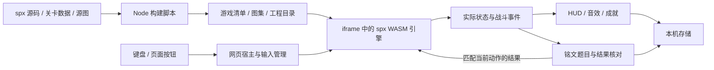

# EasyRun · 裂隙 / 倒悬钟城

**主作者**：吴荣基 （负责游戏设定、美术设计、动作设计、关卡设计、代码生成和测试）

**副作者**：翁庆、孟得有（负责游戏的动作指导、和构图测试、游戏流畅度优化）

**demo视频**：https://www.bilibili.com/video/BV1HcnU6bE5S/?vd_source=638bf0a9b7b4b137eefb790a6b71f46d

**在线体验**：https://x.qiniu.com/project/RJ/easyrun

**向下夺心，向上逃生。用钩索改变战场，用判断决定下一次出手。**

EasyRun 是一款面向成年玩家的二维纵向动作冒险原型。玩家穿过倒悬旧城的五个区域，以钩索、连招和四种技能对抗各有弱点的猎手，击破守心者，再带着钟心逃离上涨的黑潮。英语以可选的「铭文」模式融入技能释放；关闭后可以体验完整的纯动作冒险。

默认主分支：`main` · 本修订分支：`feat/skill-cooldowns` · 版本：`0.10.1 / 技能冷却` · 文档更新：2026-10-25。

**目前已完成单机可玩闭环，尚处于产品验证阶段。** 局域网联机、更多章节、账号同步和商业化功能均未实现。本文中的未来规划不代表已交付功能。

[快速启动](#快速启动) · [玩法与内容](#玩法与内容) · [操作指南](#操作指南) · [技术设计](#技术设计) · [商业价值与验证](#商业价值与验证) · [待开发路线](#待开发路线) · [完整文档](#完整文档)


_当前渲染器的裂甲卫破架画面，来自自动化布置的排练测试场景。更多截图与测试条件见 [v0.10 验收证据](docs/evidence/2026-10-25-hunt-v10/README.md)。_

## 项目定位与意义

EasyRun 希望验证：**一款动作游戏能否先凭移动、战斗与世界气质吸引玩家，再为愿意复习英语的人提供有参与感的练习方式。**

- **对动作玩家**：纵向空间既是路线，也是战斗工具。高度、站位、敌人组合和撤离压力，构成每次操作的选择。
- **对英语使用者**：在自己决定释放技能时提取词汇，通过拼写和辨义得到即时反馈，保留真实错词与完成记录。练习的价值需要另行验证，不能由答题次数推定。
- **对开发者与创作者**：展示 XBuilder / spx 与网页宿主协作的可运行工程，保留源码、美术来源、构建脚本和测试证据，便于复现和继续迭代。

当前优先服务喜欢二维动作、哥特废城氛围与挑战的成年电脑玩家；其中愿意复习英语的人可以开启铭文。教育场景是后续探索方向，尚未完成课堂适用性或学习效果验证。

## 玩法与内容

### 一次冒险如何展开

1. **准备**：选择旅人 / 无畏战斗难度；决定是否开启铭文，开启时预览本局 30 个词。
2. **下潜**：穿越五区十五段，利用平台与钩点改变高度，选择交战、绕行或先处理支援敌人。
3. **破局**：击败三场精英，挑战拥有三个形态、七种招式的守心者。
4. **撤离**：取得钟心后向上返程，应对追兵并甩开黑潮；下潜时熟悉的空间成为逃生路线。
5. **结算与再挑战**：查看战绩、实际完成的词和成就；通过检查点续行或排练提高操作熟练度。

例如，裂甲卫在前方持盾推进，缝魂师在后方保护同伴。玩家可以先远射支援者、重斩破架，也可以借钩索绕背。战斗深度来自可读的敌人行为和位置关系，普通攻击仍有用，站桩连按 J 无法解决全部局面。

### 当前已经实现

| 系统       | v0.10 的实际内容                                                                   |
| ---------- | ---------------------------------------------------------------------------------- |
| 世界与关卡 | 风钟门、铸钟炉、沉水档案、碎镜唱廊、守心机枢；共十五段建筑路线，下潜与返程共用空间 |
| 敌人与精英 | 八类普通敌人，40 名普通敌人、三场精英战（4 个体）、1 名三形态 Boss、3 名返程追兵   |
| 移动       | 跳跃、二段跳、蹬墙、方向冲刺、平台下穿、钩索牵引与松钩甩出                         |
| 战斗       | 地面三连、挑空、空中追击、坠星、击退碰撞；贯夜蓄箭、断潮蓄剑、回息、五段连环剑刀   |
| 反制       | 正面护架与绕背、重斩破架、低扑 / 跃袭判断、支援断线、远程遮挡、精英配合拆分        |
| 铭文       | 拼写 / 三选一辨义，随机 30 词池、开局预览、独立词汇难度、本机词册与复习            |
| 成长记录   | 18 项行旅 / 技艺 / 铭文成就、可佩戴称号、战绩和本机导出；称号不增加战斗数值        |
| 叙事与排练 | 五区短叙事、猎手手记、九种单类 / 组合排练；通过敌人外形和行动表现旧城故事          |
| 音频       | 82 个动作 / 材质采样，开始 / 游戏 / 结束三阶段音乐各自循环，音效和音乐独立调节     |
| 续行       | 自动检查点、本机存档与旧版迁移；从检查点重建场景，不保存半段攻击或飞行中的弹幕     |

常规敌人可以绕行，三场精英承担进度检查。当前已移除机关按钮、护送、档案底座、修复设施和 Boss 外置钟锁；角色语音与钟鼓音效保持停用。

### 八类敌人带来什么选择

| 敌人          | 战斗职责                 | 主要应对                     |
| ------------- | ------------------------ | ---------------------------- |
| 悬刃 · 折翼者 | 空中掠袭与投刃，争夺高度 | 锁向后换高度，抓收势追击     |
| 短锋 · 决斗者 | 近战试探、护架与承压撤步 | 观察架势，重斩或追撤步       |
| 壁弓 · 逐影者 | 换侧射击与远程压制       | 借平台遮挡，用钩索逼近       |
| 缚索 · 收猎者 | 链索控制与扫击           | 跳过横扫、斩链或脱离距离     |
| 封脉 · 伏猎者 | 绕侧突进与擒拿           | 改变高度，抓取落空后反击     |
| 裂甲卫        | 正面推进与盾刃重击       | L 破架或绕背，避免正面连按   |
| 棘背猎兽      | 低扑与高弧跃袭           | 跳低扑、避落点、追击收势     |
| 缝魂师        | 单体护架支援与投射攻击   | 优先击杀、隔断视线或拉开距离 |

具体状态机、精英规则和初始参数见 [猎战设计](docs/HUNT_V10.md)。这些是当前平衡基线，仍需真人试玩校准。

## 铭文：可选的英语练习

开局可关闭铭文；战斗难度与词汇难度独立设置。当前词库包含 **82 个精选 CET-4 词元**，每局抽取 30 个不同词，并优先兼顾新词、曾错词和已完成词。它不是完整四级词表，基础 / 标准 / 挑战是游戏分组。

| 规则     | 当前行为                                                                                                               |
| -------- | ---------------------------------------------------------------------------------------------------------------------- |
| 触发     | U / L / I / Q 每次有效释放都独立答题，Q 答对后才开始整套攻击；没有免题续招                                             |
| 作答     | 输入完整英文，或按 1 / 2 / 3 选择中文释义；错误字母、错误选项、超时或放弃均取消技能                                    |
| 节奏     | 作答时冻结危险逻辑，独立表现层慢速运动；确认结果后立即释放或取消，音乐保持正常音量                                     |
| 操作约束 | U / L / I 冷却 3 秒，Q 冷却 5 秒；按有效战斗时间计时，起手、收势、资源和控制状态仍然有效。普通攻击与基础移动不要求答题 |
| 解控     | 部分控制情境提供铭文脱身，原有动作解法按控制类型保留                                                                   |
| 完成记录 | 只记录真实作答与结算；30 词是可选目标，不是通关门槛，未遇到的词不会自动标记完成                                        |

英语模块应服务玩家的主动选择。重复释放、重复答题和一次答对，都不能直接证明学习效果；词条仍需独立语言审校。来源、抽样与义项边界见 [词库说明](docs/WORD_BANK.md)。

## 操作指南

面向电脑浏览器和实体键盘；目前未完成手柄、触屏或自定义键位。

| 按键                     | 功能                                                   |
| ------------------------ | ------------------------------------------------------ |
| A / D 或左右方向键       | 移动与空中调整                                         |
| Space                    | 跳跃、二段跳、蹬墙                                     |
| 按住 E / 松开 E          | 抓住高亮目标 / 借力甩出；按住 S 松钩向下甩出           |
| K 或 Shift，配合 W / S   | 水平、向上、向下冲刺                                   |
| J / W + J / S + J        | 普攻连段 / 挑空 / 坠星                                 |
| 按住 U 或 L，松开        | 贯夜蓄箭 / 断潮蓄剑                                    |
| I / Q                    | 回息 / 五段连环剑刀                                    |
| S + Space                | 下穿普通平台                                           |
| F（被缚索牵引时）        | 可选铭文解链                                           |
| 字母 / 1、2、3           | 拼写 / 选择中文释义                                    |
| Enter / Esc / R          | 开始或续关 / 暂停 / 重开；题中 Esc 打开铭文暂停面板    |
| T（标题或暂停）          | 进入排练；排练中 1–5、7–9 为单类，6 为组合，R 开始冒险 |
| 顶部「猎手手记」「成就」 | 查看故事、反制方法和铭录；主动打开暂停，题中限制入口   |

## 快速启动

### 首次安装

需要 Git、Bash、curl、tar、`shasum`；导出工程包还需 Python 3。安装脚本支持 macOS / Linux 的 arm64、x64 分支，主要已验证环境为 macOS arm64。Windows 原生安装尚未验收。

```sh
# 1. 获取当前主分支
git clone --branch main https://github.com/RJ-SRE/EasyRun.git
cd EasyRun

# 2. 安装仓库固定的 Node、pnpm、依赖和浏览器工具
bash scripts/bootstrap.sh

# 3. 从源图与源码构建主游戏及历史原型
bash scripts/with-env.sh node scripts/build-game.mjs

# 4. 启动本机开发服务
bash scripts/with-env.sh node prototypes/runlab/server.mjs
```

浏览器打开 [http://127.0.0.1:4177/](http://127.0.0.1:4177/)。看到开始页后选择难度并开始；浏览器要求用户交互后才允许播放声音，可点击「播放音乐」。终端按 `Ctrl+C` 停止服务。

首次安装需要网络下载工具；准备好资源后的游戏运行不依赖账号、API 密钥、在线模型或数据库。工具安装在项目 `.tools/`，不会要求替换系统默认 Node。已有共享依赖的协作工作树不要重复安装，直接使用 `with-env.sh` 调用现有工具。

### 后续启动与修改

```sh
# 已构建的项目：直接启动，可选择另一个空闲端口
RUNLAB_PORT=4184 bash scripts/with-env.sh node prototypes/runlab/server.mjs

# 修改主角、敌人、地图或源图后，在另一个终端重建，再刷新网页
bash scripts/with-env.sh node prototypes/runlab/build-belfry.mjs
```

服务器当前只绑定 `127.0.0.1`，**不能用另一台电脑访问，也没有多人联机能力**。`?v=...` 只是预览标记，不切换游戏版本；网页不自动热重载。浏览器存储按主机和端口隔离，换成 `localhost` 或其他端口会看到另一份本机记录。

| 页面                | 用途                  | 构建                                          |
| ------------------- | --------------------- | --------------------------------------------- |
| `/`、`/belfry.html` | 当前主游戏            | 完整构建，或已有基础资源时 `build-belfry.mjs` |
| `/passages.html`    | 独立五通道 / 钩索实验 | 另运行 `build-passages.mjs`，尚未合入主关卡   |
| `/rupture.html`     | 旧风机墓场            | 包含在完整构建中                              |
| `/legacy.html`      | 最早两款对照原型      | 包含在完整构建中                              |

遇到资源 404，先确认构建成功、启动目录和端口正确。端口占用时改用 `RUNLAB_PORT`。Linux 浏览器缺系统库、测试缺 headless shell 等处理见 [运行手册](docs/RUNBOOK.md)，无需为游玩安装 XBuilder 编辑器或生成音频。

## 技术设计

### 技术栈与职责

| 层       | 技术 / 固定版本                                       | 职责                                                |
| -------- | ----------------------------------------------------- | --------------------------------------------------- |
| 游戏模拟 | XBuilder / spx 3.3.0，`.spx` 脚本与浏览器 WASM 运行时 | 物理、角色、敌人 AI、技能、伤害、关卡与镜头         |
| 网页宿主 | 原生 JavaScript ES Modules、HTML、CSS                 | 开始页、HUD、输入所有权、铭文、成就、记录与模块接线 |
| 音频     | Web Audio API + HTMLAudioElement                      | 短音效混音、事件反馈、长曲播放与生命周期            |
| 构建     | Node 24.22.1、pnpm 11.9.0、Playwright 1.64.1          | 资源导入、拆帧、游戏清单与测试；精确依赖见锁文件    |
| 数据     | 浏览器 localStorage、静态词库和地图                   | 本机战绩、词册、成就、设置与检查点，无云端账号      |
| 工程导出 | Python 3                                              | 生成 XBuilder `.xbp` 工程包                         |
| 验证     | Node 规则测试、Playwright、ESLint、GitHub Actions     | 验证战斗、输入、存档、音频、场景容量与整关流程      |

当前是静态网页宿主加本机游戏模拟。Node 服务用于提供页面、素材和运行库，不是权威战斗服务器；现有状态观察接口也不是多人网络协议。



### 关键实现取舍

- **模拟与表现分开**：铭文阶段冻结碰撞、伤害和 AI，表现时钟平滑趋向 28% 速率，让蓄势、绳索和余影继续运动；明确暂停时再一起停止。恢复不会补算冻结期间的攻击。
- **答案与技能绑定**：题目带局次、尝试和序号信息，结果仅能结算当前动作，拒绝重复或过期结果。网页返回答题结论，spx 执行释放、取消、资源返还和伤害。
- **敌人有行动承诺**：起手、锁向、执行、收势分别处理，伤害与打断分离；同时攻击预算限制无预警围殴。护架、扑击与支援都有实际反制条件。
- **显示对象按镜头复用**：地图逻辑与显示槽分离，为箭矢和攻击预留空间。当前常驻克隆 121，三条本机整关路线的最高采样为 183；这是容量观察，不是跨设备帧率保证。
- **从源资产可重建**：源图保留，拆帧统一比例与落脚线。当前动画主要由关键姿态、运动轨迹和短交叠构成，尚未采用完整骨骼动画。
- **存档恢复明确**：当前地图 revision 3，迁移保留词池；从检查点恢复有效状态，清理临时攻击、连接和输入。音乐、成就和词册分别管理生命周期。

### 源码导航

```text
EasyRun/
├── prototypes/runlab/
│   ├── spx/belfry/             # 主角、AI、技能、碰撞、镜头与场景表现
│   ├── belfry-hunt.mjs         # 当前十五段地图、敌人角色和遭遇数据
│   ├── hunt-init.mjs           # 当前关卡的引擎初始化生成
│   ├── build-belfry.mjs        # 主游戏构建、源图导入与模块拼接
│   ├── public/                # 网页宿主、铭文、成就、音频与本机记录
│   ├── art/                   # 原始图集、背景与生成提示词
│   └── test-*.mjs             # 规则测试、浏览器专项与整关路线
├── scripts/                   # 安装、环境、完整构建、测试与证据导出
├── production/                # 音效制作资料、母版与来源记录
├── docs/                      # PRD、设计、规划、开发历史与验收证据
├── research/                  # 固定版本的 XBuilder 边界研究
└── .github/workflows/         # 远程构建、检查、回归与打包流程
```

当前主构建拼接 `HuntCombat.spx` 与 `HuntExpedition.spx`。旧机关 / 护送实现保留用于追溯，不能因为文件仍在就认为仍参与主游戏。生成目录 `projects/`、`public/art/`、运行清单与 `exports/` 应由脚本重建，不作为手工修改入口。

## 验证与交付

```sh
# 快速规则检查，不启动浏览器
bash scripts/with-env.sh node --test prototypes/runlab/test-hunt-data.mjs prototypes/runlab/test-inscription-core.mjs prototypes/runlab/test-belfry-achievements-core.mjs

# 完整默认回归：先完成构建；脚本自动使用独立随机端口
bash scripts/with-env.sh node scripts/test-game.mjs

# 已完成完整构建后，生成四个主 / 历史游戏的 XBuilder 工程包
python3 prototypes/runlab/package.py
```

如浏览器测试提示缺少 headless shell，可运行 `bash scripts/with-env.sh node node_modules/@playwright/test/cli.js install chromium` 补齐；Linux 系统库按实际报错处理。浏览器 / WASM 性能检查应串行运行，避免互相争用资源。

**已记录的 v0.10 本机验证**：25 项纯逻辑检查、206 项浏览器检查、三条真实键盘整关路线，以及四个 `.xbp` 包完整性检查。测试在 macOS arm64 / Chromium 下完成，分段运行并修复后复测；详情见 [验收账本](docs/planning/hunt-v10/IMPLEMENTATION.md) 与 [源码哈希清单](docs/evidence/2026-10-25-hunt-v10/source-manifest.json)。这轮 README 整理没有重新执行游戏回归。

自动路线的题目由脚本正确作答，不能证明真人会自然完成 30 词、愿意持续游玩或取得学习提升。真人试玩、低端设备、跨浏览器、长时间稳定性和完整 XBuilder 编辑器往返仍需验收。[GitHub Actions](https://github.com/RJ-SRE/EasyRun/actions/workflows/verify.yml) 的结果应按具体提交查看，不用本机结果代替。

`.xbp` 输出位于 `prototypes/runlab/exports/`，包含纯动作工程。网页铭文、成就册、本机记录和网页音频混音不包含在单个 `.xbp` 内；当前完整体验由网页宿主与引擎共同提供。尚无正式线上部署或桌面安装包。

## 商业价值与验证

项目现阶段的价值是提出并实现了一种可试玩的产品方向。**以下是商业假设，尚无用户规模、留存、收入或付费意愿数据支持。** 当前不开发支付功能。

| 价值假设                   | 为什么值得验证                                         | 需要得到的证据                                                    |
| -------------------------- | ------------------------------------------------------ | ----------------------------------------------------------------- |
| 动作体验能独立吸引成人玩家 | 纵向钩索、夺心返程与敌人反制形成清晰体验               | 关闭铭文后，玩家仍主动重试、探索并能说出喜欢的战斗选择            |
| 铭文能形成有意义的差异     | 同一冒险支持纯动作和英语练习，不要求所有人以学习为目的 | 玩家愿意主动开启；作答不让其回避技能；延迟复测观察词义 / 拼写表现 |
| 敌人与章节可支撑持续内容   | 敌人职责组合与不同垂直空间可以构成新的挑战             | 新遭遇带来新的决策，而非只增加血量或重复平台                      |
| 合作与挑战可增加分享理由   | 双人分工、同种子竞速和回放可承载共同目标               | 玩家愿意邀请朋友，实际完成协作后仍希望再玩                        |

可能的产品形态是可试玩单机基础版、后续章节扩展与不影响战力的外观内容；小组英语活动是更后期的探索。具体定价、渠道和发行方式要在核心体验、内容成本和真实意愿得到验证后决定，不预设广告、抽卡或付费战力。

近期先邀请 5–8 名目标玩家进行探索性试玩：记录第一次理解钩索的时间、受击原因是否清楚、退出位置、主动重试、技能使用与答题中断感。该样本用于发现问题，不用于估计市场规模。若评估英语效果，需另设延迟复测和合适的对照，不能拿通关成绩代替。

## 待开发路线

下列内容均为规划，按验证结果调整优先级，不是排期承诺。详细设计、依赖与验收条件见 [产品路线图](docs/ROADMAP.md)。

| 阶段                | 待开发 / 待验证方向                                                                  | 达成条件                                               |
| ------------------- | ------------------------------------------------------------------------------------ | ------------------------------------------------------ |
| P0 · 核心体验打磨   | 真人试玩、动作衔接、敌人起手可读性、按键自定义、减少运动设置完善、设备性能与词条审校 | 玩家理解玩法并愿意重试；确认答题与动作的冲突点         |
| P1 · 可重复挑战     | 精心设计的新遭遇切片、可复现种子的猎战委托、Boss 挑战、个人回放 / 幽影路线           | 重玩来自策略变化；回放与成绩对应真实事件               |
| P2 · 局域网双人合作 | 建房 / 加入、双人纯动作冒险、独立镜头、共同精英目标、救援与共同撤离                  | 双机状态一致，延迟与掉线可处理，合作确实需要分工       |
| P3 · 联机与内容深化 | 铭文多人节奏实验、异步同种子挑战、更多章节、个人记录导入与可选云同步                 | 不破坏现有每技能答题规则；先解决公平性、恢复和数据归属 |
| P4 · 发行准备       | 原创或已获授权的配乐、资产与许可整理、干净安装、桌面 / 手柄适配评估                  | 通过目标设备与发行检查，再决定发行与商业模式           |

### 局域网联机的初步方向

建议从 **两名玩家、纯动作模式、合作下潜与撤离** 做起：一人压制支援者，另一人抓重甲空档；返程时共同抵达区域安全点，避免变成谁先跑完的两场单机。独立镜头减少彼此拖拽，双人完成目标的规则要单独设计，首版不做 PvP。

技术上需先验证「局域网房间服务 + 权威模拟 + 客户端表现」能否与当前 spx 运行时衔接，再决定网络实现。仅将监听地址改成 `0.0.0.0` 只能开放页面访问，不能同步角色、敌人或伤害。

铭文会冻结单机战斗，直接同步给另一名玩家会造成频繁中断；只冻结一名玩家又会改变受伤与时间公平性。因此多人铭文放到独立实验，保留单机现行规则，不额外延长技能冷却或跳题来掩盖问题。

## 素材、许可与发行边界

美术源图及 AI 生成提示词、程序化音效的母版和制作记录已纳管，详见 [资产来源](docs/ASSETS.md)。当前三首背景音乐是用户提供的 Sea Power 第三方录音，来源清单不等于商业授权记录；发行准备阶段需确认授权或替换为适合发行的配乐。

词元成员信息来自 ECDICT，采用词元的来源摘录与 MIT 许可保存在仓库，中文义项及干扰项由项目编写。**词库来源许可不代表整个游戏采用 MIT 许可**；仓库目前没有覆盖整项目的统一 LICENSE，代码、素材与第三方依赖应分别明确使用条件。

本机战绩、词册和成就可以分别导出，当前没有通用导入或云同步。旧原型、研究记录与测试证据按原日期保留，不把历史方案当作已实现功能。

## 完整文档

| 阅读目的                     | 入口                                                                                                                                |
| ---------------------------- | ----------------------------------------------------------------------------------------------------------------------------------- |
| 当前需求与玩法边界           | [PRD](docs/PRD.md)、[v0.10 猎战设计](docs/HUNT_V10.md)                                                                              |
| 未来优先级与局域网合作方案   | [产品路线图](docs/ROADMAP.md)                                                                                                       |
| 安装、端口、构建、导出与排障 | [运行维护手册](docs/RUNBOOK.md)                                                                                                     |
| 当前代码与历代技术契约       | [技术设计](docs/TECHNICAL_DESIGN.md)，旧段落结合 v0.10 说明阅读                                                                     |
| 铭文、词库与成就规则         | [铭文实现](docs/INSCRIPTION_V07.md)、[词库说明](docs/WORD_BANK.md)、[成就设计](docs/ACHIEVEMENTS_V07.md)；当前数量与变更以 PRD 为准 |
| 复核测试与局限               | [猎战验收账本](docs/planning/hunt-v10/IMPLEMENTATION.md)、[测试记录](docs/TESTING.md)                                               |
| 追溯资源与音乐               | [资产来源](docs/ASSETS.md)、[场景音乐](docs/SCENE_MUSIC.md)                                                                         |
| 提交、协作与回退             | [Git 流程](docs/GIT_WORKFLOW.md)、[贡献约定](CONTRIBUTING.md)                                                                       |
| 全部文档与历史               | [文档索引](docs/README.md)、[开发日志](docs/DEVELOPMENT_LOG.md)、[决策记录](docs/DECISIONS.md)                                      |

反馈问题时请附提交 SHA、设备与浏览器、操作步骤、预期与实际结果。产品提案注明目标玩家、改变的体验、验证方式与暂不包含的内容；待开发设计进入路线图后仍需单独评审和实现。
