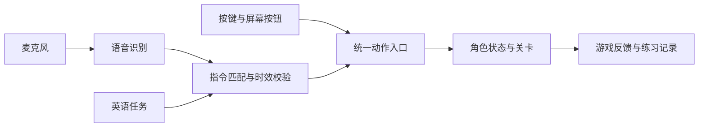

# 词境跑者 WordRunner 产品需求与三天开发计划

[在线 PRD（初版快照）](https://chatgpt.com/space/page_421ab9c4133c8191963d6ed3a4fb88a6)

2026-10-23 路线补充：用户已选择成人英语初学者作为优先人群，并要求暂不考虑付费功能。当前里程碑与执行顺序见 [产品路线](docs/PRODUCT_ROADMAP_v0.1.md) 和 [开发 Backlog](docs/DEVELOPMENT_BACKLOG_v0.1.md)。本地文档已同步该决定，在线初版尚未同步。

词境跑者 WordRunner 是一款结合英语听力理解、开口表达与动作挑战的 2D 跑酷游戏。玩家通过按键或英语语音控制角色，在不同风格的世界完成短篇冒险。产品希望让英语成为完成任务的工具，让开口表达获得即时、可见的反馈。

本期目标是交付一个可玩、可演示、可继续扩展的产品原型。三天版本以六个核心动作、真实语音识别、一条完整关卡、两套视觉主题和独立难度设置为开发基线。更复杂的移动能力和伙伴协作暂不排期，付费功能移出当前路线。

版本：v0.1

状态：待评审的开发基线，技术接入尚未实测

编写日期：2026年10月23日

开发周期：三天两夜，以实际开工日为 D1

计划假设：一名开发者使用 AI 辅助开发，主验收设备为一台桌面电脑及其指定浏览器。团队人数、比赛规则和目标设备变化时，重新估算工作量。

## 1 产品目标与需求边界

### 用户已明确的需求

- 游戏类型为跑酷，兼顾趣味、挑战性、创新和商业潜力。
- 在游戏过程中训练英语，包括理解自然语言和主动开口表达。
- 同一个动作可以通过按键或语音触发，需要真实的语音识别。
- 动作包括慢跑、快跑等速度变化，并具有继续扩展动作的空间。
- 面向多个年龄段，允许选择不同画面风格与难度。
- 首轮优先验证成人英语初学者；保留其他年龄段可使用的设置，暂不同时建设儿童课程。
- 当前不考虑付费功能，不安排支付、订阅、付费墙或定价实验。
- 开发时间只有三天两夜。
- 需要明确总体需求、开发流程、场景设计和时间规划。

### 本期建议基线

产品暂定名为“词境跑者 WordRunner”。采用 2D 横版，一局约 90 秒；暂停、教学及语音等待会延长实际时长，关卡按行进距离和任务状态推进。角色默认跑步，玩家通过速度切换、跳跃、滑行和停止完成路线。

P0 表示本次交付必须完成；P1 表示核心稳定后可选增强；P2 表示后续产品方向。本文中的数值为原型初始参数或验收目标，均不是已经取得的测试结果。

XBuilder 是优先验证的实现平台。是否必须使用官方 XBuilder 编辑器或托管发布环境，属于开工前需要明确的比赛约束。平台不能接入语音时，纯按键原型只能作为阶段成果，不能算作语音需求完成。

### 本期不包含的功能

本期不开发账号体系、真实支付、多人联网、在线排行榜、关卡编辑器、无限随机地图、实时开放式 AI 对话、专业发音评分或多语言课程系统。此前讨论的双时空切换保留为扩展创意，本期优先完成英语与语音控制。

## 2 受众与个性化设置

产品采用“视觉偏好、英语水平、操作难度”三个独立设置。年龄只用于提供默认建议，不限制主题或难度选择。

| 受众示例 | 主要需要 | 推荐起点 |
| --- | --- | --- |
| 低龄英语启蒙玩家 | 指令简单、图像清楚、失败宽容 | 自选主题、英语入门、漫游 |
| 青少年玩家 | 冒险感、连续动作、成长反馈 | 自选主题、英语进阶、漫游或挑战 |
| 成年英语初学者（首轮重点） | 画面成熟、表达有意义、开口压力低 | 自选主题、英语入门、自选操作难度 |
| 英语较熟练玩家 | 根据情境表达、较少文字辅助 | 自选主题、英语挑战、自选操作难度 |

这些划分是体验设计示例，不作为能力判断。首轮优先邀请 18 岁以上英语初学者，覆盖不同英语基础与游戏习惯；小样本只用于发现问题。儿童方向保留使用兼容性，另行验证，不与成人结果混合统计。

### 英语难度

| 档位 | 内容与示例 | 辅助与任务 |
| --- | --- | --- |
| 入门 | Jump、Run、Stop 等动作词 | 显示英文和动作图示，允许中文释义及示范音频 |
| 进阶 | Jump over the log、Slide under the gate | 使用短句；完成教学后减少中文提示 |
| 挑战 | The laser is on. Wait here. 等情境线索 | 根据情境选择行动；字幕默认关闭但可打开，口语接受预设的合理表达 |

这三个档位属于产品内部分级，不等同于 CEFR 等标准化能力认证。首版“挑战”通过人工编写的情境与表达表实现，不承诺理解任意自由英语。

### 操作难度

漫游模式降低基础速度、放宽碰撞和任务时间，提供更充分的语音窗口。挑战模式提高基础速度、增加路线收集难度，并收紧部分操作窗口。两者都保留按键接管和暂停。

操作难度不改变英语题目复杂度。英语初学者可以选择挑战跑酷，英语熟练者也可以使用漫游模式。

## 3 核心玩法与用户流程

### 游戏循环

选择主题与难度 → 麦克风检查或选择按键 → 学习少量目标表达 → 跑酷与任务交替 → 动作及环境即时反馈 → 完成投递 → 查看游戏成绩与英语练习记录 → 重玩或复习。

普通路段强调动作手感；英语任务放在视野清楚、障碍较少的路段。每局先集中练习 3 至 5 个表达，再从已学内容中加入少量复习，不一次性展示整套词库。

### 首页与开局

首页提供开始游戏、画面主题、英语难度、操作难度和声音设置。当前推荐默认使用雨夜都市、英语入门、漫游模式；玩家可随时选择明亮的云海遗迹或其他难度，不按年龄锁定画面。

首次进入语音模式时，由玩家主动开启麦克风，显示收音状态并进行一次“Jump”试说。系统未获得权限或连接失败时，明确显示原因及按键入口。按键模式可完整通关，但结算不生成语音完成记录。

### 游戏界面

- 顶部：目标、关卡进度、生命和冲刺体力。
- 中央：角色、可辨认的地形与任务目标。
- 靠近角色但不遮挡落点的位置：任务提示和可用动作。
- 底部：按键提示、收音状态、可点击的操作按钮。
- 识别反馈区：简短显示“我听到 Jump”或“没有听清，请重试”。
- 暂停菜单：继续、重新开始、关闭麦克风、返回首页。

英语挑战任务在提交前不显示正确口令。识别文本在收到结果后展示，避免反馈区泄露答案。

### 任务与失败

普通碰撞消耗一格生命并提供短暂无敌，三格生命耗尽进入失败结算。识别超时、拒绝权限、网络错误或无有效识别结果，不扣生命、不记作英语错误；系统给出重试或按键继续入口。

玩家已表达正确但跳跃失误时，记录英语任务正确与动作失败两个独立结果。英语选择错误时提供简短提示并安排稍后再现，不能把所有失败都归因为英语水平。

停止期间机关仍按自己的周期运行，角色和跟随镜头停止推进，防止原地等待使后方机关或教学任务自动失效。暂停则停止整个游戏计时和任务窗口，并停止或挂起收音。

## 4 动作与英语指令

### P0 核心动作

六个核心动作统一支持按键、屏幕按钮和语音。语音与按键进入同一个动作处理入口，共用物理与状态规则。

| 动作 | 核心口令及预设表达 | 键盘建议 | 规则 |
| --- | --- | --- | --- |
| 慢跑 | Jog；Let's jog | 1 | 低速前进并恢复体力 |
| 跑步 | Run；Let's run | 2 | 正常速度，不消耗也不恢复冲刺体力 |
| 冲刺 | Sprint；Run faster | 3 | 高速前进，持续消耗体力 |
| 停止 | Stop；Wait here | S | 停止前进，不恢复冲刺体力 |
| 跳跃 | Jump；Jump over the log | 空格 | 落地状态可触发，首版不支持二段跳 |
| 滑行 | Slide；Slide under the gate | 下方向键 | 地面状态可触发，结束后恢复站姿 |

Speed up 与 Slow down 为速度调整表达，分别在“停止、慢跑、跑步、冲刺”之间升降一档，不新增角色动画。Run faster 在本期作为冲刺表达，教学与界面必须保持一致。

初始调参建议：漫游模式慢跑、跑步、冲刺速度为 140、200、280 逻辑像素每秒；挑战模式基础速度乘以 1.15。体力上限 100，冲刺每秒消耗 20，慢跑每秒恢复 10。体力耗尽自动回到跑步并给出提示。逻辑画布建议为 1280×720；速度需结合实际关卡长度重新调整。

跳跃和滑行均保持当前前进速度。停止后依然允许原地跳跃；滑行只在地面且具有前进速度时有效。无效动作应显示状态原因，不把它记作识别失败。

### P1 表现增强

优先考虑 Open the gate 或 Give me a shield，只实现其中一项。开门可通过触发场景动画完成，护盾可通过短时免伤完成。按键与语音均可触发；语音表达完成另记练习成就，不成为唯一通关条件。

Walk、Duck 和高跳可在动作美术及关卡需要明确后加入。Walk 表示步行，Duck 表示原地或低速蹲身，不与 Slide 混淆。

### P2 动作与伙伴协作

保留 Climb、Swing、Let go、Glide、Dive、Hide、Follow me、Wait here、Light the way、Build a bridge 等扩展。后续可以制作“Swing → Let go → Glide”的连续动作关卡，以及让伙伴压住机关的合作关卡。

目前 Stop 的 Wait here 表达只控制玩家。未来加入伙伴时必须使用明确的交互目标或称呼，避免同一句话同时控制两个对象。

### 指令解析边界

首版使用人工维护的完整表达映射表。统一大小写和标点后匹配允许的表达，不能仅搜索 jump、run 等子串。Don't jump、I don't want to jump 和包含多个相互冲突动作的句子，不得误触发 Jump。

首版一次语音只执行一个动作，不执行多步骤指令。词语、短句与更复杂表达的覆盖情况由课程表明确列出。

## 5 英语教学与反馈设计

### 两种任务分开记录

听力任务要求玩家听懂英语后作出正确行动，允许按键回答。口语任务要求玩家说出目标表达并触发动作。跟读任务只证明完成了一次表达练习，不能据此推断独立理解能力。

入门先提供图像、发音和动作示范；随后减少提示；复习时更换场景、目标位置或措辞，检查玩家能否迁移已有理解。

### 任务示例

| 情境 | 英语输入或目标表达 | 玩家行为 | 记录重点 |
| --- | --- | --- | --- |
| 树干挡路 | 听到 Jump over the log | 跳过树干 | 是否理解动作与对象 |
| 能量不足 | 看到恢复体力提示，说 Jog | 切换慢跑 | 是否主动使用目标词 |
| 桥梁开始坍塌 | The bridge is falling. Move as fast as you can. | 冲刺 | 是否根据情境选择速度 |
| 激光扫过道路 | The laser is on. Wait here. | 停止等待 | 是否理解停止指令 |
| 低矮通道 | 说 Slide under the gate | 滑行通过 | 是否使用目标短句 |

本期题库建议为 18 条经核对的任务卡，按三个英语档位各 6 条配置，复用动作与机关。每局抽取其中少量目标表达，保留固定的首次教学顺序。选物、问路和生活语境任务进入后续课程包。

### 容错与复习

- 未识别到有效内容时提示“这次没有听清”，保留重试与按键继续。
- 已明确说出正确简短指令时，允许动作执行；短句练习完成情况独立记录。
- 题目要求的目标表达在两至三个后续任务后可以换情境再次出现。
- 下一局优先安排上局需要提示的表达，原型采用简单规则，不做复杂自适应模型。
- 不能因语速慢、口音不同或技术故障直接判定英语能力低。

### 结算与教学边界

游戏结算显示距离或通关、有效游戏时间、碰撞次数、收集物和本模式最佳成绩。英语区域显示任务首答情况、使用提示情况、成功通过语音完成的动作数、短句练习次数和待复习表达。

本地最佳游戏成绩按主题、英语档位、操作难度和输入模式分别保存，避免语音等待时长导致成绩不可比。

有提示完成与独立完成分开统计；无识别结果记为未完成或技术异常。首次正确率的分母为实际提交了有效回答的任务数，同时显示未完成数量。

语音识别用于判断转写内容和指令，不输出“发音标准度”“口语水平”或虚构百分比分。长期学习收益需在后续通过重复测量验证。

## 6 语音识别与输入体验

### 目标交互

玩家主动开启麦克风 → 显示正在收音 → 取得有效识别结果 → 校验表达与当前任务 → 触发一次动作 → 显示理解反馈并写入练习记录。

普通路段允许随时发出指令。语音任务区提前露出机关，并进入减速或安全等待状态，为表达和识别留出时间。初始窗口建议漫游 5 秒、挑战 3.5 秒；实际窗口按实测延迟调整，识别异常时进入安全等待，不自动制造碰撞。

在需要精确落点的语音任务中，角色在预设的安全起跳线或滑行起点等待，记录玩家原来的目标速度；识别完成后恢复该速度并执行动作。不能提前几秒跳起，等抵达障碍时已经落地。停止类任务保留机关的可观察运动周期，玩家可在安全位置判断何时恢复跑步。

所有普通通关动作均保留按键入口。玩家关闭麦克风后游戏继续，语音专属练习记为跳过。

### 输入冲突与延迟处理

- 同一条识别结果只执行一次，使用句子或结果 ID 去重。
- 本期动作以最终或已确认稳定的指令为准；未定稿转写只用于界面提示。
- 绑定任务窗口 ID；角色离开窗口后返回的旧结果直接丢弃。
- 对来自同一表达的迟到结果设置有效期；过期后提示重试，不补执行历史动作。
- 按键与语音同时请求同一动作时只执行一次；跳跃、滑行遵守角色状态与冷却限制。
- 暂停、重开、返回首页后取消未处理的输入，禁止上一局结果作用于下一局。
- 播放示范发音时暂停指令监听，结束后恢复；收音时降低背景音乐，避免游戏音频触发动作。
- 麦克风状态包含关闭、连接中、收音中、处理中和错误，不能只显示一个始终亮起的图标。

### 接入路线

浏览器 SpeechRecognition 可作为快速实验路线，但其兼容性与在线识别依赖必须在指定浏览器和演示网络验证。云端英语流式识别作为替代路线，需要可用账户、鉴权、音频传输和实际延迟测试。采用哪一条路线，由 D1 的真实链路实验决定。[MDN SpeechRecognition](https://developer.mozilla.org/en-US/docs/Web/API/SpeechRecognition)、[腾讯云实时语音识别](https://intl.cloud.tencent.com/zh/document/api/1118/53937)

XBuilder 必须先验证是否允许外部识别结果进入游戏。不能仅以浏览器可以识别语音，推断官方托管游戏支持这条数据通道。[XBuilder 项目](https://github.com/goplus/builder)

如果官方托管环境无法接入，且比赛允许其他实现，可选择可控网页或可扩展的 XBuilder 实现；如果比赛强制官方环境，则需要平台提供可用的扩展入口。D1 前两小时应给出验证结果和实现路线，不能将该依赖留到最后一天。

服务密钥仅放在服务端，通过受控鉴权或中转连接服务。原型不主动保存原始录音；云服务的处理与留存政策须在选型时确认，不能将“不在本应用保存”描述成“没有音频上传”。

### 实测目标

主验收环境固定为最终演示电脑、浏览器、麦克风及网络。邀请 5 名体验者，每人每条核心口令说 2 次，共 60 次；记录识别结果、实际动作、重复触发和从说话结束到动作开始的时间。

初始目标为安静环境有效指令正确执行至少 54 次，即 90%；延迟 P95 不超过 1.5 秒。另做 20 次背景声音或非指令表达测试，目标为零次错误动作。以上是工程验收目标，不代表对所有年龄、口音或环境的准确率承诺。

达不到目标时先检查设备、服务和指令映射，再调整语音任务的等待方式。扩大等待窗口只能改善可玩性，不能将较差的识别指标记为已经达标。

## 7 场景与视觉设计

2026-10-23 视觉补充：用户明确要求画面也能吸引成年人，避免单纯儿童化。执行细则见 [美术方向 v0.1](docs/design/ART_DIRECTION_v0.1.md)。当前路线采用雨夜都市与云海遗迹作为两套 P0 主题的工作名称，分别对应初版霓虹都市与绘本云岛的视觉演进；最终名称仍可调整。落日海岸仅为后续概念。

### 两个 P0 主题与一个后续主题

| 主题 | 核心视觉 | 场景构件 | 状态 |
| --- | --- | --- | --- |
| 雨夜都市 | 蓝灰雨夜、琥珀灯光、清楚轮廓与成熟界面 | 屋顶、站台、低闸门、信号区、投递点 | P0 主主题 |
| 云海遗迹 | 明亮开阔、云海、风化石拱与矿物青 | 石桥、石门、光幕机关、草地、观测塔 | P0 可切换主题 |
| 落日海岸 | 暖色天空、墨蓝海面、旅行氛围 | 海边步道、赤陶屋顶、灯塔 | P2 概念方向 |

两套 P0 主题共用关卡数据、碰撞尺寸、动作时间及角色动画结构，通过背景、地面、障碍外观、配色与少量特效产生差异。第二主题至少具有完整背景、地面和障碍替换，不能只更换一张背景图。

### 画面原则

角色和障碍的轮廓优先于装饰。前景不遮挡落点，关键障碍不与背景同色。使用远景与近景视差、冲刺尾迹、跳跃落地反馈和滑行动效提升表现力。

同一种机关在不同主题下保持相同的动作含义：石桥对应城市通道，石拱低门对应闸门，光幕对应信号区机关。教学词句必须匹配实际物体，不能把石块或箱子称为 log。教学图标同时使用形状与文字，不能只靠红绿颜色区分。

语音成功反馈突出角色动作与环境变化；避免长对话框遮住跑酷画面。麦克风指示和字幕在两套主题下保持高可读性。

### 最小素材清单

- 一套角色动作：慢跑、跑步、冲刺、停止、跳跃、滑行，允许复用基础跑步帧并调整节奏。
- 两套主题的远景、近景、地面和三类障碍。
- 生命、体力、麦克风状态、字幕、任务与设置图标。
- 六条核心指令示范及实际任务所需的短句音频，尽量控制在 20 条以内。
- 跳跃、滑行、冲刺、碰撞、成功与结算音效。
- 开始页、设置页、游戏界面、失败及通关结算。

AI 可辅助生成美术草图、题目初稿和代码。使用前核对素材可用性、词句含义与音频发音，所有核心碰撞和动作规则仍由确定性游戏逻辑处理。

## 8 演示关卡设计

主关卡暂名“夜行急件”，目标是把讯息送到终点；云海主题复用路线和投递目标。以固定空间段落组织内容，下面的秒数仅为正常跑步下的节奏参考；角色停止或进入语音等待时不按墙钟时间跳过段落。

| 参考进度 | 场景与事件 | 核心任务 |
| --- | --- | --- |
| 0 至 12 秒 | 安全起点与小路 | 练习 Jog、Run，感受速度变化 |
| 12 至 25 秒 | 低矮障碍与宽阔落点 | 听懂或说出 Jump，完成第一次跳跃 |
| 25 至 38 秒 | 发光门洞 | 用 Slide 穿过低门 |
| 38 至 50 秒 | 周期巡逻光束 | Stop 等待，然后 Run 通过 |
| 50 至 65 秒 | 宽阔加速通道 | Sprint 通过，观察体力消耗 |
| 65 至 78 秒 | 安全恢复区与旧题新景 | Jog 恢复体力，复习一个表达 |
| 78 至 90 秒 | 终点前短组合与投递 | 组合速度和一个身体动作，完成投递 |

漫游模式给予更长安全区和更宽落点；挑战模式增加可选收集路线，缩小部分机关容错。首版不要求玩家连续说长句来躲避高密度障碍。

P1 若实现开门，可替换终点投递动画：玩家说 Open the gate，场景打开通道并播放完成效果。该增强不得影响 P0 的通关流程。

## 9 功能清单与验收

| 编号 | 功能与优先级 | 可验收结果 |
| --- | --- | --- |
| F01 | 设置系统 P0 | 两主题、三英语档位、两操作档位可独立选择并在下一局生效 |
| F02 | 基础跑酷 P0 | 六个动作具有明确状态变化，按键可从开始玩到结算 |
| F03 | 语音控制 P0 | 六个动作通过真实识别触发，显示收音和识别状态 |
| F04 | 输入统一 P0 | 同一动作的按键与语音效果一致，无重复跳跃或跨局触发 |
| F05 | 英语任务 P0 | 18 条任务卡可读取，按所选英语档位展示 |
| F06 | 教学反馈 P0 | 能区分正确、错误、提示辅助及技术异常 |
| F07 | 复习与结算 P0 | 显示游戏与英语两类记录，需复习内容可在下一局出现 |
| F08 | 场景主题 P0 | 两套主题均具有背景、地面、障碍和可读界面 |
| F09 | 完整关卡 P0 | 约 90 秒主流程，具有成功、失败、重开和暂停 |
| F10 | 异常恢复 P0 | 权限拒绝、识别超时和断网时可明确切换按键继续 |
| F11 | 交付演示 P0 | 可玩入口、真实语音演示录像、部署说明和已知问题清单齐全 |
| F12 | 开门或护盾 P1 | 可选完成一项，真实输入触发并有明确视觉反馈 |
| F13 | 更多移动与伙伴 P2 | 作为后续独立关卡扩展，不进入本次验收 |

P0 缺项应在交付清单中明确标注，不能通过将录音回放或人工触发动作包装为真实语音识别完成验收。两套主题与难度配置属于用户需求，进度紧张时先降低素材精细度和关卡长度，不默认删除这些入口。

## 10 技术结构与开发流程

### 模块划分

- 输入模块：键盘、屏幕按钮和语音服务适配。
- 指令模块：表达归一化、白名单匹配、去重、时效与任务窗口校验。
- 角色模块：速度、体力、跳跃、滑行、碰撞与动画。
- 关卡模块：空间段落、障碍、任务触发和主题素材映射。
- 教学模块：题库、示范、提示、回答判定与复习选择。
- 记录模块：本局事件、本地最佳成绩、练习结果和错误状态。
- 展示模块：开始、设置、游戏、暂停与结算。

输入识别与游戏核心分离，便于更换识别服务。课程内容、主题素材和操作参数通过数据配置切换，避免为不同年龄段维护多套游戏。

### 最小数据结构

任务卡包含 task_id、英语档位、练习类型、目标表达、允许表达、期望动作、提示文本、音频资源、场景目标和复习标签。主题配置包含背景、地面、障碍外观、配色及音效引用。操作难度包含速度倍率、生命数、语音窗口与碰撞容错。

本局事件记录输入来源、任务 ID、目标动作、识别到的允许表达、实际动作、使用提示情况、响应时间和错误类型。首版以本地存储保存设置与必要练习记录，不建立用户画像或云端账户；不保存原始录音。

### 实施顺序

1. 确认比赛平台约束和演示设备，验证麦克风到角色动作的完整链路。
2. 用方块完成移动、碰撞、暂停、失败和重开，不等待正式美术。
3. 将语音与按键接入统一动作入口，测试关键异常。
4. 用数据配置接入英语档位、任务窗口和反馈。
5. 串成固定关卡，加入两个主题的素材映射。
6. 完成结算与本地记录，邀请目标用户试玩。
7. 修复阻断问题，冻结功能，完成演示与交付。

开始正式场景制作前，必须能在实际游戏中说 Jump 并触发一次真实跳跃。外部网页显示识别文字不等同于该节点完成。

## 11 三天两夜时间规划

以一人开发、AI 辅助为假设，安排约 27 小时净工作时间，两晚各 2 小时，不依赖通宵。时间采用 D1、D2、D3，实际开工后再映射到日期。每日 12 至 13 点及晚间间隔留作休息。

| 时段 | 时长 | 工作与产物 | 检查点 |
| --- | --- | --- | --- |
| D1 09至11点 | 2小时 | 验证平台通道、麦克风、识别服务与真实角色动作 | 确定可行技术路线 |
| D1 11至12点 | 1小时 | 建立工程、逻辑画布与统一输入入口 | 能启动、暂停、重开 |
| D1 13至16点 | 3小时 | 六个动作、碰撞、体力和基础机关 | 按键灰盒可玩 |
| D1 16至18点 | 2小时 | 语音映射、去重、迟到结果和权限失败处理 | 六条指令可操作 |
| D1 19至21点 | 2小时 | 串成灰盒短关卡并自测 | 首个可完整通关版本 |
| D2 09至12点 | 3小时 | 完成主关卡与雨夜都市主题 | 第一套完整体验 |
| D2 13至16点 | 3小时 | 云海遗迹主题映射、三英语档位与任务音频 | 主题和内容可切换 |
| D2 16至18点 | 2小时 | 两操作难度、结算、复习与本地设置 | 所有 P0 功能接通 |
| D2 19至21点 | 2小时 | 输入异常、两个主题和配置组合回归 | 功能版封板，P1 不再新增 |
| D3 09至11点 | 2小时 | 5名成年人试玩与语音抽样测试 | 收集真实问题和指标 |
| D3 11至12点 | 1小时 | 修复最影响通关与开口的问题 | 中午冻结功能和内容 |
| D3 13至15点 | 2小时 | 最终设备回归、现场演练和故障缓冲 | 候选发布版 |
| D3 15至17点 | 2小时 | 录像、部署说明、产品介绍和交付核对 | 完成交付包 |

### 关键节点

D1 前两小时为技术决策点。如果 XBuilder 接入不可行，依据比赛约束决定可控网页或平台扩展路线，记录影响；不能无限消耗后续制作时间。

D1 晚必须完成六个动作和真实语音的灰盒闭环。D2 晚必须具备两个主题、难度选择、任务和结算。D3 中午以后只修阻断问题与明显体验缺陷，不增加新动作或新平台支持。

### 延误时的收缩顺序

先取消 P1；再减少装饰、复杂动画和额外音效；再将主关卡从约 90 秒缩短到 60 秒。保留真实语音、六个核心动作、按键接管、两个可选主题和独立难度。

如果 P0 仍无法按期完成，交付时明确列出缺项和可运行状态，更新范围决定，不能把演示替代品计为完整功能。

## 12 测试与交付标准

### 功能检查

- 六个动作逐项检查按键、语音和屏幕按钮，覆盖允许与不允许触发的状态。
- 验证冲刺消耗、慢跑恢复、体力耗尽回退及停止时机关仍运行。
- 检查同一句话多次返回、按键与语音同时到达、暂停后结果到达、重开后旧结果到达。
- 检查 Don't jump、背景人声、音乐和示范音频不会误触发动作。
- 检查拒绝麦克风权限、连接失败、识别超时及主动关闭麦克风。
- 两主题、三英语档位、两操作档位共 12 个配置组合均进行启动与一项任务检查；至少完成云海入门漫游与都市挑战模式的完整通关测试。
- 检查结算区不会把语音识别失败记录成学习错误，也不会把按键动作计为口语完成。

### 性能与展示

在最终演示设备上，目标为正常运行不出现明显长时间卡顿，跑酷主体尽量稳定达到 50 帧每秒以上。记录测试设备与浏览器；不以单台电脑的结果宣称所有移动设备兼容。

首次加载、音频启动、全屏或窗口缩放、长句字幕、深浅背景文字对比均需检查。网络不稳定时明确显示服务状态，保留按键继续；录像仅作为现场备份，不代替功能测试。

### 用户试玩观察

观察玩家能否在简短教程后独立开始游戏、理解慢跑与冲刺的区别、主动尝试语音，以及失败后愿不愿意再次尝试。记录任务成功、操作失败、技术异常和主动重玩，避免把“觉得有趣”直接当作已经学会英语。

小规模测试只指导修改。后续优先观察多次使用后的复习表现与持续使用，付费功能和价格验证暂不规划。

### 交付物

- 可运行的游戏入口与源代码或可继续编辑的项目文件。
- 指定运行设备、浏览器、启动方法和语音服务配置说明；配置模板不得含真实密钥。
- 两个主题、三档英语内容及两档操作难度。
- 60至90秒真实操作演示录像，其中清楚展示至少三种语音动作。
- 简短测试记录、实际语音指标、已知限制和待完成清单。
- 一页产品说明、成人验证计划与本 PRD 的最终范围记录。

## 13 产品价值与后续验证

核心价值主张是“用英语完成冒险，让开口表达产生即时反馈”。当前先验证成人英语初学者是否愿意玩、愿意开口、主动回来，以及能否在新情境独立使用原来需要提示的表达。

三天交付可玩原型，之后依据证据决定是否继续成人试点、一周练习内容和小范围免费测试。复用两套主题，不同时建设儿童课程、家长后台或机构系统。

按用户最新要求，支付、订阅、付费墙、价格实验与订单系统均暂不考虑。产品介绍只写实际功能和待验证假设，不填入未经测量的收入、留存或学习提升数据。

若使用云语音，记录实际服务消耗并控制免费试用规模；运行预算属于工程管理，不引入收费功能。实际用户试验口径与后续条件见 [产品路线](docs/PRODUCT_ROADMAP_v0.1.md)。

产品差异化集中在三项：语音与按键共用动作；语言难度和动作难度独立；听懂或说出英语后出现与冒险有关的视觉反馈。

## 14 待决策事项与后续路线

### 开工前与 D1 必须决定的事项

| 事项 | 当前基线 | 决策时间 |
| --- | --- | --- |
| 是否强制官方 XBuilder | 优先验证 XBuilder，强制性未确定 | 开工前 |
| 开发人数与实际开工时间 | 一人，按 D1 至 D3 相对时间安排 | 开工前 |
| 演示设备与网络 | 桌面电脑、指定浏览器及麦克风 | D1 开始 |
| 语音服务及可用账户 | 浏览器识别实验，云端英语流式作为替代 | D1 前两小时 |
| 场景与名称最终定稿 | 词境跑者，雨夜都市与云海遗迹 | D1 当天 |
| 首批目标玩家 | 已确定成人英语初学者，具体参与者尚未招募 | D2 结束前安排试玩 |

这些事项不阻止原型范围整理，但平台与语音账户会直接影响可执行路线。角色职责按产品与内容、开发与集成、视觉与测试组织；一人开发时由同一人承担，不假设存在额外团队成员。

### 后续版本

下一阶段先完成成人试点、去提示复习与延迟保持检查，再扩充方向、位置和简单请求情境。只有教学需要明确时才加入一个对应的新交互。第三主题、伙伴协作、更多移动能力、教师系统、自由 AI 对话和专业发音评测暂不排期；付费功能明确移出当前路线。阶段条件见产品路线，不能仅按日期自动扩张。

## 15 参考依据

- [XBuilder 官方项目](https://github.com/goplus/builder)：产品基于 spx 与 XGo，在线入口和开发资料。
- [spx 游戏引擎](https://github.com/goplus/spx)：2D 游戏、事件与动作编程基础。
- [XBuilder 产品设计](https://github.com/goplus/builder/blob/dev/docs/product/index.md)：舞台、角色、资源与项目概念。
- [MDN SpeechRecognition](https://developer.mozilla.org/en-US/docs/Web/API/SpeechRecognition)：浏览器识别接口、兼容性与服务依赖。
- [腾讯云实时语音识别](https://intl.cloud.tencent.com/zh/document/api/1118/53937)：英语流式识别和稳定结果等接口能力。
- [British Council 听力教学建议](https://www.teachingenglish.org.uk/professional-development/teachers/knowing-subject/kids-and-listening)：赋予听力任务目的，并通过行动回应听到的内容。

外部资料用于支持平台能力与设计依据，不代表本项目已经验证学习效果或商业回报。
