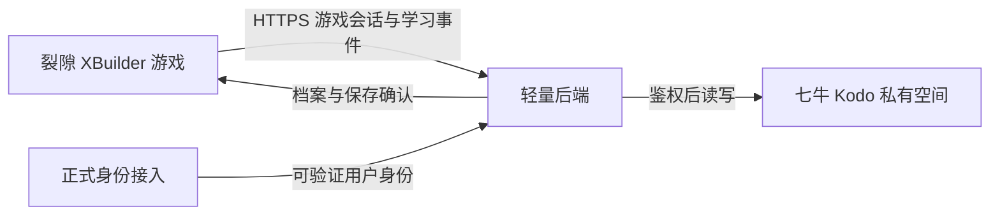

# 裂隙云端学习档案 PRD

> 2026-11-01 更新：最新用户决策为纯本地学习档案，当前不启用云同步。此文为云端 PRD 历史版本；本地需求与已验收范围见 [纯本地验证版](LOCAL_LEARNING_VALIDATION.md)，其本机访客持久化、名称分档与冲突规则优先。

版本：v1.5（2026-10-31 用户名档案修订）  

> **最新用户决策（v1.5）**：现改用运行器的 `username` 关联档案，无须另行注册，也不等待平台稳定 ID 授权。该模式只按名称查找，**不验证账号归属**；同名共享档案，改名建立独立档案，旧档案保留，不自动认领或迁移。空用户名为游客，战斗/R 保持本局原归属。平台当前在外部启动前注入用户名，改名/切换账号后须重新运行；宿主若确实推送了新值，游戏只在标题处理变化。
>
> 本修订覆盖下文 v1.4 中“必须经过平台身份验证／不能使用用户名关联／改名不产生新档案”的要求，包括身份可行性门槛、第 6.4 节、第 10/11 节身份与对象 Key、第 15 节身份验收条目。存储仍使用名称派生的隔离哈希键与私有七牛空间，**哈希和会话签名都不构成平台身份认证**。v1.4 的稳定 ID 模式保留为可选协议，与新名称档案隔离。详细规则与实现以 [用户名档案说明](USERNAME_PROFILES.md) 为准；其他学习规则、队列与存储要求不变。
日期：2026-10-31，Asia/Shanghai  
状态：原生学习、HTTP 保存/恢复与后端本地联调已实现；正式身份接入、新词库及线上验收待完成  
适用范围：XBuilder 原生导入版的常用词库、个人单词学习记录与七牛云存储接入  
交付约束：两天开发周期，以现有游戏可玩性为前提

本版让登录玩家再次进入《裂隙》时，能够恢复已经保存的单词学习记录，并据此安排后续词册。游客直接游玩，不建立个人云端记录。云端保存采用“结算时保存、检查点补存”：通关、失败画面、主动返回标题和整局重开时提交学习记录，到达检查点时补存；普通战斗中不进行固定周期上传。

学习记录与通关成绩分别计算。未通关也保存真实作答，通关只确认本局实际答对的词，不给未遇见的词补进度。本版保存学习档案，不承诺关闭游戏后恢复角色位置、敌人状态或原来的战斗现场。

本文作为现有游戏 PRD 的词库与云端学习功能补充。游戏战斗、输入、战斗难度和美术沿用当前实现；单词选择改为普通、困难、挑战、随机。需求与实现状态分开记录：本地交付进度见第 17 节，正式外部接入仍按验收条目执行。

v1.3 增补常用词库来源研究与四种选词模式，更新第 4、8、9、10、13、14 节的选词、ID、目录、性能和验收规则。Oxford 3000 是首选候选，具体版本、可用词条数量与嵌入／分发授权尚待确认。保留 v1.2 的后端准备 30 词和小型同步协议；文件名保留 `v1`，表示第一版功能范围。

v1.4 确认：只使用 XBuilder 账号，不新增独立注册登录；返回标题才切换游客远征归属；本局薄弱页；题型覆盖与交替；内部测试与正式发布分离。用户于 2026-10-31 确认尚无部署及授权配置，本轮完成本地开发与配置模板，真实云端验收仍待资源就绪。

## 1 核心决策

| 项目 | 本版规则 |
| --- | --- |
| 保存对象 | 每个用户的学习档案，包含分题型历史、近期远征摘要及同步状态元数据 |
| 登录玩家 | 身份经过后端验证，并成功读取或确认创建自己的档案后，启用云同步 |
| 游客 | 正常游玩，仅保留当前运行会话内的学习记录，不访问个人云档案接口 |
| 游客中途登录 | 不自动上传此前游客记录；返回标题并完成账号准备后，新远征使用云档案；R 重开保持原归属 |
| 同步时机 | 新检查点、失败画面、通关结算、主动返回标题、整局重开 |
| 战斗内上传 | 不按每题或每隔十几秒上传；已有失败批次的异步重试可以继续 |
| 失败后的学习 | 正确、错误、超时与提示使用均保留，通关次数不增加 |
| 重试与防重复 | 同一批数据重复发送只生效一次；检查点已保存的数据不在结算时重复累计 |
| 多设备 | 支持先保存再换设备；同一账号同一时刻只允许一个会话写入 |
| 网络异常 | 不阻塞战斗；显示待同步，不把未确认的数据显示为已保存 |
| 跨刷新离线保存 | 不纳入两天首版承诺；当前原生版尚无已验证的持久化能力 |
| 存储方案 | 一个轻量后端实例加七牛 Kodo 私有空间，每个用户一份当前档案 JSON |
| 游戏首次读取 | 返回汇总与本局 30 词所需学习状态；完整 `current.json` 留在后端 |
| 词库方向 | 取消四六级筛选，目标为有明确来源的约 3,000～4,000 个常用词；优先评估 Oxford 3000，不为凑数量随意扩词 |
| 单词选择 | 普通、困难、挑战、随机；前三项按目标义项分层，随机从全部已启用词条混合选取 |
| 难度关系 | 单词选择独立于战斗难度、提示方式与作答时间，不因选择“挑战”自动改变其他设置 |
| 局内执行 | 用构建时固定 ID 到本地整数索引的映射访问数组，单题只更新对应词 |
| 同步回包 | 只返回批次、事件确认边界、版本和时间，不返回整份学习历史 |
| 身份与请求能力 | 必须先在实际交付的 `.xbp` 中完成验证；不能把用户名或平台内部 AI Token 当作接入完成 |

## 2 目标与当前基础

### 2.1 产品目标

1. 玩家能够看到上次已经保存的学习成果，失败或重玩不会清空长期记录。
2. 游戏能够区分“辨义会、拼写不会”，后续词册和题型能够使用这一差异。
3. 用户知道哪些记录已经保存，哪些仍可能随页面关闭而丢失。
4. 在两天内完成真实登录、真实网络、真实 Kodo 写入与读取的可演示闭环。

不以两天内证明学习效果、提升留存或形成商业级账号系统为目标。学习权重与复习间隔是本版产品规则，后续需要实际使用数据调整。

### 2.2 当前实现基础

截至本轮开发启动时，原生导入版基线为 v0.16.10，网页长期词册说明为 v0.11。两条运行路径的能力不同。

| 能力 | 当前原生导入版 | 网页版本参考能力 | 对本版的影响 |
| --- | --- | --- | --- |
| 词库 | 旧版四六级词库，8,815 条去重可用词条 | 同源旧版词库 | 新版改为常用核心词库；云端只存用户历史，不为每个用户复制词典 |
| 本局词册 | 30 个不重复词，答对计入本局已解 | 30 词及分组策略 | 保留 30 词体验 |
| 错词记录 | 当前运行内的单词权重 | 按拼写、辨义分别记录 | 原生版需要补充分题型数据 |
| 跨日复习 | 尚未移植网页规则 | 已有本地规则 | 不能把网页已实现视为原生版已实现 |
| 保存 | 刷新或关闭页面后重置 | localStorage／IndexedDB | 网页本地保存不能直接作为原生版离线保障 |
| 登录与云端档案 | 尚未接入 | 尚未实现云同步 | 本版新增能力 |

8,815 是旧版项目词库的可用词条数，不代表官方大纲的独立词目数量。旧版内容版本为 `cet46-2026-10-26.1`；本文没有实际替换该文件。新版以第 4.6 节完成核验后的发布清单为准，词库更新与档案格式更新分别管理。

## 3 用户与首版范围

### 3.1 使用场景

| 用户状态 | 主要需求 | 应得到的体验 |
| --- | --- | --- |
| 首次游客 | 立即体验游戏 | 无强制登录，照常使用词册和结算 |
| 首次登录玩家 | 建立个人学习记录 | 后端确认无历史后创建空档案，结算后保存 |
| 回访登录玩家 | 继续学习 | 开局前恢复已保存历史，下一轮考虑薄弱词和到期词 |
| 未通关玩家 | 保留练习成果 | 失败画面保存学习记录，再试时长期历史继续存在 |
| 换设备玩家 | 接续已保存的学习 | 新设备读取云档案；首版不恢复战斗现场 |
| 网络不稳定玩家 | 游戏不中断 | 保留当前会话待同步内容，给出明确状态与重试入口 |

### 3.2 两天内必须完成

P0 是正式完整版本发布的必要条件，不能通过隐藏错误提示来绕过。内部联调可沿用旧词库，必须标明测试版本与旧内容版本；不得改名冒充常用词库。云同步与新词库分开开发和测试，正式发布必须共同验收。

| 编号 | 需求 |
| --- | --- |
| FR01 | 游客与已验证账号分流，游客不上传个人学习记录 |
| FR02 | 开局读取个人档案，明确区分新用户、读取失败、格式不兼容 |
| FR03 | 按单词和题型记录作答结果、提示使用及复习状态 |
| FR04 | 结算保存、检查点补存、失败画面保存、返回标题与重开保存 |
| FR05 | 同批重试不重复计算，已确认内容与待同步内容分离 |
| FR06 | 单一写入会话、版本冲突保护、账号切换隔离 |
| FR07 | 显示读取、保存、成功、失败、需重新登录等状态 |
| FR08 | 云端历史能够参与下一局词册与题型安排 |
| FR09 | 私有存储、服务端身份校验、服务端保存密钥 |
| FR10 | 在最终 `.xbp` 和实际运行网站上完成验收 |
| FR11 | 读取包大小、主线程耗时、同步回包和后端全量写入成本满足第 10 节性能预算 |
| FR12 | 使用已明确来源、版本和使用条件的常用词库，提供普通／困难／挑战／随机四种选词模式，移除四六级筛选入口 |
| FR13 | 词条身份跨难度保持稳定；新旧词库切换不删除历史，当前词库进度与全部历史统计分别表达 |

首版词册明确分为“本局词册”“本局薄弱”“完整词库”。薄弱页只筛选当前 30 词，结合该词已加载账号历史与本局作答；完整词库用于静态查词，未加载状态不得显示为未学习。全账号历史仍由后端参与选词，后续再增加分页的全账号薄弱词册。拼写／辨义分别展示；本局一次正确（含辅助正确）即可已解，不要求两种能力均答对。

### 3.3 后续版本

暂不包含：跨刷新离线队列、游客历史认领、两设备并发学习后的自动合并、战斗现场恢复、完整历史报表、班级与教师系统、排行榜、在线 AI 出题、自动导入网页旧存档，以及整套网页学习算法的全面移植。

最近多个档案版本的自动备份列为 P1。首版必须处理损坏档案而不自动清空，但不承诺已有自动回滚系统。若已有可复用的业务数据库，可在实现评审时替换 JSON 存储；不能同时引入两套互不一致的进度来源。

## 4 学习数据口径

### 4.1 五种数值分开显示

| 名称 | 精确定义 | 不能代表什么 |
| --- | --- | --- |
| 本局接触词数 | 本局至少完成一次有效作答的不同单词数，正确、错误、超时均计入 | 不等于答对，不包含仅预览词册 |
| 本局已解 | 本局至少答对一次的不同单词数，范围为 0～30，有提示答对也计入并另标 | 不等于长期掌握 |
| 累计答对词数 | 历史中至少答对一次的不同词库条目数，按稳定 `wordId` 跨局去重 | 不等于累计作答次数、词汇量测评或已合并所有英美变体的词元数 |
| 待复习词数 | 至少一种已练习能力达到复习时间的不同单词数 | 不代表必须立即补题或阻止通关 |
| 通关次数 | 被确认获胜的不同远征 `runId` 数量 | 不因重复上传、刷新结算页而增加 |

另保存“随通关确认过的词”：只有某局获胜且该词在该局实际答对，才设置对应标记。它兼容已有通关词册表达，与“累计答对词数”分别存储。

首版不展示“永久掌握”或“掌握率”。同一个词拼写答错、辨义答对，必须同时保留两类证据，不能用一次辨义正确清除拼写弱项。

累计答对词数保留全部历史口径，包括以后退出当前词库的词。当前词库另显示“本词库已答对 X／N”，按当前版本启用 ID 与历史答对 ID 的交集计算；N 来自清单，不写死为 3,000 或 4,000。待复习默认仅统计当前启用词库，选择难度时可显示该范围的待复习数。旧库有记录但新库未收录的词不进入分母、候选池或当前待复习数，也不从历史中删除。

### 4.2 有效作答

一次题目只能形成一个最终结果：正确、错误、超时三选一。主动放弃、重开导致取消、系统中断和只打开词册不形成学习作答，不记错误。

原生版第一处无效拼写即失败，不能把后续残留按键再记为新错误；最后一个正确字母与超时同时发生时，也只能结算一次。题目实例需要唯一标识，客户端先防止重复结算，服务端再防止重复同步。

每种能力的计数满足：`attempts = correct + wrong + timeouts`。`assistedCorrect` 是 `correct` 的子集。一个词答对十次，正确次数可以增加十次，累计答对词数只增加一次。

### 4.3 提示与回忆证据

保存真实提示模式：完整显示、渐隐、短时展示后隐藏、全程不展示答案。另记录是否实际展示过答案、是否额外查看提示。

当前原生版名为“独立回忆”的模式仍先展示完整单词约一秒，因此云端不能仅依据该模式名称把它记为全程无提示。首版把出现过答案的拼写正确记为辅助完成，不以此累计无提示回忆证据。辨义题正常展示英文题词，不因此视为泄露正确选项。

此规则只影响学习记录与后续复习安排，不取消现有答对释放技能和本局已解奖励。

数据格式预留全程不展示答案的类型，但本版不因此新增提示难度。当前原生提示方式保持原样，按实际展示情况入账。

### 4.4 两天版复习规则

首版使用统一的 `learningRuleVersion = 1`，拼写与辨义独立更新：

| 结果 | 对应能力薄弱分 | 下次复习 |
| --- | --- | --- |
| 错误 | 加 1，上限 6 | 服务端确认保存后 6 小时 |
| 超时 | 加 0.4，上限 6 | 服务端确认保存后 6 小时 |
| 辅助正确 | 乘 0.8 | 服务端确认保存后 12 小时 |
| 无提示正确或未泄露答案的辨义正确 | 乘 0.4 | 服务端确认保存后 1 天 |

服务端按事件顺序更新薄弱分，不能只凭一批中的总正确数和总错误数推算。客户端在本局使用相同规则即时预估，下一次读取以服务端已确认档案为准。首版不扩展到 3／7／14／30 天阶梯，也不实现历史薄弱分的时间衰减。

时间字段以 UTC 保存，界面按 Asia/Shanghai 展示。首版复习时间从服务端确认时间计算；因此长时间未同步的作答会较晚进入到期状态，这属于本版明确的简化。原始作答时间可保留用于展示，但客户端时间不决定云端版本先后。

### 4.5 下一局如何使用历史

默认每局 30 个不重复词，目标组成采用 12 个新词、10 个到期复习词、6 个薄弱词、2 个其余已学词。首版只提供这一默认组成，不新增三套策略设置界面。

分类按以下顺序互斥判断：从未有效作答为新词；否则，任一适用能力薄弱分不低于 0.65，或最近一次结果仍为错误／超时，归入薄弱词；其余有能力到期的归入到期复习；剩余归入已学未到期。

先按第 4.6 节的 `wordMode` 筛选，再分组抽样。类别不足时，在同范围内按“到期复习、新词、已学未到期、额外薄弱词”顺序补足，排除已选 ID；有足够其他词时不突破薄弱配额。新用户可以全部抽到新词。不能为凑配额重复同一个词，不能自动越过所选难度取词。

题型先覆盖未练过的适用能力；全新词在允许题型内随机首题。两种都练过后优先较薄弱能力；薄弱分相同时与上次题型交替。薄弱词组内按 1 + 最大薄弱分进行无放回加权抽取，仍遵守 6 词目标配额；战斗内原有紧急场景限制仍优先，只能辨义的词不生成拼写题。云档案迟到、后台同步完成或算法更新，均不能在战斗中替换已经锁定的 30 词；影响从下一局开始。

登录且联网时，以上全历史分类与 30 词选择由后端在准备阶段执行。游戏接收本局 30 个 ID、选入原因及对应的必要能力状态，不下载全量历史再自行分类。游客在本地执行相同范围规则，历史仅来自当前运行会话；首次无历史时可全部选新词。已登录但同步或网络不可用时，可以继续原局或复用当前已加载词册练习，保留原账号事件队列，不把未加载历史当作全是新词。换词组或切换词库范围需要成功准备新的词册，失败时保留原词册并提供重试。

### 4.6 常用词库与四种选词模式

#### 4.6.1 产品决定与来源建议

已确定的产品需求是取消四六级分类，面向常用英语提供普通、困难、挑战、随机四项。优先采用有明确编选依据和分级依据的约 3,000～4,000 词核心词库；这是规模目标，不是已经获取、清洗或获得授权的词库。

研究后的首选方案是 Oxford 3000：先把约 3,000 个核心词及对应题目做好，不为了达到 4,000 拼入旧四六级词或随机生僻词。Oxford 按语料频率和学习相关性选词，并提供 CEFR 分级，适合为游戏分层提供依据。[OUP：Oxford 3000 的选词与分级](https://teachingenglishwithoxford.oup.com/2019/11/11/oxford-3000%EF%B8%8F-eltoc/)

| 候选来源 | 可采用的依据 | 限制与本项目定位 |
| --- | --- | --- |
| Oxford 3000 | 核心常用词与 A1～B2 学习分级 | 首选候选；需确认固定版本及词表、分级数据的嵌入／分发条件 |
| Longman Communication 3000 | 口语和书面语频率标记 | 可作为频率交叉参考；S1／W1 等是频率层级，不能直接等同普通／困难／挑战 |
| NGSL 1.2 | 官方项目说明为 2,809 词，并注明 CC BY-SA 4.0 | 可评估的替代来源，但数量低于本次目标，且仍需另定分级；使用时需遵守署名及相应共享条件 |

来源分别见 [OUP 说明](https://teachingenglishwithoxford.oup.com/2019/11/11/oxford-3000%EF%B8%8F-eltoc/)、[Longman 原编说明与词表 PDF（Lextutor 托管）](https://www.lextutor.ca/freq/lists_download/longman_3000_list.pdf)、[NGSL 官方页面](https://www.newgeneralservicelist.com/new-general-service-list)。这里比较的是词库依据，不表示本项目已下载、转换或获准再分发这些内容。

若 Oxford 的使用条件无法在开发窗口内确认，不将公开可阅读等同于可打包发布，也不静默换成另一套词后仍宣称 Oxford 3000。替代方案需要说明真实来源、实际数量、分级办法及与目标的差异；未达成词库条件的交付不能标为“新版权威常用词库已完成”。

#### 4.6.2 模式定义

以下是本游戏拟定映射，不是 Oxford 官方的游戏难度命名，也不能视为玩家英语水平测评。

| 界面选项 | `wordMode` | 候选范围 | 推荐界面说明 |
| --- | --- | --- | --- |
| 普通 | `normal` | 目标义项为 A1、A2 的启用词条 | 常用基础词 |
| 困难 | `hard` | 目标义项为 B1 的启用词条 | 日常进阶词 |
| 挑战 | `challenge` | 目标义项为 B2 的启用词条 | 更有挑战的常用词 |
| 随机 | `random` | 上述三个池的并集，覆盖本版全部启用词条 | 全词库混合，兼顾复习 |

OUP 对 2019 年修订版的说明给出 A1 约 900、A2 约 800、B1 约 700、B2 约 600。按本方案映射，可用于初步估算普通约 1,700、困难约 700、挑战约 600；这些是来源版本的参考数，不是游戏实际导入数。最终须审核版本、计数单位、重复条目、拼写变体及可用题目，以 `manifest` 的实测数量为准。[OUP 分级数量说明](https://teachingenglishwithoxford.oup.com/2019/11/11/oxford-3000%EF%B8%8F-eltoc/)

首版按规范 `wordId` 计数，不将同一词的不同词性、义项或允许的拼写变体重复计入词库规模。每个启用 ID 只绑定一个经过审核的目标词性、目标义项与游戏难度；目标义项不同可能对应不同 CEFR 等级。例如 `book` 的名词“书”和动词“预订”不能因为拼写相同而直接视作同一难度。[OUP：词性与等级的示例](https://learningenglishwithoxford.oup.com/2021/02/17/how-to-online-learner-dictionaries/amp/)

词长不决定普通、困难或挑战。词长可以参与拼写作答时间的现有计算，短词的多义性也不能被忽略。没有可靠分级或尚未完成题目审核的条目不进入正式候选池，不能凭字母数量补上等级。战斗难度、提示方式与词库范围保持独立设置；切换词库难度不自动增加伤害、减少提示或缩短答题时间。

#### 4.6.3 抽词与切换规则

1. 默认选中“普通”。准备词册时先锁定内容版本和 `wordMode`，按范围取候选，再执行第 4.5 节的新词／复习／薄弱词配额，最终得到 30 个不同 ID。
2. “随机”是全词库范围，不是随机选择一个难度，也不是忽略历史的纯随机。按学习状态分类后，各类别在其候选中无放回抽取，不设三个难度各 10 词的硬配额；池大小与个人历史都会影响实际比例。
3. 随机池使用去重并集，不复制三套词库。同一个词在普通与随机中被选中时使用同一份学习记录；“随机”不是词条自身的难度标签。
4. 同一难度内某类历史不足，按第 4.5 节补足。若整个有效候选池不足 30 词，返回明确的准备失败，不复制词、不跨难度凑数；各模式至少 30 个可出题词是发布检查项。
5. 切换模式只在准备界面生效。完成新的词册准备后才能显示新选择为可开始；失败保留原词册及其模式。开始战斗后锁定 30 词、版本和模式，重开／续局沿用第 5 节规定，不重新随机替换。
6. 游客也使用四种模式和同一份静态词库，不请求个人云档案。登录用户换组前先确认此前待同步记录，避免后端按过期历史选词；网络失败时按第 10.2 节复用旧词册。

#### 4.6.4 题目质量与来源记录

首版每个词只训练一个明确的目标义项，避免一个条目拼接多个互不相干的中文释义。词性和目标义项由内容构建冻结，不在运行时用 AI 临时决定。功能词或多义词需要短语／短句语境时，使用预先编写并审核的内容；暂时不能形成清楚题目的词标记为未启用，并在数量报告中说明，不能直接用模糊单字翻译凑数。

内容校验覆盖：规范 ID 唯一、目标义项与等级对应、有效拼写可被输入系统处理、不可拼写词只出辨义题、题干与答案一致、同题只有一个正确选项、干扰项不与当前语境中的正确答案同义。选择词库与审核题目是两件工作；从权威词表取词不代表自动生成的中文题目同样可靠。

来源记录至少区分：词目选择来源、CEFR／分级依据、中文释义与例句来源、许可或使用依据、固定版本、取得日期以及项目自己的调整说明。不能将词表使用条件推及其全部释义、例句或音频。开发前先抽查三个难度各 20 个候选词，覆盖功能词、多义短词、变体及特殊输入；发布前完成全量结构检查，并审核实际采用的题面和干扰项。两天内做不完时明确未完成内容，不以抽样通过声称全库质量已验收。

#### 4.6.5 两天范围与历史兼容

本次只规划一套常用词库、一个固定内容版本、四个入口、既定 30 词配额和静态分级。暂不实现自动水平测评、动态升降难度、联网生成词义、全部多义项训练或在线随意增删词库。增加至 4,000 词属于后续明确来源与分级后的内容发布，不改动 `wordId` 命名空间或为用户新建档案。

与旧库相同且身份经核对的词保留原 ID；退出候选池的旧词只停用，不删历史。经固定来源与人工审核确认是同一词目的英美变体，新库只选择一个规范 ID 出题并计数，其他拼写进入有效答案集合；既有不同 ID 的历史仍分别保留，不能凭 `accepted` 集合重叠合并学习次数。新版目标义项若与旧版不一致，旧辨义正确不能直接证明新义项已会。由于本次不自动导入网页旧存档，首版先冻结目标义项；未来对已有云档案变更目标义项前，必须完成第 8.7 节的显式迁移设计，不能把改释义当作无影响更新。

## 5 一局的生命周期

### 5.1 远征与失败重试

`runId` 在真正进入冒险时创建，同时产生远征开始事件；词册预览与换组不创建远征记录。每个写入会话内使用递增的 `runSeq`，由写入会话与远征序号确定唯一 `runId`。同一失败画面的重复渲染不产生新失败，只有新的失败尝试标识才能增加失败次数。

| 操作 | 远征身份 | 本局已解 | 长期学习记录 |
| --- | --- | --- | --- |
| 到达新检查点 | 保持同一 `runId` | 保留 | 累计并触发补存 |
| 死亡进入失败画面 | 保持同一 `runId`，增加一次失败尝试记录 | 保留 | 累计并触发保存 |
| 从检查点继续 | 保持同一 `runId`，开始下一次尝试 | 保留 | 不回滚、不重复记旧题 |
| 整局重开 R | 尚未结束的旧 `runId` 记为放弃，创建新 `runId` | 新局清零，保留当前词组 | 旧局历史与待同步队列保留 |
| 主动返回标题 | 尚未结束的当前 `runId` 记为放弃 | 保留在该局摘要 | 触发保存，长期记录保留 |
| 真正通关 | 当前 `runId` 结束为获胜 | 以真实作答为准 | 触发保存，通关次数只加一次 |
| 刷新或关闭页面 | 不保证收到结束事件 | 最后确认内容仍在云端 | 未同步部分可能丢失 |

“失败画面保存”不等于立刻把整局标记为终止。失败次数属于远征内的尝试；随后从检查点继续，最终仍可以把同一局结算为获胜。

已获胜或已放弃的远征保持终态；结算后返回标题、反复点击按钮或重开，都不能把获胜改为放弃，也不能重复增加通关次数。

页面意外关闭后，云端可能仍显示上次远征未完成。首版在新设备或重新运行后开始新局，不提供“恢复原战斗”按钮，不猜测旧局已经通关或失败。下一局开始事件到达后，可把此前未关闭的远征归档为中断，保留已确认学习结果，不额外增加失败次数。远征状态限定为进行中、获胜、放弃和中断。

### 5.2 明确的保存触发

| 触发 | 保存内容 | 限制与表现 |
| --- | --- | --- |
| 到达新的检查点 | 尚未确认的作答、远征进度与检查点标识 | 同一局重复停留在同一检查点不反复触发；不暂停战斗 |
| 进入失败画面 | 尚未确认的作答及本次失败尝试 | 即使直接点继续，也保留上传任务 |
| 通关结算 | 剩余作答、最终词册完成情况、获胜事件 | 不等待网络再显示本局结果；云端保存状态独立显示 |
| 主动返回标题 | 剩余作答及放弃事件 | 取消未完成题目后封装记录，不清空待同步队列 |
| 整局重开 | 旧局剩余作答及放弃事件 | 网络不阻塞重开；新旧局记录按顺序发送 |
| 手动重试保存 | 原失败批次，随后处理已排队批次 | 不能重新生成同批编号，也不能把本局总次数再加一遍 |

重复回到已保存检查点且没有新增事件时，不上传空批次。首次到达新检查点、失败、获胜或放弃事件即使没有新的单词作答，也属于需要保存的变化。铭文关闭时不产生单词学习记录；真实远征成绩仍可在结算时保存。排练场不写入正式学习档案或通关次数。

暂停、开关词册、菜单翻页、普通移动、普通攻击及每帧更新均不触发同步。浏览器隐藏或关闭事件不能成为保证保存成功的必要条件。

## 6 完整使用流程

### 6.1 游客开始与中途登录

游客直接进入准备页、生成词册、开始冒险。开始页和结算页显示“游客模式，本次学习记录不保存到云端”。本次会话内可以继续使用已产生的错词历史。

游客中途登录后，本局、局内 R 重开和检查点续关仍保持游客归属；提示“已登录，返回标题后开始新远征，可保存学习记录”。返回标题后先读取账号档案，再生成词册并开始账号远征。不能把共享电脑上此前的游客记录自动并入当前登录账号。

### 6.2 登录玩家进入

1. 通过正式支持的身份接入方式，让后端验证用户身份并建立游戏会话。
2. 后端读取该用户的云端档案并检查版本，向游戏提供精简学习视图，不发送原始完整 JSON。
3. 首次使用时，由后端明确确认档案不存在，再初始化空档案。
4. 取得当前账号的写入会话，后端以此时的最新已确认档案生成 30 词及学习视图。读取、取得写入权和准备词册可合并为一次准备接口调用，避免前端重复往返和使用过期版本。
5. 玩家预览并进入冒险，创建 `runId`，开始累计事件。

读取失败不是新用户。超时、无权限、文件损坏、未知格式时，不能用空对象覆盖旧档案。显示“学习记录暂时无法读取”，提供重试和“暂不同步游玩”。后者使用独立临时会话，首版不在恢复网络后自动认领这些临时记录。

初始化等待单次最多 10 秒，之后转为可操作的失败状态，不无限显示加载。玩家可以选择暂不同步游玩；不会因为云服务异常失去游戏入口。

### 6.3 已登录后的网络中断

已成功加载档案的玩家遇到断网，继续在内存中记录本账号的作答与远征事件。保存触发时如果失败，界面显示待同步；网络恢复且身份仍有效时重试。

当前页面仍运行时，可以恢复这些待同步记录。刷新、关闭、浏览器崩溃或 XBuilder 重新运行后，首版不保证恢复未同步内容。不得展示“离线也绝不丢失”等文案。

### 6.4 登录过期与切换账号

登录过期不把已有记录改成游客记录。暂停云端写入，继续保留原账号待同步队列，提示重新登录。恢复同一账号后可以继续原批次；登录其他账号时不能提交原账号记录。

游戏内发起切换账号时，先尝试保存并显示结果；有未确认数据时，明确告知关闭页面将丢失这些内容。切换后隔离旧账号队列和画面，不能在新账号词册中显示旧账号历史。旧队列仅在当前进程中保留，回到原账号且写入会话仍有效时才允许续传。

## 7 同步协议与一致性

### 7.1 三份状态各自负责什么

客户端区分以下内容：最后确认的本局词册学习视图与汇总、尚未确认的有序事件队列、当前战斗使用的学习视图。完整云端档案只存在于后端与 Kodo。战斗视图可以包含尚未上传的学习结果，不能因此标记整个档案已同步。

客户端上传“本批新发生的事件”，后端依据自己的档案更新并写回 JSON。客户端不能提交任意累计总数来覆盖云端历史，也不能自行指定要写入的其他用户路径。

### 7.2 单批处理顺序

1. 到达保存触发点，记录本次需要刷新的事件序号上限。
2. 把上限以内、尚未确认的事件组成不可变批次，分配批次序号与标识。
3. 同一个写入会话最多有一个批次等待结果。上传期间新事件进入后续队列，不修改正在发送的内容。
4. 后端验证账号、写入会话、批次顺序、档案版本和事件内容，再按顺序计算新档案。
5. 后端将学习结果、远征摘要、版本号及去重信息写入同一个当前档案对象。
6. 七牛确认写入成功后，后端返回已确认批次、事件序号、档案版本和保存时间。
7. 客户端只移除明确被确认的事件；仍有待保存内容时继续显示待同步。触发范围内的大队列分批顺序发送。

请求失败或响应丢失时，原批次保持原编号与原内容重试。后端不能在请求刚收到或只更新内存后就返回“已保存”。

同步成功仅返回小型确认包。客户端用冻结批次及服务端确认时间推进已确认的本局视图，再叠加尚未确认事件；不能再次把已乐观显示的答对次数相加。不同批次的到达顺序、账号和写入会话均先验证。下一局准备接口基于最新已保存档案返回新的 30 词，不依靠一次同步回包携带全历史来刷新游戏。

### 7.3 幂等与版本规则

“幂等”指重复发送同一批记录，只改变一次学习结果。

| 字段 | 规则 |
| --- | --- |
| `writerSessionId` | 后端创建的当前写入会话，绑定经过验证的账号 |
| `writerEpoch` | 每次写入权转移递增，旧会话无法继续提交 |
| `batchSeq` | 当前写入会话内从 1 开始连续递增，前一批确认后才发送下一批 |
| `batchId` | 由写入会话与批次序号唯一确定，同批重试保持不变 |
| `eventSeq` | 写入会话内连续递增，支持确认边界及重复事件检查 |
| `baseRevision` | 客户端所依据的云档案版本 |
| `revision` | 后端在成功改变当前档案时递增 |
| 内容摘要 | 后端计算，用于识别同一批次编号被换了内容 |

服务端在检查版本冲突前，先检查该写入会话下的已处理批次：最新同号同内容返回原确认结果；最新同号不同内容拒绝；更早的连续已确认批次返回“已处理”及确认边界，不再处理其载荷；跳号的新批次拒绝并要求先完成前批。只有下一个合法新批次才继续检查 `baseRevision`，它必须等于当前档案版本。

去重序号、最新批次内容摘要与确认边界必须随档案持久保存，不能只放在进程内。单写入会话与连续序号让首版不必无限保留每条原始事件。当前写入权已失效的旧会话，即使带着历史批次也不能产生新写入。

### 7.4 多设备和版本冲突

允许“设备 A 保存成功，设备 B 再读取后开始”。不提供同时在两台设备学习后的自动合并。

设备 B 发现存在有效写入会话时，显示“此账号正在另一处保存学习记录”，可以选择暂不同步游玩，或明确选择在本设备继续。接管必须由后端在同一用户的写入锁内执行，递增并持久保存 `writerEpoch`；成功后才让 B 开始同步。

A 后续写入会被拒绝并显示“保存已在其他设备继续”。A 的战斗可以继续，但其未保存记录不会偷偷覆盖 B。首版不自动合并这一部分记录，应提示重新加载云档案后开始新局。

普通版本冲突也不能靠更新时间较晚就整份覆盖，或把所有计数取最大值解决。停止提交，保留当前会话未确认内容并显示冲突；重新读取后的新局使用最新云档案。

### 7.5 重试与边界

单次客户端请求超时设为 10 秒。网络失败和可重试的服务端错误，按约 2、5、15 秒间隔最多自动重试三次；仍失败则等待手动重试或下一次保存触发。401 转入重新登录；会话失效或版本冲突转入冲突状态；内容非法与不兼容格式不能无限重试。

批次上限初始设为 200 个事件或 256 KiB UTF-8 JSON，以先到者为准。达到限制时切成连续批次，不丢事件。上限属于本版接口预算，必须在真实运行环境中验证。

256 KiB 是后端拒绝超大请求的协议上限。正常客户端优先按不超过 32 KiB 且不超过 200 个事件切批，避免原生运行时一次序列化过多内容；只有实测通过第 10 节执行预算后才调整这一默认值。

后端写入超时可能代表“结果未知”，不能立刻当作没有写入。此时保留同用户写入串行约束，核验存储结果中的版本及批次标识；确认前不处理会覆盖该用户档案的后续写入或接管。无法确认时返回可重试状态，不能用旧内存档案继续写。

重启恢复也必须处理尚未确定结果的上传，不能仅因进程锁消失就认为旧请求已结束。实现时需要可恢复的写入意图记录或经验证的等效机制；如果现有后端无法满足，应采用已有事务存储承接写入状态后再开放云同步。该能力是可靠性要求，不能只靠一份内存锁宣称完成。

返回标题和重开只清理战斗对象，不销毁登录会话与同步队列。页面已切换时，旧请求回调仍必须核对账号和写入会话，不能更新另一账号的界面。

## 8 数据结构要求

### 8.1 云端当前档案

以下是必须表达的数据含义，实际字段可在技术设计中映射，但不能省略相应语义。

| 分组 | 必要字段或内容 |
| --- | --- |
| 版本 | `schemaVersion`、`contentVersion`、`learningRuleVersion`、`revision` |
| 归属 | 内部 `playerId`，由后端根据稳定的身份提供方和用户标识映射 |
| 同步 | 当前写入会话及代次、最后确认批次序号、事件序号、最新内容摘要、确认结果、当前会话已开始的最大远征序号 |
| 时间 | 服务端创建时间、最后保存时间 |
| 单词历史 | 以稳定 `wordId` 索引的拼写和辨义记录、首次接触时间、是否曾答对、是否曾随通关确认 |
| 分题型记录 | 尝试、正确、错误、超时、辅助正确次数，最近结果、最近提示模式、薄弱分、最近学习时间、下次复习时间 |
| 当前或最近远征 | `runId`、`runSeq`、状态、`contentVersion`、`wordMode`、30 词 ID、本局接触和已解集合、失败次数、最后失败尝试标识、最后检查点、开始及结束时间 |
| 近期摘要 | 最多 10 局的结果和学习数值；不保存完整战斗录像 |
| 累计统计 | 累计通关次数；接触、答对、待复习等词数由词条状态计算或一致地派生 |

删除超过 10 局的摘要不能删除单词历史或降低累计通关次数。已经关闭的远征不能再次转换成获胜；历史批次不能在去重元数据清理后被当作新局重新创建。后端只接受当前写入会话中按序开始的新远征，旧 `runSeq` 不能重新开始；换写入会话后，由会话代次隔离旧事件。

### 8.2 作答事件

每条作答至少包含：事件序号、题目实例 ID、`runId`、稳定 `wordId`、题型、结果、提示模式、是否展示答案、是否额外提示、有效作答时长和内容版本。时长不包含暂停时间。

学习事件内不包含完整键盘输入、Token、邮箱或头像；错误类型与题型已足以支撑基础复习。身份凭证仅按正式鉴权协议传递，不存入学习档案。远征开始、失败、检查点、获胜和放弃采用独立事件种类，与作答按同一队列排序。通关事件位于本局最后一条作答之后，分批时也不能先写通关再漏掉前面的答案。

### 8.3 单词身份与兼容

`wordId` 使用固定词库导出的稳定规范 ID，不使用原生词数组下标，不使用中文释义或显示顺序。普通、困难、挑战和随机只决定候选范围，不为同一条目重复建学习档案；判题接受的拼写变体记到本次题目绑定的条目，不按玩家输入重新推导 ID。

旧版词库同时存在 `color` 和 `colour` 两个条目，二者的 `accepted` 均包含这两种拼写。这说明有效答案集合不等于词条身份：已有两个来源 ID 的历史不自动合并。新库若收录并确认是同一词目的英美变体，只启用一个规范 ID，另一个 ID 的旧历史保留但不参加新库出题与进度计数；具体选择随固定来源登记。旧库还存在类似 `auto` 与 `automobile` 的关联，不能仅凭集合重叠做传递合并。后续需要跨变体聚合时，另增人工确认的 `lexemeId`，保留原始作答归属。

内容更新不自动清空历史。旧词暂时不在当前词库时保留历史但不出题；ID 改名或拆分需要明确迁移映射。未知档案格式、损坏 JSON 或无法解释的字段，不得用空档案覆盖；首版停止同步并保留云端原对象。

网页旧存档不在首版自动迁移。以后提供导入时，需要独立处理来源、账号归属、旧统计含义与去重，不能把旧累计数直接加到云端。

### 8.4 单词 ID 的确定格式

首版云端采用 `en:{sourceWordId}`，例如 `en:book`。`sourceWordId` 是项目登记并冻结的词条键，不代表 Oxford 提供了相同格式的官方 ID。旧版构建中的 `WORDS[].id` 等于 `entry.word`；新库对身份相同的词沿用该键，对新增词在构建时审核登记，发生拼写冲突或词目口径差异时使用显式映射。不能用答题输入、数组位置、随机 UUID 或释义哈希临时生成 ID。

| 名称 | 示例 | 是否随内容更新变化 |
| --- | --- | --- |
| `sourceWordId` | `book` | 首次登记后冻结，后续修正显示词形不重新分配 |
| `wordId` | `en:book` | 不变化，作为学习记录和题目的引用键 |
| `word` | `book` | 展示文字，可按内容修订 |
| `accepted` | `["book"]` | 可增加经确认的有效答案，不改变学习归属 |
| `targetPos`、`meaning` | `noun`、`书` | 当前教学目标；改变义项须评估旧辨义记录兼容性 |
| `cefr` | `A1` | 来源核验后的目标义项等级，不靠词长推导 |
| `difficulty` | `normal` | 按第 4.6 节由等级映射；只允许 `normal`、`hard`、`challenge`，不存 `random` |
| `wordMode` | `random` | 存于词册与远征，表示本局选词范围，不参与词条 ID |
| `lexiconId` | `en-core` | 常用词库产品标识；未来扩至 4,000 词不需要改名 |
| `contentVersion` | `core-2026-10-31.1-draft` | 本文设计示例，非已发布版本；正式版本不含 `-draft`，不嵌入 `wordId` |

具体约束：

1. 先登记旧版 8,815 个唯一来源键以检查兼容性，再从新来源确定本次启用集合。完整新库文件有 N 个唯一启用 ID，N 为实测值；旧版总数不等于新版发布数量，也不等于需要预创建的用户历史条数。
2. 后续构建沿用已登记 ID。单纯调整顺序、难度标签或展示词形不改 ID；修正释义不能改变既有作答的原始含义。确实需要拆分／合并或更换目标义项时先发布显式迁移方案，不在加载时猜测。
3. 旧版合法 ID 可能包含空格、句点和连字符，例如 `en:according to...`、`en:b.c.`、`en:father-in-law`，保留其历史字符。这不表示它们必定收录于新库。JSON 字符串可以表达它们；云端不把单词 ID 拼进对象路径，因此无需改成丢失信息的 slug。
4. 中文释义、词性、英美拼写输入均不参与 ID 计算。选择题的选项位置也不作为身份。
5. 原生构建产物需要新增同长度、同顺序的 `nativeWordIds` 映射。运行时用本题数组下标查出固定 ID，上传的是 ID；数组下标仅用于本次构建内部寻址。
6. 后端按客户端声明的受支持内容版本验证 ID。首次上线同时只启用一个固定词库版本；后续保留仍受支持旧包所需的 ID 清单，不以加载最新词库的方式静默丢掉旧词。

以旧库兼容场景为例：题目绑定 `en:color`，玩家输入 `colour` 并判对，应更新 `words["en:color"]`；题目绑定 `en:colour` 时才更新另一条记录。不能一题同时更新两个 ID。新库仅可对该版本实际启用且具有相应有效答案的条目出题。

### 8.5 共享词库文件格式

词库文件每个内容版本保存一份，供后端校验、构建追溯和后续分发使用。原生 `.xbp` 继续内置词库，战斗中不按单词向七牛请求释义。

`words.json` 使用以下设计结构。示例仅用 `book` 的名词义演示字段；中文为本文件的简要示例，不表示已完成整套词库制作。`draft: true`、待定来源版本和待核验使用条件均禁止进入正式发布。正式文件必须包含清单声明的全部 N 个启用条目，不能把示例当完整词库上传。

```json
{
  "schemaVersion": 1,
  "lexiconId": "en-core",
  "contentVersion": "core-2026-10-31.1-draft",
  "wordIdScheme": "language-source-v1",
  "draft": true,
  "selectionSource": {
    "name": "Oxford 3000",
    "edition": null,
    "usageStatus": "pendingVerification"
  },
  "words": [
    {
      "wordId": "en:book",
      "sourceWordId": "book",
      "language": "en",
      "word": "book",
      "accepted": ["book"],
      "targetPos": "noun",
      "meaning": "书",
      "cefr": "A1",
      "difficulty": "normal",
      "spellable": true
    }
  ]
}
```

该文件定位为后端词条身份、目标义项、分级与有效答案清单，不替代原生完整题库。游戏题面、语境、干扰项和字形资源来自同一次构建；以后若用于在线下发题目，需要另补完整题面字段并升格式版本。详细来源和审核记录保存在版本化的内容制作材料中，词库清单引用其确切位置，不能只保留一个无法追溯的来源名称。

同目录 `manifest.json` 保存 `schemaVersion`、`lexiconId`、`contentVersion`、`wordIdScheme`、实际 `wordCount`、`wordsKey`、`wordsSha256` 和 `publishedAt`；新增 `difficultyCounts`、`selectionSource`、`sourceEdition`、`sourceUrl`、`sourceRetrievedAt`、`provenanceRef`、`usageStatus` 与 `draft`。`difficultyCounts` 只含 `normal`、`hard`、`challenge` 三项，三项之和等于 `wordCount`，随机池大小也等于 `wordCount`。

摘要对实际上传的 UTF-8 文件字节计算 SHA-256；不能填占位值或把七牛对象 ETag 当作 SHA-256。只有来源版本明确、使用依据核验完成（`usageStatus = verified`）、`draft = false`、内容审核通过、各模式至少 30 词且数量与摘要一致的清单才可发布。先写词库并核验，再发布清单；这里的 `verified` 是项目核验状态，不表示内容提供方对游戏作出认证。

### 8.6 用户档案 JSON 的确定格式

使用 UTF-8 JSON，字段采用 camelCase。时间统一为带毫秒的 UTC ISO 8601 字符串，例如 `2026-10-31T02:00:00.000Z`；没有发生过的时间使用 `null`，不能混用空字符串、0 和本地时间文本。计数均为非负整数，布尔值使用 JSON 布尔值。

下面是首次初始化、尚未取得写入会话的完整最小档案设计。`playerId` 为格式示例，不是真实账号；`contentVersion` 沿用上节草案占位版本，正式创建必须引用已核验发布的版本。第 9 节定义用户 ID 的生成与路径。

```json
{
  "schemaVersion": 1,
  "lexiconId": "en-core",
  "contentVersion": "core-2026-10-31.1-draft",
  "learningRuleVersion": 1,
  "revision": 1,
  "playerId": "p_0123456789abcdef0123456789abcdef0123456789abcdef0123456789abcdef",
  "createdAt": "2026-10-31T02:00:00.000Z",
  "updatedAt": "2026-10-31T02:00:00.000Z",
  "sync": {
    "writerSessionId": null,
    "writerEpoch": 0,
    "lastBatchSeq": 0,
    "lastEventSeq": 0,
    "lastBatchHash": null,
    "lastReceipt": null,
    "maxRunSeq": 0
  },
  "words": {},
  "activeRun": null,
  "recentRuns": [],
  "totals": {
    "completedRuns": 0
  }
}
```

`words` 使用对象映射，只创建实际产生有效作答的词条。下面是可以放入 `words` 的一条记录片段，表示拼写错一次、辨义对一次，尚未随通关确认。它不是可单独覆盖整个档案的完整文件。

```json
{
  "en:book": {
    "firstSeenAt": "2026-10-31T02:05:00.000Z",
    "everCorrect": true,
    "everCompletedInWonRun": false,
    "spell": {
      "attempts": 1,
      "correct": 0,
      "wrong": 1,
      "timeouts": 0,
      "assistedCorrect": 0,
      "weaknessMilli": 1000,
      "lastOutcome": "wrong",
      "lastHintMode": "brief",
      "lastAnswerShown": true,
      "lastExtraHintUsed": false,
      "lastSeenAt": "2026-10-31T02:05:00.000Z",
      "nextReviewAt": "2026-10-31T08:05:00.000Z"
    },
    "meaning": {
      "attempts": 1,
      "correct": 1,
      "wrong": 0,
      "timeouts": 0,
      "assistedCorrect": 0,
      "weaknessMilli": 0,
      "lastOutcome": "correct",
      "lastHintMode": "none",
      "lastAnswerShown": false,
      "lastExtraHintUsed": false,
      "lastSeenAt": "2026-10-31T02:05:00.000Z",
      "nextReviewAt": "2026-11-01T02:05:00.000Z"
    }
  }
}
```

| 字段约束 | 定义 |
| --- | --- |
| `spell`／`meaning` | 尚未练过对应能力时为 `null`；只有有效作答后才建立该能力对象。不可拼写词的 `spell` 始终为 `null` |
| `weaknessMilli` | 第 4 节薄弱分的千分整数，0～6000；错误加 1000，超时加 400，辅助正确取 `floor(原值 × 8 / 10)`，其他正确取 `floor(原值 × 4 / 10)`；分类阈值 0.65 对应 650 |
| `lastOutcome` | `correct`、`wrong`、`timeout`，不把取消保存成错误 |
| `lastHintMode` | `full`、`fade`、`brief`、`none`；当前原生短时展示模式为 `brief` |
| `lastAnswerShown` | 题目是否泄露过目标答案；辨义正常展示英文题词不算泄露正确选项 |
| `activeRun` | 未结束远征或 `null`；终态远征进入 `recentRuns`，保存原有 `runId` |
| 远征 `status` | `active`、`won`、`abandoned`、`interrupted` |
| `lastReceipt` | 非空时至少包含已确认 `batchId`、`batchSeq`、`lastEventSeq`、`revision`、`savedAt`，供同批重试返回 |
| 汇总数值 | `completedRuns` 为历史累计；接触、答对和待复习词数从 `words` 派生，避免维护一份容易失配的第二总账 |

每条记录不重复存储英文展示、中文释义、选项和词库标签。它们通过 `wordId` 查对应版本共享词库。不为约 3,000～4,000 个词预填零记录；用户只学过 12 个词时，`words` 就只有 12 个条目。词库增加或停用条目不会要求批量重写每个用户的空记录。

### 8.7 版本字段各自的职责

| 字段或路径 | 变化原因 | 对用户历史的处理 |
| --- | --- | --- |
| 对象路径 `learning/v1` | 档案对象布局发生不兼容变化 | 需要显式迁移，不能仅切路径让用户看起来丢档 |
| `schemaVersion` | JSON 结构或字段含义变化 | 服务端迁移后再写；未知版本停止覆盖 |
| `contentVersion` | 释义、有效答案、分级或词条发布变化 | 保留稳定 ID 的历史；目标义项改变需先定义兼容或迁移规则 |
| `learningRuleVersion` | 薄弱分或复习算法变化 | 明确迁移派生状态，保留原始累计次数 |
| `revision` | 每次当前档案成功变更，包括写入会话变化 | 用于冲突判断，不能当作词库版本 |

第 4 节的学习事件按其绑定内容版本验证，账户档案的 `contentVersion` 表示该次档案处理采用的内容基线。首版每词固定一个目标义项；只改中文措辞且含义相同可以保留证据，换成另一义项不能把旧辨义成绩当作该义项的记录。以后若需要多义项或变更目标义项，应先增加稳定 `senseId` 与显式迁移方案，保留旧记录并为新义项建立未练习状态；不直接把释义文字拼成新的 `wordId`。该迁移尚未实现，完成前禁止发布需要此迁移的内容变更。

## 9 七牛存储与后端边界

### 9.1 部署结构



首版采用一个后端进程实例处理档案写入，同一用户的读取修改写回串行执行。不得在没有共享锁或事务机制时启动多个写入进程；仅在 JSON 内增加版本号不能让并发覆盖自动变得安全。部署切换也要确保旧写入进程已经停止。

用户当前档案的固定对象 Key 为 `rupture/learning/v1/users/{playerId}/current.json`，由后端生成，完整目录规范见第 9.3 节。学习档案使用私有空间；游戏图片、音频等公开资源与个人档案分离。

学习记录体积较小，首版统一经过后端代理读写，不给游戏分发可覆盖用户档案的七牛直传凭证。七牛 AK／SK 仅配置在后端。私有空间本身不认识游戏账号，用户间隔离仍由业务后端执行。[七牛上传下载安全机制](https://developer.qiniu.com/kodo/12019/security-upload-download-manage-data)

七牛指定 Key 的上传默认可以覆盖同名资源，因此档案顺序、去重及冲突处理属于后端职责。[七牛上传策略](https://developer.qiniu.com/kodo/1206/put-policy)

云档案读取应使用受保护的源站或服务端读取通道，避免 CDN 和浏览器旧缓存造成版本倒退。游戏 API 对个人档案响应使用禁止缓存策略；不能将公开 CDN 链接作为实时个人档案接口。

### 9.2 最小业务接口职责

以下为拟定业务接口，属于我们的后端，不代表 XBuilder 已提供这些能力。

| 接口职责 | 输入 | 输出与关键约束 |
| --- | --- | --- |
| 身份适配与建立游戏会话 | 正式可验证的登录证明 | 返回绑定内部用户的游戏会话；实际协议由前置验证确定 |
| 读取本人学习视图 | 游戏会话 | 汇总、版本、服务端时间，或明确的新用户／读取失败状态；不返回完整存储档案 |
| 申请或接管写入会话 | 游戏会话、读取版本、是否明确接管 | 写入会话、代次和最新版本；接管与写入同样按用户串行 |
| 准备本局词册 | 游戏会话、`contentVersion`、`wordMode`、当前已确认版本 | 固定的 30 词、模式、选入原因和必要学习状态；预览不创建远征成绩，可与首次读取和取得写入权合并 |
| 提交学习批次 | 游戏会话、写入信息、基准版本、事件批次 | 已确认批次、事件边界、新版本、保存时间 |

鉴权后从会话确定 `playerId`，不能相信客户端随意传入的用户名、用户 ID 或对象路径。校验事件数量、数据类型、枚举、词 ID、远征状态与计数关系。`wordMode` 只接受 `normal`、`hard`、`challenge`、`random`；旧 `cet4`／`cet6` 参数或未知值明确返回不支持，不静默映射。后端验证选词范围，并将模式和内容版本绑定到准备结果及远征开始事件。客户端作答不构成竞技防作弊证据，本版不据此提供奖励兑换或竞技排行榜。

### 9.3 空间与对象目录

推荐为测试和正式环境分别配置私有空间。示例名称为 `rupture-learning-dev-<项目后缀>` 与 `rupture-learning-prod-<项目后缀>`，实际名称以账号可用名称为准；本文没有创建这些空间。后端通过环境配置选择 Bucket，不接受客户端传入 Bucket 名。

两套环境使用相同对象布局，方便联调后部署。学习档案采用标准存储，不配置自动归档或到期删除 `current.json`。已有公开图片、音乐空间保持独立，不能为了新增档案而直接改动公开素材空间的访问属性。

```text
<当前环境的私有 Bucket>
└── rupture/
    ├── lexicons/
    │   └── en-core/
    │       └── <contentVersion>/
    │           ├── words.json
    │           └── manifest.json
    └── learning/
        └── v1/
            └── users/
                └── <playerId>/
                    ├── current.json
                    └── snapshots/                 后续 P1 功能
                        └── r0000000000000042.json
```

| 对象 | 创建者与时机 | 写入约束 | 首版是否需要 |
| --- | --- | --- | --- |
| `lexicons/.../words.json` | 发布人员或构建流程，在词库版本发布时 | 同内容版本只创建，不覆盖成另一份内容 | 需要，供后端校验与追溯 |
| `lexicons/.../manifest.json` | 词库上传并核验后发布 | 同版本只创建；记录完整内容摘要与数量 | 需要 |
| `learning/v1/users/.../current.json` | 后端首次验证用户、确认无档案后 | 首次只允许新增；以后按第 7 节串行更新 | 需要，每个用户一份 |
| `learning/v1/users/.../snapshots/r....json` | 后端备份逻辑，功能启用后 | 只创建，不覆盖；编号来自档案 `revision` | 首版不创建，P1 预留 |

表中 Key 统一以 `rupture/` 开头。`<contentVersion>` 必须替换为正式发布版本，不能直接上传本文草案样例。词库路径为 `rupture/lexicons/en-core/{contentVersion}/words.json`；四种模式共用一份词库和清单，不分别创建四份 `words.json`。按模式预建的索引是运行时缓存，无需建立云端难度目录。

个人档案路径仍为 `rupture/learning/v1/users/{playerId}/current.json`，不随词库名称、词数或难度变化。目录按业务与用户划分，不按单词、模式或日期拆分当前学习档案；不创建 `words/abandon.json` 这种每人每词一个对象的结构，也不创建全体用户共写的 `users.json`。若以后存在已发布的旧词库对象，保留其版本路径用于受支持旧包与历史追溯，不覆盖成新核心词库。

**七牛目录是对象 Key 的前缀，不需要先调用类似 `mkdir` 的操作。** 上传 Key 为 `rupture/learning/v1/users/p_.../current.json` 的对象后，控制台即可按 `/` 显示层级。控制台手动创建目录可能产生以 `/` 结尾的零字节对象，后端不需要依赖这些占位对象。[七牛存储常见问题中的目录上传说明](https://developer.qiniu.com/kodo/kb/12957/kodo-nomarl-faq?category=kb)

目录层级本身不是权限边界。即使控制台可以看到所有用户前缀，游戏客户端也不能列举私有空间；个人档案只经鉴权后的业务接口访问。

### 9.4 用户目录 ID

`playerId` 与 `wordId` 是两类 ID。用户目录不能使用昵称、用户名、邮箱、客户端自报 ID 或登录 Token；改昵称和重新登录不应生成新存档。

首版采用服务端确定性映射，避免为了查找文件再维护一份全用户索引：

```text
identity = 固定格式序列化的 [已验证身份提供方 issuer, 稳定用户 subject]
playerId = "p_" + HMAC-SHA256(专用身份映射密钥, UTF-8(identity)) 的小写十六进制
```

身份数组两项均为字符串，按固定顺序输出无多余空白的 JSON，非 ASCII 字符统一按 UTF-8 输出，控制字符按 JSON 规则转义；所有后端实例与恢复工具采用同一序列化规则。首版使用完整 64 位十六进制摘要，因此 `playerId` 格式为 `p_` 加 64 个小写十六进制字符。

身份映射密钥是后端独立配置，不复用七牛 AK／SK，不写入档案，也不从用户的短期 Token 派生。该密钥必须持久保存并备份；更换它会改变对象路径，必须先设计映射迁移。测试、正式环境分别配置。

这层映射用于稳定命名和减少直接暴露上游用户标识，不能替代鉴权。后端每次仍从已验证会话计算本人路径；即使客户端猜中别人的 `playerId`，也不能读取或写入。

如果正式身份接入已经提供可复用的内部用户映射表，可使用其稳定内部 ID，但需在实现前统一修改本节及路径校验；不能同一个环境同时采用两套不同算法导致同人多档。

### 9.5 创建与更新顺序

**环境初始化一次完成：** 配置私有 Bucket、服务端凭证和可用读取通道；按第 8.5 节完成来源与内容发布检查后上传固定词库 `words.json`，核验总数、分层数量、ID 唯一性和字节摘要，再上传 `manifest.json`。后端绑定明确内容版本，不通过一个可随时变化的 `latest.json` 偷换运行中的题库。

**新用户首次使用：** 验证身份并计算 `playerId` → 精确读取 `current.json` → 只有明确的对象不存在才创建第 8.6 节空档案 → 使用指定 Key、仅新增的上传策略 → 收到保存确认后再申请写入会话。超时、403、解析失败都不属于对象不存在。

如果初始化时对象已经存在，读取并验证已有档案，不改用强制覆盖。七牛上传策略的 `insertOnly` 可限制新增；指定 Key 的普通上传可覆盖已有对象，所以两类操作必须明确区分。[七牛上传策略](https://developer.qiniu.com/kodo/1206/put-policy)

**正常同步：** 后端验证事件并生成完整新档案 → 在同用户写入约束内更新唯一的 `current.json` → 七牛确认成功 → 返回新版本及批次确认。客户端虽然只上传新增事件，后端对 Kodo 更新的是完整 JSON 对象，不能假定 Kodo 会自动修改其中某个单词字段。

对象设置为 `application/json; charset=utf-8`。后端读取按 Bucket 和完整 Key 定位，不在每次登录时列举整个空间。个人档案经业务 API 返回时禁止缓存；词库文件因版本路径固定，可在后端按摘要缓存。

未知结果上传的恢复仍须满足第 7.5 节。写入意图和未决操作记录属于后端可靠性状态，必须放在可恢复存储中；不能把进程内 Map 或临时容器文件当持久日志。`snapshots/` 是历史备份预留，不是原子提交或未决操作日志的替代方案。

### 9.6 文件粒度与容量

后端冷加载时读取一个用户档案就能获得其全部已保存学习历史，正常结算也只更新这一个权威对象。游戏端读取第 10 节定义的精简视图，不能直接下载这一完整对象。把每个单词拆成对象，会增加读取次数，并引入“一部分词写成功、另一部分失败”的跨文件一致性问题；两天内不采用这种结构。

档案采用稀疏存储：只放接触过的词、不重复词典释义、不保存逐按键输入，近期远征最多 10 局。同步批次的 256 KiB 限制只约束事件请求，不是用户历史档案的大小上限，不能因此截断已保存词条。

开发验收需要用全词库已建立适用能力记录的构造档案，检查后端全量读写、精简接口、原生初始化和内存；构造数据仅用于容量验证，不冒充真实用户学习。无论历史有多少词，游戏正常准备接口仍返回本局 30 词，不以截断云端历史来达成传输预算。

当确实需要多人统计、按单词查询全体用户、频繁并发更新或档案明显变大时，再把事务更新迁入数据库，Kodo 保留词库和备份。首版不提前创建 256 个分片目录或多层日期分区。

### 9.7 备份和清理边界

首版仅把 `current.json` 作为权威档案，不宣称覆盖后可自动取回旧版本。P1 启用后，可把获胜／放弃结算形成的已确认档案写入 `snapshots/r<16位补零revision>.json`，同名只新增；保留最近 3 份成功快照，其余由后端清理。

快照写入失败不回滚已经保存的当前档案，但不能显示“已备份”。恢复快照时必须停止该用户写入，校验用户归属、格式和内容版本，以新的当前版本和新的写入会话代次发布；不能照抄旧快照中的写入会话及确认序号让旧设备重新获得写入权。

清理规则只作用于已经实现的快照前缀，不给整个 `rupture/` 或 `users/` 配置到期删除。共享词库旧版本在仍有受支持客户端引用时不得删除。新用户创建与日常同步都不需要删除目录占位对象或扫描其他用户目录。

## 10 读取与执行性能

### 10.1 存储结构与运行结构分开

性能是 P0 验收条件。一个用户一份完整 JSON 适合作为两天版的存储单元，但游戏不能把该文件直接当运行时数据结构，也不能每次保存后重新下载它。

| 层次 | 保存或处理的数据 | 访问时机 |
| --- | --- | --- |
| Kodo | 用户完整、已确认的学习档案 | 后端冷加载及批量提交 |
| 后端 | 已确认档案缓存、词库索引、本次变更 | 准备词册和处理同步；按用户串行 |
| 游戏准备视图 | 汇总、本局 30 个词的 ID、分类原因和必要状态 | 登录后准备、主动换组、开始下一局 |
| 游戏战斗状态 | 30 词的本地整数索引、能力状态和待同步事件 | 单题查询与更新，不扫描全历史 |

2026-10-31 在 v1.2 方案中，按旧词库 8,815 词规模扩展记录样例，对不可拼写词保持 `spell = null`，做了 UTF-8 紧凑 JSON 的大小计算：完整档案为 5,775,895 字节，约 5.51 MiB；一个只包含 30 词必要状态的视图样例为 7,468 字节，约 7.3 KiB；最小确认包样例为 129 字节。该计算保留为旧规模的容量参考，不代表新核心词库的最终大小，也不是实际玩家数据、云端延迟或原生帧率测试。新库固定 N 后需重新测量，不能按词数比例宣称性能提升。

这决定了首版采用“完整档案留在后端，游戏按用途取小视图”。压缩可以降低传输量，但不能消除解压后大 JSON 的解析、对象分配与垃圾回收成本，所以不能只加 gzip 就继续向游戏下发全量历史。

### 10.2 准备接口只返回本局所需内容

正常准备返回以下字段，`viewVersion = 1` 与持久化 `schemaVersion` 分别管理：

| 内容 | 必要字段 |
| --- | --- |
| 会话与版本 | 当前写入会话信息、`revision`、`contentVersion`、`learningRuleVersion` |
| 时间 | `serverTimeMs`，用于建立当前会话的服务端时间基准 |
| 汇总 | 全历史累计答对与通关次数；当前词库已接触、已答对、有效总数、待复习及统计时点；字段明确各自统计范围 |
| 本局词册 | 30 个唯一 `wordId`、选入原因、`wordMode` 及本次准备标识 |
| 每词状态 | 是否曾答对／随通关确认，适用能力的 `weaknessMilli`、最近结果、下一次复习时间 |

没有历史的词必须明确表示为未接触，未练习能力使用 `null`，不能与“该词历史尚未读取”混为一谈。英文、中文、干扰项和有效拼写仍从包内固定词库读取，准备接口不重复发送。

运行视图的复习时间采用命名明确的 UTC 毫秒整数，例如 `nextReviewAtMs`，在原生侧使用能容纳该范围的整数类型；落盘格式仍按第 8 节保留 ISO 8601 字符串。转换只发生在后端生成视图及客户端接收时，不在每帧反复解析日期。

准备接口可以一次完成读取、初始化检查、写入会话处理和选词。更换词库范围时，同一客户端最多保留一个有效准备请求；使用请求代次丢弃过期响应。玩家已进入战斗后到达的预览结果不能替换当前词册。

上局仍有未确认事件时，不要求后端基于旧历史生成“最新个性化词册”。先完成同步；网络不可用时允许复用当前已加载的 30 词继续练习。游客继续本地抽词，进入游戏不依赖准备接口。

完整历史列表不属于首版必需界面。以后提供时按页面或指定词 ID 查询，只在打开相应页面时请求；不能为了展示一个累计数字而把所有能力记录加载进游戏。

### 10.3 局内使用整数索引和小范围更新

静态词库覆盖本次发布的 N 个启用词条；旧版 8,815 条不再是新运行包的必需装载量。`wordId → nativeIndex` 映射及三个难度池在构建时预生成或菜单初始化时建立一次，随机使用全部有效索引的去重集合；接收 30 词后转换成 `deckIndices[30]`。索引只在当前内容版本的内存中使用，网络和持久化引用仍采用稳定 `wordId`。

单次打开题目、查询能力和记录结果直接访问当前词对应的数组位置。允许检查本局固定 30 词；禁止在每次按键、每帧更新或每次答题时遍历全词库或全部历史来找词、重算分类或统计累计数。已停用的历史 ID 留在后端，不要求新包为它们生成题面或运行索引。

答题只改变该词的局内状态，并追加一个结构化事件。每题不序列化完整档案、不重新构建词册、不重新解析全词库。UI 只更新变化字段；本局已解通过首次正确时更新计数，不能因为同步回包把整个词册和全部字形重复创建。

收到同步确认后，仅推进被冻结批次的已确认边界。需要重算预测状态时，只处理受影响词及其尚未确认事件；处理量超出帧预算时分片完成，再发布一致的状态。已经显示的正确结果不重复累加，也不回滚已经释放的游戏技能。

事件队列使用读游标或等效队列结构，确认后及时释放旧事件引用；新事件与当前不可变批次分开保存。不能每次追加或确认都复制整条离线队列。事件序列化、回包处理与 UI 更新均需测量；异步 HTTP 不代表回调里的 JSON 解析也不会占用主线程。

### 10.4 小型确认包和触发合并

同步成功只返回确认字段：写入会话及代次、已确认批次和事件边界、新 `revision`、原始保存时间。不得返回完整 `words`、历史远征数组或重复携带整份上传事件。格式错误只返回有界的错误信息，不能把整个输入对象回显给游戏。

同一帧连续触发检查点和失败时，合并尚未冻结的待保存范围。已经发送的批次保持不变；后来的触发只提高后续需要保存的事件上限，不能再并发创建一条上传链。批次成功后没有新增事件，就不再发第二次相同保存。

成功确认不能由“请求已入队”代替。网络慢只影响保存状态，不影响移动、判题、伤害、技能冷却或检查点恢复。进入下一局时需要完整个性化结果，则在准备阶段完成，不把这一等待放进战斗。

### 10.5 后端缓存与全量写入成本

固定词库、ID 清单和三个难度池按内容版本在进程启动或首次使用时加载并复用；随机池引用全量有效 ID，不复制完整词条。准备时遍历已选范围、按 ID 查询该用户状态即可，约为 O(候选词数)；无须逐次扫描私有空间或把所有旧历史加入候选池。用户档案采用有容量上限的缓存；初始配置上限为 32 个用户且约 64 MiB 已解析档案，两项先到者触发淘汰，具体对象内存占用需按实现语言测量。准备中的候选状态和未决写入另计内存，不能用磁盘 JSON 字节数冒充进程实际占用。

缓存只代表最后已确认档案。新批次在独立候选状态中更新被影响词，写入 Kodo 成功后才发布新缓存和返回确认；失败时不能让读接口看到“已保存”的候选结果。正在写入或结果未知的用户状态不能随意淘汰。

在缓存命中、单后端写入且没有管理操作改变档案的前提下，一次有效同步对 `current.json` 目标为零次 GET、一次 PUT；同批重试为零次重复 PUT。冷加载、重启恢复和未知结果核验允许额外读取，操作日志的 I/O 单独统计。人工修复、恢复快照和写入会话接管必须走同一协调入口并更新或失效缓存，不能在控制台随意改文件后继续使用旧缓存。

不同用户只共享容量和并发限制，不共享一把覆盖所有用户的写入锁。全词库分类和选词只在准备阶段执行，汇总结果按统计时点复用；不因答一题或检查一个批次编号就重新扫描全用户历史。

到期分类缓存不能仅以 `revision` 为键：即使没有新作答，时间经过后也会出现到期词。准备接口按用户版本、内容版本、学习规则、所选范围及下一次到期边界决定能否复用；越过边界时按需重算，不启动游戏端每帧全量检查。

必须承认本方案的成本边界：修改受影响词可以只触及少量记录，但完整 JSON 序列化和 Kodo 覆盖上传仍随该用户历史大小增长。缓存可以减少重复下载和解析，不能把整份对象更新变成数据库的单行更新。

当单用户档案超过 2 MiB、全量序列化显著占用后端 CPU，或冷读取／提交持续超过下节预算时，启动事务数据库方案评估；若通过局部实现优化仍达不到验收要求，则迁移写入来源后再开放对应规模，Kodo 保留共享词库和档案备份。不能通过清空历史、改成一词一个文件或提前返回成功来掩盖问题。

### 10.6 性能预算与测量方法

以下是待验证的首版预算，不是已经达成的结果或线上 SLA。网络测试在记录明确的验收机、浏览器、运行包、后端规格和区域上执行，控制链路目标 RTT 100 毫秒、下行 10 Mbps、上行 2 Mbps、无注入丢包；身份提供方登录耗时另记，不计入准备接口处理耗时。

| 项目 | 首版预算或规则 |
| --- | --- |
| 正常准备回包 | UTF-8 解压后不超过 32 KiB，固定 30 词；历史增长不使回包线性变大 |
| 同步成功回包 | UTF-8 解压后不超过 2 KiB，不含全历史 |
| 正常客户端同步请求 | 优先不超过 32 KiB，最多 200 个事件；协议拒绝上限仍为 256 KiB |
| 缓存命中的准备请求 | 端到端 P95 不超过 1.5 秒 |
| 冷缓存准备请求 | 端到端 P95 不超过 3 秒，单次仍保留 10 秒失败退出机制 |
| 保存确认 | 在 10 个活跃账号的规定压测下，成功提交 P95 不超过 3 秒；超时按原批次重试 |
| 战斗中新增同步处理 | 回调及状态应用的主线程耗时 P95 不超过 2 毫秒、P99 不超过 4 毫秒；超预算任务分片 |
| 长任务 | 不新增可归因于同步序列化、解析或整份历史重建的 50 毫秒及以上主线程任务 |
| 游戏侧新增常驻内存 | 以 30 词视图、ID 映射和 2,000 条待同步事件为场景，目标不超过 4 MiB；按实际运行时观测，不按 JSON 文件大小推算 |
| 连续运行 | 100 批成功同步后不保留旧批次或旧视图引用；积压消除后内存回到对应稳定范围 |

网络请求至少记录 50 次有效样本，区分首次冷加载、缓存命中、重复重试和并发排队，不只报告平均值。分别使用 30、1,000、N 个已学习词的构造档案，并增加保留旧库记录的 8,815 词历史场景；N 为新词库实际启用数量。四种模式均检查 30 词视图的客户端成本是否稳定，明确后端读写随历史增长的成本。不得把旧词排除出本局候选池等同于从存储档案删掉历史。

游戏帧率对照使用同一机器、分辨率、DPR、关卡输入与资源，每种配置至少三轮、每轮 120 秒。记录 rAF 帧间隔 P95／P99、最大间隔、长间隔次数和同步处理耗时；不以平均 FPS 或引擎内部步长代替浏览器实际停顿。目标是 P99 帧间隔相对关闭云同步的对照回退不超过 10%，同时满足无新增同步长任务要求；基线噪声过大时先稳定测试条件。

项目此前已有原生 GC 相关长帧和紧凑数据初始化的优化记录，接入时应保持这一约束，避免把数千个嵌套学习对象加入原生运行时。[原生长帧优化记录](/Users/rj/.codex/worktrees/inscription-integration/七牛黑客松/docs/PERFORMANCE_V163.md)

## 11 界面状态与文案

准备界面的“单词选择”仅展示普通、困难、挑战、随机，配合第 4.6 节的简短说明，默认普通；“战斗难度”保持独立分组。移除四六级按钮、提示和结算中的考试分类，不把 CEFR、内部版本或云端字段放进主要操作流程。词册预览与结算显示本局实际使用的模式，准备失败时不出现“新模式名称配旧词册”的状态。

状态只在开始页、暂停菜单和结算页占用简短区域；检查点保存成功可做轻提示，不遮挡技能题面。需要用户处理的身份过期或冲突提示在暂停或结算界面提供操作。

| 状态 | 展示文案 | 操作与转换 |
| --- | --- | --- |
| 游客 | 游客模式，本次学习记录不保存到云端 | 可进入正式登录流程，不阻止游玩 |
| 读取中 | 正在读取学习记录 | 成功后进入已加载；10 秒后仍无结果则显示失败 |
| 读取失败 | 学习记录暂时无法读取 | 重试／暂不同步游玩 |
| 已加载且无新事件 | 已同步 · 最近保存时间 | 产生新学习后变为待同步 |
| 有新事件 | 有学习记录待保存 | 保存触发时进入保存中 |
| 保存中 | 正在保存学习记录 | 保持游戏和菜单可操作 |
| 保存成功且队列为空 | 学习记录已保存 | 显示服务端确认时间 |
| 部分保存 | 部分记录已保存，仍有记录待同步 | 继续处理后续批次 |
| 保存失败 | 尚未保存到云端，关闭页面可能丢失本次新增记录 | 重试保存 |
| 登录过期 | 登录已过期，重新登录后继续保存 | 恢复同一账号身份 |
| 写入被接管 | 保存已在其他设备继续 | 重新读取后开始新局，或暂不同步游玩 |
| 格式异常 | 学习档案暂时无法使用，原记录已保留 | 重试或联系维护者；无自动清空按钮 |

结算页分开展示本局游戏结果与学习结果。示例：“本局接触 12 词，已解 8 词，4 词仍需练习”，另显示保存状态。页面上的本局成绩可以立即出现，但未收到确认时不能写成“云端已更新”。

## 12 典型数据场景

### 12.1 失败后继续

首次游玩的玩家本局选入 30 个新词，作答涉及 12 个不同词，其中 8 个至少答对一次、4 个尚未答对，随后失败。云端保存这 12 个词的实际作答，未遇见的 18 个词没有学习历史，通关次数不变。已有历史的回访用户则保留未遇词的原记录，不因本局没碰到它们而清空。

玩家从检查点继续，再答对其中 2 个错词。本局已解变为 10，两个词的错误历史仍保留，同时增加新正确记录。再次失败或最终获胜时，只发送新增事件，不重新累计之前的 12 个词。

### 12.2 检查点与结算重复

检查点已确认事件 1～8，随后又产生事件 9～12 和获胜事件 13。结算只需提交 9～13。若该请求已写入七牛但返回响应丢失，客户端原样重发；后端返回已处理，通关次数仍只增加一次。

### 12.3 同词两种能力

同一个词先拼写错误，再辨义正确。拼写错误次数加一，拼写仍需复习；辨义正确次数加一并更新辨义复习时间。该词计入本局已解一次，不能从拼写薄弱列表中无条件移除。

### 12.4 断网后直接关闭

检查点前的 8 条作答已经保存，之后 4 条因断网仍在内存队列。玩家直接关闭页面：下次读取可以恢复已确认的 8 条，后面 4 条首版无法保证找回。界面必须在保存失败时给出这一后果，不能事后显示全部已保存。

## 13 前置验证与两天计划

### 13.1 开始开发后的前两小时

| 验证项 | 必须得到的结果 | 未通过时的处理 |
| --- | --- | --- |
| 身份接入 | 后端可以验证真实用户，并得到稳定身份标识 | 云端能力不进入本次发布；保留游客版本，不用用户名假冒鉴权 |
| 原生网络 | 实际 `.xbp` 能向目标 HTTPS API 发请求并处理返回、超时和失败 | 排查当前运行版本与跨域；不能用网页成功代替原生成功 |
| CORS 与部署 | 实际发布和调试来源均按需允许，预检与授权方式可用 | 修复配置后再接正式档案，不靠关闭浏览器安全限制演示 |
| Kodo 闭环 | 后端私有写入一条测试档案，再读取到同一版本内容 | 检查权限、域名、读取缓存与服务端配置 |
| 词库可交付性 | 来源版本、使用依据、可取得的数据、题目审核工作量和分层数量明确 | 暂不发布新词库；记录缺口，不能用旧四六级词改名冒充常用核心词库 |

身份、网络或 Kodo 条件未通过时，本次两天交付只能称为游客学习版本，云端部分保留为待实现需求；不能宣布云同步已经完成。词库条件独立验收，即使云同步已通，也不能宣称新常用词库已完成。网络和身份能力需要基于项目实际运行版本验证，不因为较新 SDK 或平台内部功能存在就视为可用。

### 13.2 实施安排

| 时间 | 工作 | 退出条件 |
| --- | --- | --- |
| 第一天前两小时 | 完成身份、网络、Kodo 最小闭环，确认词库来源与可交付性 | 分别明确云端和新词库的交付条件 |
| 第一天其余上午 | 固定数据口径、事件格式、用户隔离和单写入会话；冻结词目 ID 与难度映射 | 最小作答批次可读写；生成可核对的词库清单 |
| 第一天下午 | 原生事件采集、失败／通关／检查点同步、分题型记录；完成题库构建与内容审核 | 实际游戏产生记录并保存，游客无上传；词库来源、数量与题目质量可验收 |
| 第二天上午 | 恢复历史、四模式选词、幂等、冲突、异常状态与新旧 ID 检查 | 回访能恢复；各模式 30 词无重复；重复与失序提交不会损坏档案 |
| 第二天下午前半 | 按验收表验证实际交付包，处理阻断问题 | P0 场景通过，保存清晰证据 |
| 第二天下午后半 | 冻结功能、复测修复项、打包并演示 | 一份明确版本的 `.xbp` 与相匹配的后端配置 |

若进度不足，先取消 P1 备份和额外报表，不削减账号隔离、去重、读取失败保护和真实保存反馈。不要在最后阶段新增自建账号注册、跨设备自动合并或复杂记忆模型。

上述排期以能取得可用词库、可复用的合适题目和明确使用依据为前提，不把从零编写并审核 3,000～4,000 道题当作两天内必然可完成的工作。第一天检查即应暴露内容缺口；到冻结时仍不满足的部分列为未交付，后续补齐，而非降低来源和答案正确性的标准。

## 14 验收标准

下列场景均为待执行验收，不代表已经通过。涉及原生功能的检查必须使用最终交付 `.xbp`；接口测试只能补充，不能替代实际运行。

| 编号 | 场景与操作 | 预期结果 |
| --- | --- | --- |
| AC01 | 未登录完成一局 | 游戏正常；个人档案接口无读写，结算显示游客 |
| AC02 | 新账号首次进入 | 明确确认无档案后初始化，不把超时当空档案 |
| AC03 | 账号 A 保存后账号 B 读取 | B 无法读取或修改 A 的词条与远征；篡改用户字段仍无效 |
| AC04 | 同词拼写错、辨义对 | 两类记录分别更新；本局已解只加一 |
| AC05 | 有提示完成拼写 | 正确计数和辅助正确均增加，不计为全程无提示 |
| AC06 | 原生短时展示后隐藏模式答对 | 记录真实答案展示，不仅依据“独立回忆”名称分类 |
| AC07 | 超时与最后输入接近同时发生 | 每题只产生一个结果，不同时记正确与超时 |
| AC08 | 主动取消、暂停、预览词册 | 不新增错误或有效作答次数 |
| AC09 | 到达检查点后通关，再反复返回标题或重开 | 之前记录不重复累计；通关次数只加一，获胜终态不变 |
| AC10 | 失败后从检查点继续 | 保持同局身份及本局已解，保留错误历史，失败本身不计通关 |
| AC11 | R 重开和主动返回标题 | 旧局新增记录进入队列；不因清理战斗而丢弃；新局归属正确 |
| AC12 | 只接触 12／30 词即结算 | 未遇见的 18 个词不获得作答或完成标记 |
| AC13 | 同一词连续答对多次 | 正确次数可增长，累计答对词数和本局已解不重复增长 |
| AC14 | 七牛写入成功但响应丢失后重试 | 同批只生效一次，收到有效确认后才清队列 |
| AC15 | 最新已确认批次换内容、跳号提交，以及更早批次重放 | 前两者拒绝；更早批次仅返回已处理，均不产生新增累计或通关 |
| AC16 | 已确认写入后重启后端，再重发上一批 | 从持久档案恢复去重状态，不重复计数 |
| AC17 | 请求超过批次容量 | 顺序分批，获胜事件不早于此前作答被处理 |
| AC18 | 断网后继续战斗并到达结算 | 战斗正常，明确待同步；恢复网络后在当前会话重试成功 |
| AC19 | 待同步时刷新页面 | 至少恢复最后已确认档案；不声称未确认内容被找回 |
| AC20 | 登录过期后登录同一或另一账号 | 同账号可按有效会话规则恢复；其他账号不接收原队列 |
| AC21 | 两设备接管写入 | 新代次生效后旧设备被拒绝，不能以晚到请求覆盖新记录 |
| AC22 | 读取超时、403、损坏 JSON、未知格式 | 不初始化覆盖；展示可理解状态，保留原对象 |
| AC23 | 已保存后关闭再进入 | 已确认的分题型历史、累计计数和最近摘要恢复 |
| AC24 | 云历史含薄弱词和到期词 | 新词册在所选模式内按分类配额选取、补足且 30 词无重复；薄弱题型参与选择 |
| AC25 | 云端返回晚于本局开始 | 不在战斗中替换已锁定词册 |
| AC26 | 游客本局中途登录 | 本局不自动上传，下一局才使用账号档案 |
| AC27 | 正常战斗无保存触发 | 无每题上传和固定周期上传；已有失败任务的重试除外 |
| AC28 | 保存过程中继续游戏 | 主循环不等待网络，输入、技能和暂停规则不受请求延迟影响 |
| AC29 | 七牛写入结果未知，分别测试进程存活和重启 | 后端不使用旧快照放行后续覆盖；恢复未决状态并核验后再继续 |
| AC30 | 旧词库下标变化或条目停用 | 稳定 ID 保持历史归属，停用词不出题且历史不被删除 |
| AC31 | 向不存在的用户前缀首次上传档案 | 按完整 Key 可创建并读回，不依赖预先创建的目录占位对象 |
| AC32 | 测试与正式环境使用相同逻辑路径 | 操作落入各自配置的私有 Bucket，不串读、不串写 |
| AC33 | 新库来源 ID 转换、与旧库映射对照并打乱词库顺序 | 生成 N 个唯一启用 ID，与清单一致；相同词身份沿用旧 ID，重排不改变 ID，原生索引映射正确 |
| AC34 | 用旧库兼容数据分别测试 `en:color` 和 `en:colour` 接受变体 | 各自仅更新题目绑定 ID，不一题增加两条历史，不自动合并；新包仅对实际启用条目出题 |
| AC35 | 包含空格、句点、连字符的合法 ID，以及伪造 ID | 合法 ID 按清单精确匹配；伪造 ID 拒绝，不被解释成对象目录 |
| AC36 | 同一已验证身份重新登录、换昵称并重启后端 | 使用持久身份映射配置得到同一用户路径；Token 更新不改变路径 |
| AC37 | 构造全词库双能力档案并检查统计关系 | 能完整保存和读取，不因事件请求大小限制截断；每能力计数关系及千分权重符合规范 |
| AC38 | 词库文件与 manifest 的版本、数量或 SHA-256 不一致 | 拒绝启用该词库版本；不修改现有用户历史 |
| AC39 | 分别使用 30、1,000、N 词历史，以及保留旧词的 8,815 词历史准备新局 | 四种模式均返回固定 30 词和必要状态，解压后不超过 32 KiB；游戏不接收完整历史 |
| AC40 | 正常保存、失败重试与重复确认 | 成功确认包不超过 2 KiB，不回传全量 `words`，不重复增加已乐观显示的结果 |
| AC41 | 连续按键、出题、作答和帧更新 | 不触发全词库历史扫描、全量 JSON 序列化或词册重建，单题只修改对应状态 |
| AC42 | 缓存命中后保存，再重发同批 | 对 `current.json` 正常提交目标零 GET 一 PUT，重复提交无新增 PUT；核验与日志 I/O 分开统计 |
| AC43 | 快速切换范围、换组并让响应乱序到达 | 只有当前有效准备响应可展示；进入战斗后旧响应不能替换 30 词 |
| AC44 | 在战斗中注入慢请求、断网和回包集中到达 | 游戏不等待网络，分片处理满足主线程预算，不新增可归因于同步的长任务 |
| AC45 | 2,000 条积压事件、连续 100 批确认和多次词册切换 | 无旧事件与旧视图泄漏；内存、计数和队列推进符合预算 |
| AC46 | 冷缓存、热缓存和 10 个活跃账号压测 | 分别记录包体、后端读取／序列化／写入／排队及端到端 P95，满足第 10 节预算 |
| AC47 | 档案版本不变，但时间越过下一复习时间 | 下一次准备正确更新到期分类，不能因缓存命中漏掉复习词 |
| AC48 | 查看选词界面及提交四种模式；另提交旧 CET 或未知参数 | 入口仅为普通／困难／挑战／随机；合法参数生效，旧参数与未知值明确拒绝，默认普通 |
| AC49 | 分别准备普通、困难、挑战词册 | 目标义项分别属于 A1～A2、B1、B2；不按词长分级，不更改战斗难度、提示或时限配置 |
| AC50 | 在三层均有候选及复习历史的固定数据上选择随机 | 候选来自全池去重并集，继续执行学习配额；允许混合难度，不是先随机选一层或强制每层 10 词；单局 30 ID 唯一 |
| AC51 | 某类配额不足，以及整个难度池不足 30 词 | 前者只在同范围内补足；后者明确失败并保留旧词册，不重复、不越级 |
| AC52 | 同一词在普通和随机中作答，再调整其难度标签 | 始终引用同一 `wordId`、同一历史，不按模式重复建档 |
| AC53 | 新词库停用旧词，并比较累计数与当前库进度 | 旧历史保留且不出题；全历史累计保留；本词库已答对 X／N 的分子、分母和待复习范围正确 |
| AC54 | 来源版本未定、使用依据未核验、草案文件或分层数量不符 | 拒绝发布；正式清单来源可追溯，三层数量之和与唯一启用词数 N 一致 |
| AC55 | 检查功能词、多义短词、特殊拼写与同义干扰项 | 目标词性、义项、等级和题面一致；需要语境的题有明确语境；选择题恰有一个正确答案 |
| AC56 | 游客切换模式，以及登录用户在准备期间断网或响应乱序 | 游客本地选词无个人云请求；登录用户只接受当前准备响应，失败不把新模式与旧词册混用 |
| AC57 | 拟发布会改变既有目标义项的内容修订 | 未完成明确迁移前禁止启用；不把旧辨义正确直接作为新义项的学习证据 |

演示路径固定为：真实账号登录 → 答对与答错不同题型 → 经过检查点 → 失败继续 → 通关或主动结束 → 确认已保存 → 关闭重新进入 → 恢复历史并展示下一局复习安排。另单独演示游客无上传、重复提交不翻倍及断网提示。

## 15 交付物与待验证依赖

### 15.1 实现完成后的交付物

1. 标明版本的 `.xbp`，其中包含学习事件采集、同步状态和历史使用逻辑。
2. 可部署的轻量后端，以及不含真实密钥的配置样例。
3. 档案格式、身份接入说明、私有空间配置和单实例部署约束。
4. 验收记录，标明包版本、后端版本、环境、结果及剩余限制；截图和日志不得包含登录凭证。
5. 已知限制说明：无战斗现场恢复、无跨刷新离线保障、无并发学习自动合并。
6. 固定版本的常用词库、来源与使用依据、词目 ID 登记及旧库对应关系、分层数量报告、题目审核记录和匹配的 `manifest.json`；标明实际启用数，不用来源名称代替验收证据。

### 15.2 尚未落实的外部条件

| 条件 | 所需信息或证据 | 对范围的影响 |
| --- | --- | --- |
| XBuilder 正式身份能力 | 支持的授权／身份验证协议、稳定用户标识及应用接入配置 | 决定能否安全启用个人云档案 |
| 实际 `.xbp` 网络能力 | 当前版本的 HTTPS 请求、异步、失败处理实测 | 决定原生运行包能否接后端 |
| 后端运行环境 | 一个可用 HTTPS 域名及单实例部署位置 | 决定能否完成联调与交付 |
| 七牛资源 | 私有空间、服务端凭证、可用读取通道 | 决定能否完成真实保存与恢复 |
| 原生本地持久化 | 跨重新运行／刷新／关闭后的保存验证 | 仅影响后续离线保障，不是首版可宣称能力 |
| 常用词来源与使用条件 | Oxford 3000 固定版本、词目及分级数据的嵌入／分发依据；释义、例句等另行核验 | 未确认前仅为首选候选，不能发布为已接入词库 |
| 实际数量与内容质量 | 去重与变体口径、三级词池实测数、目标义项和全量题目审核记录 | 决定最终 N 及是否满足约 3,000～4,000 词目标，不能以参考分级数充当实测数 |

## 16 参考资料

- [Oxford 3000 选词依据与分级数量](https://teachingenglishwithoxford.oup.com/2019/11/11/oxford-3000%EF%B8%8F-eltoc/)：OUP 对 2019 年修订版的说明；用于来源比较与初步分层，不作为嵌入或分发许可证明。
- [OUP 在线学习词典使用说明](https://learningenglishwithoxford.oup.com/2021/02/17/how-to-online-learner-dictionaries/amp/)：同一拼写的词性与用法可能对应不同等级。
- [NGSL 官方词表介绍](https://www.newgeneralservicelist.com/new-general-service-list)：NGSL 1.2 的规模与页面声明的 CC BY-SA 4.0 使用条件。
- [Longman Communication 3000 原编 PDF（Lextutor 托管）](https://www.lextutor.ca/freq/lists_download/longman_3000_list.pdf)：口语／书面语频率分类的参考，不等同 CEFR 分级。
- [当前原生导入版范围](/Users/rj/.codex/worktrees/inscription-integration/七牛黑客松/docs/XBUILDER_NATIVE.md)：原生词册、提示、会话存储与运行边界。
- [网页自适应词册设计与实现](/Users/rj/.codex/worktrees/inscription-integration/七牛黑客松/docs/WORD_MEMORY_V11.md)：分题型历史、词册配额、网页本地保存的参考实现。本文的两天版复习间隔按第 4 节单独定义，不等同于完整移植。
- [当前词库说明](/Users/rj/.codex/worktrees/inscription-integration/七牛黑客松/docs/WORD_BANK.md)：词库版本、数量、规范词条与有效变体。
- [原生词册逻辑](/Users/rj/.codex/worktrees/inscription-integration/七牛黑客松/prototypes/runlab/spx/belfry/NativeWords.spx)：当前运行内权重、本局完成与题目结算。
- [词库构建脚本](/Users/rj/.codex/worktrees/inscription-integration/七牛黑客松/scripts/build-wordbank.mjs)：当前来源 ID 使用 `entry.word`，生成完整词库。
- [原生词库构建脚本](/Users/rj/.codex/worktrees/inscription-integration/七牛黑客松/prototypes/runlab/build-belfry-native-lexicon.mjs)：当前原生数组构建方式，是新增固定 ID 映射的接入位置。
- [网页词册核心](/Users/rj/.codex/worktrees/inscription-integration/七牛黑客松/prototypes/runlab/public/inscription-core.js)：现有分题型数据和通关确认逻辑。
- [七牛上传下载安全机制](https://developer.qiniu.com/kodo/12019/security-upload-download-manage-data)：业务服务端、密钥与私有访问凭证的边界。
- [七牛上传策略](https://developer.qiniu.com/kodo/1206/put-policy)：指定对象的上传权限和同名覆盖行为。
- [七牛存储常见问题](https://developer.qiniu.com/kodo/kb/12957/kodo-nomarl-faq?category=kb)：对象 Key 前缀、虚拟目录及目录占位对象的说明。

本节参考资料用于设计研究，不表示已替换新词库或已建立真实云端用户档案。上述研究来源于 2026-10-31 查阅；Oxford 的具体数据使用授权仍待核验。本地实现进度见下节。

## 17 本地交付状态（2026-10-31）

用户确认部署资源与身份授权尚未准备，先完成本地开发与配置模板。原生游客学习、本局薄弱、分能力状态、配额抽词、R 保留词组，以及服务端协议、Kodo 适配、持久化写入意图、账号隔离与独立参考客户端已加入本地工作树。

2026-11-01 修订：四种选择入口已与核心词库是否就绪解耦，网页与默认原生本地包都只显示普通、困难、挑战、随机。现有库暂用游戏分组实现四种候选池，不将旧 tier 冒充 CEFR；新常用核心词库仍需通过来源、版本、分级和审核校验后再替换。详见 [选词修订说明](WORD_SELECTION_V181.md)。

原生 HTTP 准备/提交绑定、保存状态 UI、账号队列隔离、2,000 条积压边界及重进恢复已接本地测试服务。正式平台身份凭证授权与宿主入口、真实七牛与部署联调、新词库内容及第 10 节线上性能验收尚未完成。不能把本地 HTTP/替身测试标为云同步正式发布。

实现和操作说明：[本地学习版本](/Users/rj/.codex/worktrees/inscription-integration/七牛黑客松/docs/CLOUD_LEARNING_LOCAL.md)、[后端与配置](/Users/rj/.codex/worktrees/inscription-integration/七牛黑客松/services/learning/README.md)。

## 2026-11-01 已实施的词表决策（v0.22.0）

常用词库已采用 NGSL 1.2 + 补充词 + NAWL 1.2，共 3,816 去重词头。普通／困难／挑战根据词频和用途分层；本版不宣称 CEFR 认证，替代此前尚未落实授权的 Oxford 首选方案。319 条编辑覆盖、固定 ECDICT 与可追溯源文件已接入网页和 `.xbp` 的默认构建。逐词释义修订号与本地档案迁移已落地；更新后拼写保留、改义辨义归档、退役词历史保留、成就不清空。范围、限制与验证见 [v0.22.0实施说明](BOSS_AND_COMMON_V220.md)。
