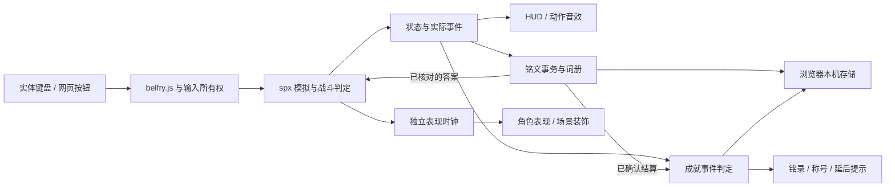

# 倒悬钟城技术设计

> v0.10 当前构建入口使用 `belfry-hunt.mjs` / `hunt-init.mjs`，拼接 `HuntCombat.spx` 与 `HuntExpedition.spx`。旧 City/Expedition 机关文件不参与主游戏构建。地图存储 revision 3；8 种敌人、121 常驻克隆；新增护架、压力撤步、单体支援、扑击与审判者 AI。详细协议与调参见 [猎战设计](HUNT_V10.md)。下方旧版机关字段仅用于兼容读写，不代表现行玩法。

v0.8.1，2026-10-25，当前交付包括五区、城市修复、供能选择、铭文与成就。铭文事务见 [实现说明](INSCRIPTION_V07.md)，成就规则见 [钟城铭录](ACHIEVEMENTS_V07.md)，可执行命令见 [运行手册](RUNBOOK.md)。基础关卡参数参见 [v0.4 技术设计](TECHNICAL_DESIGN-v0.4.md)。Node 24.22.1 / pnpm 11.9.0 / spx 3.3.0 / Playwright 1.64.1 保持锁定，无新增运行库。

## 架构与入口

`belfry-level.mjs` 提供唯一关卡数据，`build-belfry.mjs` 导入原图、生成造型/场景和初始化。主循环在 `main.spx`，角色输入、战斗、移动和动画在 `Hero.spx`。所有战斗判定仍在 spx，宿主仅收取遥测、管理 UI/声音/本机记录。

`Assassins.spx` 在构建时合入主场景，提供五类敌人的状态机；`EnemyTell.spx`、`Hazard.spx` 表现起手、动态锁链、近战刀弧与擒拿，`Enemy.spx` 与 `EnemyBlend.spx` 提供姿态与短交叠。所有实体克隆仍在 `initLevel` 完成后由主场景创建。

`public/belfry-audio.js` 管理动作音效、聚焦反馈与播放生命周期，`public/belfry-music.js` 管理三阶段流式配乐；角色语音/对白按用户要求停用。运行入口不导入 `belfry-dialogue.js`、`belfry-director.js`，不加载任何角色语音资源。`public/audio/sfx/` 包含 82 个动作/材质采样及来源清单；制作稿和试音保留在制作资料中。

## 城市环境与叙事

`City.spx` 在构建时合入主场景。`floorActive` 统一决定原钟门与三块新平台是否存在；升降台索引 17、镜桥 18、档案肩台 19，原锚点 / 敌人 / Boss 索引保持稳定。`updateCity(dt)` 只在有效模拟更新中运行，搬运站立乘客后进入 Hero 更新；表现时钟不推动碰撞体。

四个修复标记、cityChoice、cityDepth 随检查点保存，恢复时校验并注入宿主配置。默认值兼容旧存档；普通死亡不重置城市，新局调用 resetCity。CityUI 只发 F/V 输入和读状态，不能通过网页直接写路线。

`belfry-city-art.mjs` 将五个区域背景、配重、风柱、水面、碎镜和机关绘入 spx。`belfry-city.js` 管理非阻塞短笺、纪事、按状态选择的返程与结局；纪事的暂停确认与输入隔离同成就册。资产、阈值和测试夹具边界见 [CITY_V08](CITY_V08.md)。

## 战斗状态机

`attackKind`：0 空闲、1/2/3 地面连段、4 挑空、5/6 空中连段、7 重击。`attackAge/attackWindup/attackDuration` 分离起手和恢复；有效窗口约 0.10 秒；`attackApplied` 保证每次挥击的伤害只结算一次。`attackBuffer` 保存输入意图 0.24 秒，进入可衔接时间才执行。`chainWindow` 0.8 秒。

三段时长 0.23/0.25/0.52 秒，起手 0.07/0.08/0.14；挑空 0.33、空中 0.28；重击起手 0.16，总时长 0.62。普通攻击间隔 0.28 秒，第三击恢复为 0.52 秒。L 蓄力 0.55 秒增强至 3 伤害。轻击有效帧之后可取消进跳跃、钩索或冲刺；重击恢复不接受普通位移取消。四技能无时间冷却；Q 在第一击前请求辨义，答对后执行整套五击，可取消普通动作，但不能覆盖正在执行的重斩、回血或五连斩；封脉擒拿期间所有动作入口均被阻断。

`attackTime` 只用于有效窗口/弹反。断弦额外窗口必须单独衰减，不能因 `attackKind==0` 而永远保留。受伤、重开与续关调用统一清理，取消攻击、蓄力和待输入。

敌人有独立偏移、速度、硬直、被掷出时间。挑空给轻敌向上速度，空中追击维持双方悬空；重击给横向冲击，近距离碰到其他敌人造成碰撞伤害。地面敌人使用平台支撑、追踪步进、重力和收势阻尼，取消出生点弹簧复位；悬刃单独使用悬停平衡，壁弓在固定壁龛范围回撤。Boss 不接受位移。

## 敌人与练习

种类：0 悬刃、1 短锋、2 壁弓、3 守心者、4 缚索、5 封脉。生命 3/4/3/16或20/5/4。状态 0 观察/位移、1 起手、2 收招、3 执行、4 擒拿、5 身法；`enemyClock` 按状态重置。

`canEnemyAttack` 统一限制两个攻击槽、一个近身控制槽和镜头内起手；状态 5 身法也占名额。锁向发生在起手的最后 0.22 秒。普通敌人受击进入收势，危险判定同步取消。短锋三段分别有独立有效窗口，未进入连段范围则中止。

`chainOwner/chainTime` 表示可解除牵引，向目标施加速度而非瞬移；近身、斩击、永久锚点、超距和超时都释放。`bindEnemy/bindTime/bindX/bindY` 表示不可提前解除的 0.7 秒擒拿。Hero.update 在所有输入与攻击更新前检查擒拿，同时采样按键边沿，避免解除后播放积压技能。`controlGrace` 0.4 秒同时保护伤害与新起手；纯动作 `controlImmune` 为 2 秒，封脉铭文结算后为 10 模拟秒。暂停通过主循环冻结；重开/续关统一清理。

Bolt 使用每帧旧位置到新位置的线段距离检测，降低快箭穿透；与普通平台和边墙碰撞后短暂钉住。地面/控制伤害均走 `hurt`，集中处理擒拿保护。

公开排练场 `practiceKind` 0–4 单类、5 组合；数字 1–6 与可点击选择器等价。20 生命、死亡后三秒重生，R 恢复完整关卡。排练平台用 `800.0/1983` 显式浮点缩放，避免整数除法导致视觉消失。

五套透明原图均保存在仓库。构建以 alpha 连通区域切出六个姿势，同图集固定比例，脚底注册在 366/384 像素。渲染提供 65 毫秒交叠；交叠克隆计入现有 FX 预算。没有骨骼动画依赖。

## v0.6.1 身法实现

`enemyFromX/Y`、`enemyMoveX/Y`、`enemyMoveTime`、`enemyMoveArc` 保存起步时的位置、目标、时长和弧高。状态 5 使用 smoothstep 水平插值和正弦抛物弧近似，持续更新真实碰撞坐标；受击转收势即终止轨迹，地面目标夹在原支撑平台内。不是闪现、无敌状态或按键预判。恢复/重开统一重置这些字段。

- 悬刃：第一刀后 0.12 秒开始 0.32 秒掠身，横移 155、升高 28、弧高 46；新方向起手 0.34 秒（旅人另加 0.1）后追刀。
- 短锋：隔轮先后撤 88 单位/0.28 秒，再准备 0.62 秒（旅人另加 0.1）。起手前 0.32 秒的架势可格挡一次正面、近身、同高度的 1 点攻击；2 点以上破架，背面与收招不格挡。飞踢位移 180/0.42 秒，弧高 60，有效帧 0.14–0.36；0.70–0.87 低扫，随后 1.15 秒恢复。Boss 共用身法与姿势，保留原双钟锁与护甲规则。
- 壁弓：隔轮蹬墙，0.88 秒正弦轨迹偏离壁龛 145、升高 82；0.30 秒射箭，方向仍指向起手锁定的位置；受击会中断回程而进入正常硬直恢复。
- 缚索：隔轮低扫（范围 220、有效 0.12–0.34、玩家脚底离地 22 可避），0.64 秒后重新预警并抛链。抛链、牵引、解除沿用原规则。
- 封脉：隔轮向玩家起步时的另一侧 90 单位处移动，时长 0.42 秒/弧高 24；重新起手 0.62 秒（旅人另加 0.1）再突进。擒拿与释放保护参数保持原值。

`enemyCycle` 在起手时递增，使中断后的下一轮也能切换战术。本次冻结的集成基线从基础轮开始，初始化、死亡续关与返程启用都由 clearEnemyMotion 统一处理；另一个聊天后续提出的深层敌人进阶首招与新攻击特效未合入本次版本。短锋原三段仍在目标离开衔接范围时中止。身法残影复用 EnemyBlend 的静态模式：保存出生坐标、0.18 秒淡出、最短生成间隔 0.065 秒、计入 FX 上限；暂停、受击停顿与局次变更统一处理。常规换姿仍为 0.065 秒交叠。

新增三张透明图集十个姿势，总计 42 个敌人关键姿势。仍是关键图像加运动轨迹，未加入骨骼动画或复杂寻路。

## 声音（角色语音停用）

单个 AudioContext，音效 / 背景音乐与独立危险预警总线，经 master 和压缩器输出。危险预警跟随音效音量。动作采样包含刀风、衣料、绳索、瓷裂和干燥接触声；聚焦保留低音量气流。音乐使用单个 HTMLAudioElement，经 MediaElementAudioSourceNode 接入音乐总线，不进入短采样缓存。采样按实际挥击/接触事件播放，普通挥空不追加材质命中。

只读取/保存 `belfry-audio-v2` 中的 `sfx`、`music`。旧 `voice/chatter/subtitles` 字段被忽略；界面已无对白、说话者或字幕控件。战绩继续使用 `easyrun-belfry-v1`。

暂停、失败、重试、隐藏和静音调用 `stopAll()`，停止短音效活动源并递增 epoch。歌曲有独立生命周期：阶段切换淡出旧曲再淡入新曲，暂停 / 隐藏 / 静音保留位置；铭文阶段播放同一游戏曲，保持正常音量；聚焦过程不修改音乐增益，只有明确暂停 / 静音 / 隐藏会暂停歌曲。完整映射、异常重试与 Range 服务见 [场景音乐](SCENE_MUSIC.md)。异步解码完成后复核 epoch、游戏阶段、页面可见性和事件时效，旧音效不能复活。单个资源解码失败记录在诊断中，不阻塞游戏。没有 TTS 或对话服务的运行时依赖。

钟鼓移除修订：`BelfryAudio.air` 复用两秒噪声缓冲，经低 Q 带通和缓慢包络输出，不创建音调振荡器；停止、暂停、静音和题目结束继续清理相应声音。检查点 / 回声 / 夺心 / 通关不再追加钟鸣。`brass` 保留旧事件 ID，但采样已改为干燥接触；heavy / land / nova、重斩 / 终式与裂印去掉低音鼓层，回血完成去掉铃音。生成器、母版和运行采样同步更新。

## 遥测与测试

`@state` 追加战斗参数、bindTime、controlImmune、controlGrace、chainOwner、chainTime、attackSlots、practiceKind。`@foe` 输出附近敌人的位置/生命/模式/预警/危险/硬直/时钟；`@enemyEvent` 传递类型和事件，支持材质音与攻击预警。宿主 `latestState/foes/soundDiagnostics` 是观察接口，测试不反写引擎。

```sh
bash scripts/with-env.sh pnpm game:build
bash scripts/with-env.sh pnpm game:lint
bash scripts/with-env.sh pnpm game:test
bash scripts/with-env.sh pnpm game:package
```

统一测试先运行词汇 / 成就规则，再执行战斗、敌人、身法、技能、箭术、铭文 / 恢复 / 动效、成就浏览器流程、生命周期、两档完整路线、旧风机与动作生命周期。测试服务使用独立随机端口。共享依赖工作树可用 [运行手册](RUNBOOK.md) 中的 Node 直调方式，避免 pnpm 自动修复依赖目录。

## 输出边界

`.xbp` 含 spx 核心、敌人、动作和美术。HTML HUD、动作音效、背景音乐、设置与存储属于配套网页；没有声称这些能力随 XBuilder 包独立运行。实际入口为本地 `/` 或 `/belfry.html`。生成图集是关键姿态图片动画，不是骨骼动画。

## v0.7 铭文与四技能集成

当前技能、资源与输入以 PRD v0.8.1 为准，旧版断弦能量描述为历史。四技能与刺客共享同一 Hero/碰撞/敌人列表；新增 phase 5 作为模拟冻结阶段。战斗请求在本帧判定之后确认，网页题目只返回结果，具体伤害、退款和解控仍由 spx 执行。

宿主由 `inscription-core.js` 与 `inscription-ui.js` 分工；词条静态导入并在开场加载。模块加载失败时明确回退到纯动作。内部按键适配与 `session/epoch/attempt/serial` 去重、输入所有权、故障恢复详见 INSCRIPTION_V07.md。页面持久化每三秒及生命周期节点批量写入，不按字母重建词册或保存。

浏览器存储 `easyrun-inscription-v1` 与原战绩键分开，包含内容版本、设置、30 词种子、词汇状态、已提交事务和检查点。恢复使用已保存难度与检查点重建；不持久化引擎对象、精灵引用或渲染缓冲。

终式挥刀事件为 `swordcut`，仍使用 chaincut 材质采样；敌人断链继续为 `chaincut`，避免提示/音效串台。铭文结束收到实际释放事件即恢复音频状态，不等待下一条定期遥测。当前全包 82 个音效，角色语音保持关闭。

## 当前宿主与引擎数据流



`public/belfry.js` 负责启动 iframe、加载构建清单、解析事件、HUD 与模块接线；`inscription-core.js` 管理词池和持久化事务，`inscription-ui.js` 接管作答输入，`inscription-motion.js` 绘制独立局部表现。`belfry-achievements-core.js` 是可单测的成就规则，`belfry-achievements.js` 管理册页、称号和提示；两个系统共享已确认事件，不相互修改伤害。

| phase | 状态            | 模拟与输入边界                                                 |
| ----- | --------------- | -------------------------------------------------------------- |
| 0     | 标题            | 选择难度 / 词组、查看词册 / 成就、开始或续档                   |
| 1     | 冒险 / 排练运行 | 正常物理、战斗和动作输入                                       |
| 2     | 通关            | 结果、实际词汇确认、成就结果；不要求 30/30                     |
| 3     | 失败            | 检查点继续或重开                                               |
| 4     | 普通暂停        | 模拟冻结；打开成就册可复用此阶段并记住暂停归属                 |
| 5     | 铭文聚焦        | 冻结全部战斗；只有独立表现和前台题目时钟运行，题内暂停再停表现 |

## 表现时钟与声音交接

主循环的 `visualTime` 与 `wordVisualRate` 不参与碰撞、伤害或冷却。目标速率在 phase 5 为 0.28，其他运行阶段为 1；以指数阻尼渐变。`presentationDelta` 在普通暂停或铭文暂停时为零。装饰、角色姿态、绳索摆动和余影使用表现时间，游戏逻辑仍用原模拟时间。

网页聚焦推镜最大 1.035 倍，在约 0.42 秒内进入，带入有界的运动惯性；固定 24 条尘迹与最多 8 枚字母余迹，减少运动偏好关闭推镜和网页粒子。成功 / 失败的提示淡出不拥有输入，不能延迟技能释放。

`resolveWord` 仅提交当前题目对应的技能结果；`beginWord` 校验通过后创建本次词汇事务，不读取或消耗免题额度。已移除 `wordFlowTime` / `wordFlowCharges`、`wordflow` 事件和对应 HUD；引擎 `@state` 与宿主字段数组同步缩减，保持后续表现时钟字段对齐。裂印不再绕过断潮刻印；短蓄与满蓄均通过 `requestWord`。Q 的 `nova` 只准备待释放状态，正确答案才调用 `releaseUltimate` 并发送 `chainstart`，未授权前不产生任一段伤害、释放特效或大招无敌。

声音在进入聚焦时短淡出并使用无音高的滤波气流 / 输入摩擦声；引擎释放事件可能先于定期状态到达，因此适配器暂存本次有效动作声，待匹配的恢复确认后播放。取消、重开清理队列和 epoch，不能把旧声音带到下一局。

## v0.8.1 技能失败与无冷却契约

`applyInscription` 是统一释放出口。弓与剑失败调用 `cancelAttack`；回血失败清除引导并返还本次余烬一次；大招失败清除时间、段数和有效窗口。选错、首个错误字母、超时、放弃均走失败出口，不生成普通箭、基础重斩或残留终式。原来的 `session/epoch/attempt/serial` 身份校验、重复结果拒绝和重开取消继续生效。

`updateInput` 按大小写归一后的正确前缀校验：一旦不匹配立即失败，完整匹配自动成功。按键隔离只隔离仍按住的旧键，新按键可以立即接动作；结果余影不阻塞输入。输入法合成、暂停和后台仍暂停题目。

删除四技能冷却检查、赋值和衰减；`bowCool/bladeCool/healCool/ultimateCool` 遥测字段保留为零，避免破坏既有字段位置和观察接口。HUD 改为待刻印、蓄力、释放状态或资源条件。普攻、冲刺、钩索计时与动作恢复不变。成功后的短蓄保持短蓄伤害，满蓄与裂印增伤仍由真实命中决定。

## 成就事件与输入保护

`@deed` 格式为 `serial name attempt phase practice health difficulty deaths echoes hook`。只有有意义的实际事件才发送快照；序号单调递增，避免使用滞后约 70 毫秒的 HUD 推断回血前生命、模式或尝试。落地新增 `touchdown` 信号，用于结束连续换钩，不改变落地运动或声音。

规则层拒绝重复序号、旧尝试和排练事件。新冒险、检查点重试与续档分别重建临时挑战状态；无伤条件要求 fresh、已取得钟心、未伤 / 未死亡，重试或续档明确取消资格。词汇事件仅在 `InscriptionBook.settle` 返回成功且当前行动身份匹配后送入成就规则，词 ID 与 actionId 分别用于独词计数和结算去重。

成就册使用原生 dialog，Tab 保持在册页内；开关时释放 / 隔离此前按住的键。册页触发的内部暂停 / 恢复事件带 `inscriptionTransport` 标记，避免自身 Esc 被物理按键隔离拦截。只恢复由册页暂停的游戏；原本已暂停的不恢复。词库模块失败的纯动作回退也保留按键释放机制。

通知队列有 15 项的自然上界，使用现有状态接收而不增加 rAF；仅在可见且可展示的阶段累计 2.7 秒。规则或称号变化时才写存储。成就模块加载失败不阻止冒险，本地存储失败保留内存记录并提供导出。

## 本机数据与模块边界

| 键 / 模块                        | 数据                                         | 不保存什么                     |
| -------------------------------- | -------------------------------------------- | ------------------------------ |
| `easyrun-belfry-v1`              | 战绩                                         | 完整引擎快照                   |
| `easyrun-inscription-v1`         | 内容版本、设置、词池、事务、历史、检查点     | 精灵对象、半段技能             |
| `easyrun-belfry-achievements-v1` | version、progress、unlocked、words、equipped | 云账号、服务器成绩、防作弊凭据 |
| `belfry-audio-v2`                | sfx、music                                   | 已停用的角色语音偏好           |

`window.latestState`、`inscriptionDiagnostics`、`achievementDiagnostics` 和 `soundDiagnostics` 用于观察与测试，不是公开的网络 API。浏览器按 origin 隔离这些存储；单个 `.xbp` 不提供宿主 UI、这些记录或网页音频。当前实现没有账号 / 云同步、在线 AI、付费或遥测上报服务。
