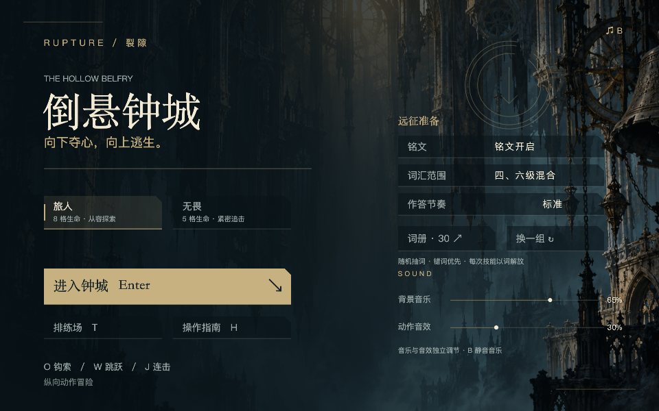
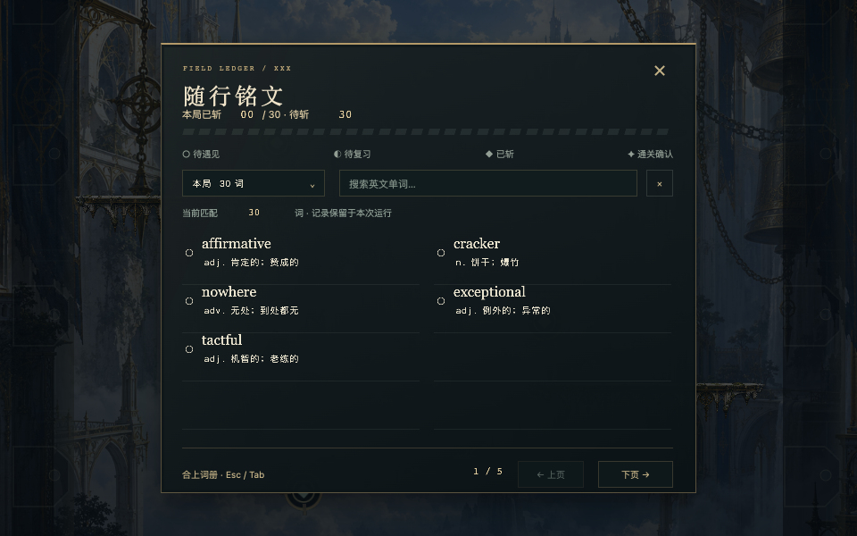
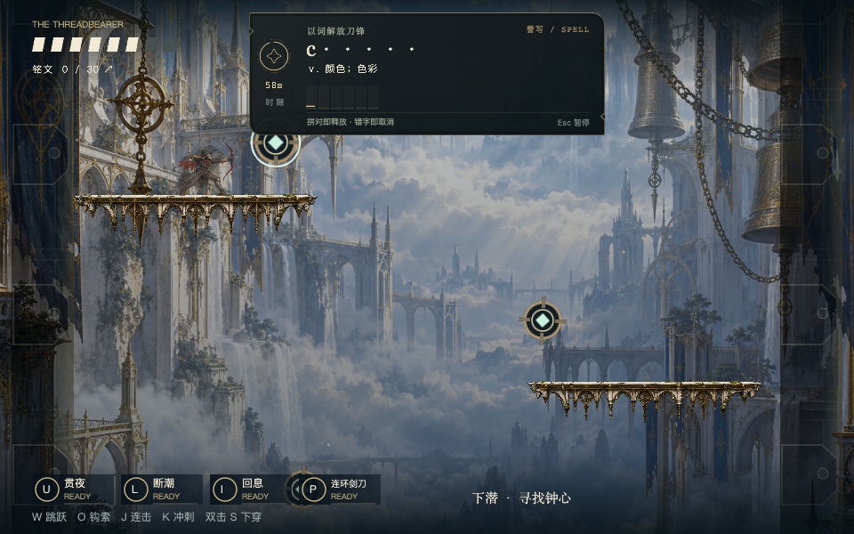
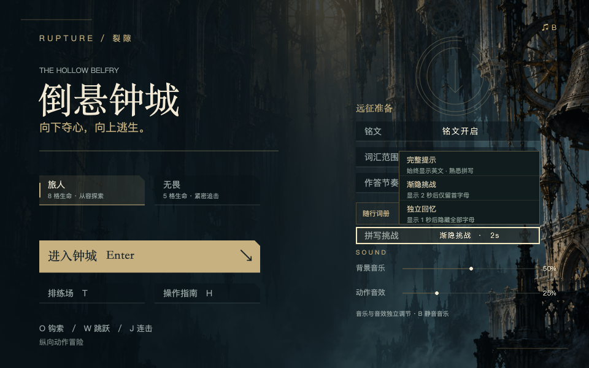
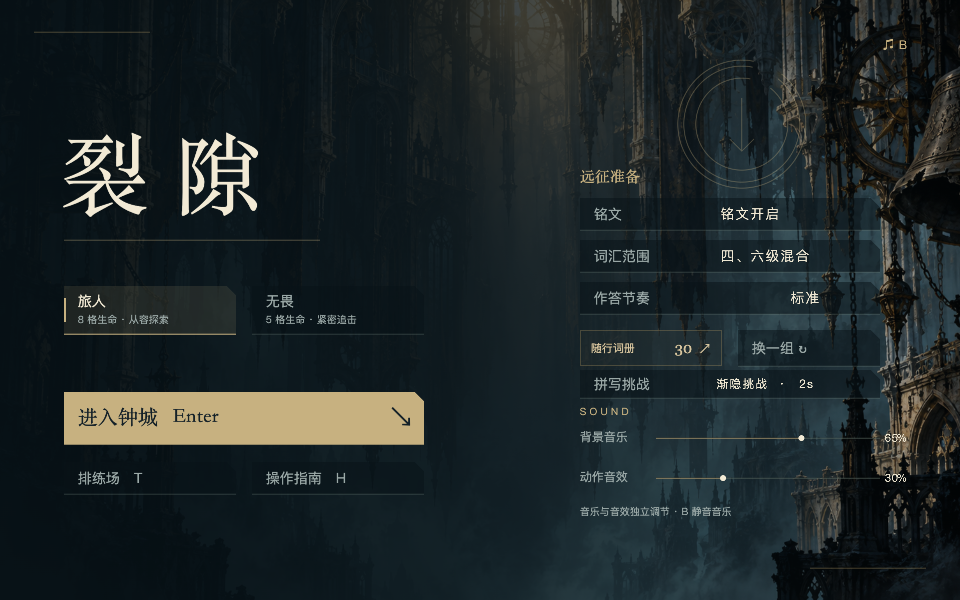
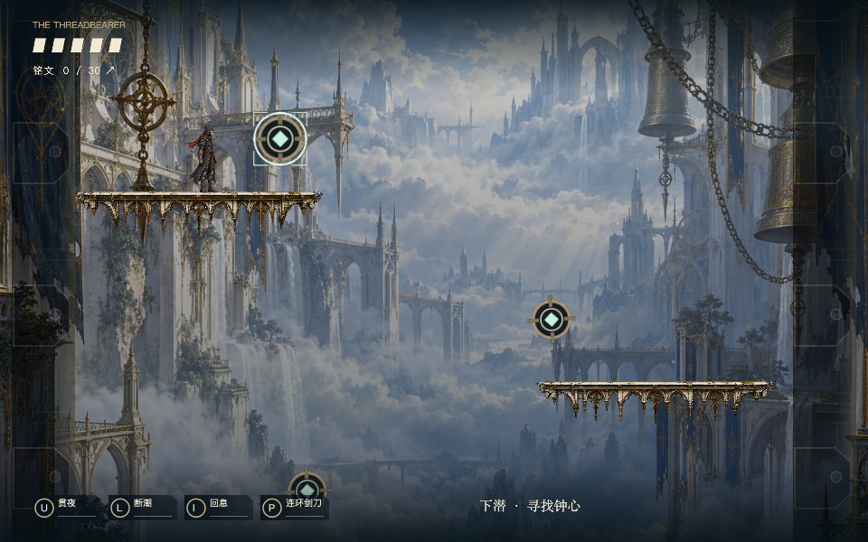
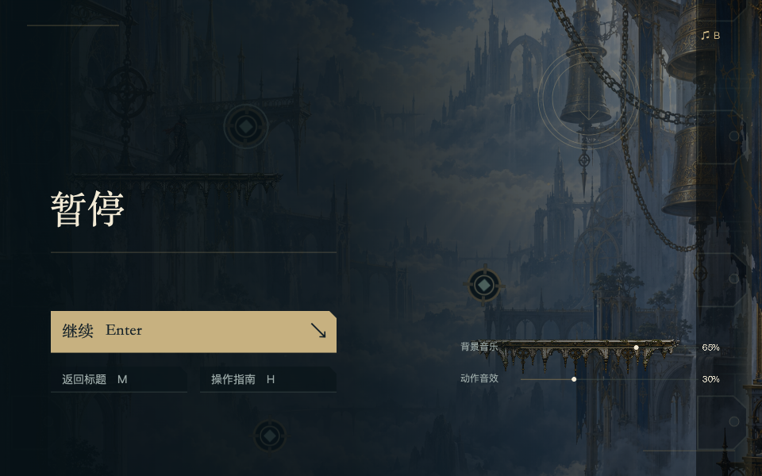

# XBuilder 原生导入版 · v0.15.2

本版交换开始菜单与游戏音乐：开始菜单播放 Cleaning out the Rooms (Wandering Horn)，游戏 / 排练播放 Melancholy Of The Boot，结束仍为 Strange Sports。沿用默认音乐 40%、动作 85% 的混音及上一版功能。所有功能在 `.xbp` 内独立运行，不需要网页宿主；继续本地交付，不推送 GitHub。性能实测及边界见 [v0.15 说明](PERFORMANCE_V15.md)。

## 导入与游玩

1. 在 XBuilder 的项目菜单选择「导入项目文件」，选择 `EasyRun-XBuilder-v0.15.2-music-swap.xbp`。建议新建导入，保留原工程。
2. 点击运行后停留标题。左侧选旅人 / 无畏；右侧可切换铭文开关、四级 / 六级 / 混合词库、标准 / 紧凑 / 从容节奏，以及独立的拼写提示难度。
3. 「随行词册 30 ↗」预览本次 30 个不重复词条，双列分页；「换一组」重新抽取。点击进入钟城或 Enter 使用当前预览词册。新远征生成新词册，检查点重试保留当前词册。
4. U 蓄箭、L 蓄刀、I 治疗、P 连环剑刀进入原有铭文关口；链条和束缚解救也接入。拼写用字母键输入，正确的完整单词立即自动释放技能，不用按 Enter；第一处错误字母立即取消技能前摇，不能在错误发生后用 Backspace 挽回。正确前缀可用 Backspace 删除，输入未完成时 Enter 不结束题目；辨义用 1 / 2 / 3。输入大小写统一，支持词库中的有效拼写变体。
5. 答对调用现有技能释放逻辑；错误或超时取消技能。成功技能冷却为 3 / 3 / 3 / 5 秒，取消不消耗冷却。普通攻击、移动、钩索及排练不出题。
6. Esc 暂停题目 / 继续；题目期间 R/T/M/H/B 等是拼写输入，不会重开、切页或静音。正常游戏 H 打开指南，Esc 暂停，暂停后 M 回标题。
7. 开始 / 暂停 / 结算菜单可拖动背景音乐与动作音效的独立滑条，范围 0–100%。默认音乐 40%、动作 85%；B 是背景音乐快速静音，保留原设定值。

开始、游戏、结算分别循环原来的三首完整 Sea Power 曲目。正常答题不降低背景音乐；明确暂停时同步暂停音乐，并压低动作通道至静音。原生动作采样来自项目已有的挥刀、弓箭、钩索、冲刺、治疗等 16 个音效，保持无角色语音，不加入钟鼓层。网页使用相同的 40% / 85% 默认混音；恰好匹配旧默认组合（音乐 65%、动作 30%）的保存值自动迁移一次，自定义音量和静音偏好保留。

## 词册与记忆的范围

- 复用当前固定版本的 **8,815 条词库**，包含词性对应中文释义、两项干扰义、有效拼写变体和 CET 分类。范围与来源见 [WORD_BANK](WORD_BANK.md)，该数字不是官方大纲单独列出的词目数。词源说明与 ECDICT MIT 许可同时随 `.xbp` 分发。
- 每次抽样在 4 个随机候选中优先选当前运行中更常错的词，排除已抽取词和不符合范围的词；失败权重增加 2，最高 8，成功减少 1。属于轻量的运行内错词优先，未移植网页的跨日复习算法。
- 一题答对将对应词标记为本次已解；失败不会增加进度。仍有多个未完成词时先换词，再回到错词；最后仅剩一个未完成词时继续挑战该词。30 词全部完成后仍可继续作答释放技能，完成数不超过 30。
- 拼写标准时间为 `max(9, 字母数 × 0.65 + 4)` 秒，辨义 9 秒；紧凑乘 0.8、从容乘 1.35。沿用现有战斗冻结 / 表现缓慢过渡机制，碰撞和伤害不会在答题期间累积。
- **错词权重、词册与音量仅保留于本次 XBuilder 运行会话**。返回标题保留错词权重和音量；点击网站「重新运行」、刷新或关闭页面后重置。网页 IndexedDB 历史、跨日复习、成就和导入导出仍只在网页提供。没有新增账号或云存储。

## 拼写挑战 · v0.14.0

「拼写挑战」与词汇范围、答题节奏分别设置，默认渐隐挑战：

| 难度 | 英文提示 | 中文释义 |
| --- | --- | --- |
| 完整提示 | 整题保持完整单词 | 始终显示词性与完整中文 |
| 渐隐挑战 | 先完整显示 2 秒，之后只留首字母；空格、连字符保留 | 始终显示 |
| 独立回忆 | 先完整显示 1 秒，之后全部字母变为点；空格、连字符保留 | 始终显示 |

计时从题目实际打开开始，不从按技能键开始。提示展示时间包含在原来的作答时限内；暂停同时冻结作答和提示渐隐计时，恢复不重新展示已经隐藏的答案。辨义题仍显示完整英文题词。

每次输入同时检查主拼写和词库中有效变体的前缀；完整匹配立即成功，所有候选前缀都不匹配则立即失败。输入槽跟随有效变体长度，避免 colour / color 被误判。U / L / I / P 共用一条结算路径，错字不产出本次技能释放、不消耗冷却；治疗返还本次资源，终极取消尚未释放的最后两击，之前已经发生的动作不回滚。题目结束仍按住的答题键必须松开后才能恢复对应游戏控制，防止 W 跳跃、R 重开等延迟误触；其他已松开的控制正常可用。

## 随行词册 · v0.13.2

点击标题页「随行词册」或游戏内铭文进度打开，也可按 Tab。战斗中打开会暂停，Esc / Tab 合上后继续；从暂停页或结算页打开则返回原状态。答题时 Tab 不打开词册，不提供额外查词通道。

600×504 的居中面板复用网页 `.word-ledger-page` 的底色、标题与细线。上方是已斩 / 待斩数量与 30 枚逐词刻度，下方为双列单词、词性和完整中文释义；状态按当前记录显示 ○ 待遇见、◐ 待复习、◆ 已斩、✦ 通关确认。

范围选择为真正的下拉列表：本局 30 词、薄弱 / 宿敌词、完整词库。后两者遵守标题页选择的四级 / 六级 / 混合范围。搜索支持英文子串，键入即过滤；Backspace 删除，右侧 × 清空。键入 R/T/B/H/F/V/M 不会重开、切换排练或静音。预览、筛选、搜索与翻页均不改变本局词册，不增加已斩数量。

分页每页最多 8 词，预留标题 / 查询字符后按完整词条字数组织页面；避免原生字形占满 300 克隆预算。不会用省略号丢弃定义，也不会漏词或重复词。刻度用 10 个原始精灵，每个显示 3 枚状态，以 27 种小造型组合表示，无新增刻度克隆。

与网页版的边界：原生采用分页，搜索仅支持英文；错词权重和进度仍限本次运行。网页跨日学习历史、中文搜索、文件导入导出和账号能力未迁移，不显示对应的不可用控件。

## 界面与实现

开始页左侧用「裂隙」两字呈现标题，保留难度和主行动，右侧集中远征设置与声音。使用现有钟城原画、暗金细线、切角和低对比底板；界面图与点击区域共用一组矩形，点击动态字形也会转发给同一命中逻辑。

技能栏每枚 **76×28**，相较上一版 92×34 面积缩小约 32%；保留按键、技能名、恢复环与 0.1 秒剩余倒计时，就绪时仅显示细金线，不再显示 READY。四枚卡间距 8，靠左下排列，底部操作提示已移除，键位说明集中在指南页。题目位于上方：拼写 **400×138**，辨义 **400×148**（960×600 逻辑尺寸，面积分别缩小约 25% / 31%）。复用网页黄铜细边、断环倒计时、Georgia 英文题词与三列辨义卡；保留主体战场，不恢复游戏中此前隐藏的指南 / 暂停 / 音乐大按钮。

`NativeWords.spx` 管理抽词、题目、输入、结果与运行内权重，复用 `Inscription.spx` 的效果结算。`build-belfry-native-lexicon.mjs` 生成原生词库和 约 3,350 个小尺寸 PNG 字形造型（含英文衬线、等宽输入和错字颜色变体），按需创建 / 回收、不超过 160 个字形实例，不为每个单词生成一张大图；不依赖运行设备的中文字体、DOM 或外部词典服务。场景 SVG 继续沿用下文的预渲染兼容修复。

声音采用舞台背景音乐和独立 `NativeSfx` 精灵通道；v0.15.1 取消原先额外的 0.55 倍动作衰减，由动作滑条直接控制通道音量，音效事件最短间隔仍为 45ms。原有 M4A 在打包时转为单声道 22.05kHz PCM WAV，转码前校验来源哈希，清单写入 `native-sfx-manifest.json`；三首 MP3 不转码、不裁剪。spx 3.3.0 的音量 API 将 0 钳制为 1%，因此 0% 用暂停背景轨、停止并禁止动作采样来实现真正静音，重新调大时恢复原曲位置。依据：[运行库音频管理源码](https://github.com/goplus/spx/blob/v3.3.0/internal/audio/manager.go)。

### 战斗铭文样式与本次修订

`build-belfry-native-style.mjs` 直接复用 `belfry.css` / `inscription.css`，仅覆写固定舞台位置和原生文本占位。构建时生成透明 2x PNG，导出包不需要 DOM、外链字体或运行期浏览器截图。本次仅增加标题右侧拼写挑战设置，既有技能 HUD 不变。

- 拼写提示、中文释义、等宽字槽分三层排布；有效输入为浅金色。错字当即取消并在战场反馈正确单词与释义，不保留继续作答的红字状态。
- 英文词题按实际字宽排版，超宽时缩小字号；三列词义每项最多 28 字、最多四行，不省略用于判断的尾部释义。
- 断环和秒数同步剩余时间；最后四分之一变为铜红色。160ms 轻位移入场不会改变既有 180ms 输入隔离和战斗时钟规则。
- 暂停展示独立说明并保留输入，恢复后继续答题。技能冷却及音量规则不变，判题更新为实时校验。
- 字形按需创建 / 回收，最多 160 个；输入槽只增加一个原始精灵，不增加按字母的背景克隆。

## v0.12.1 镜头纠偏

编辑器在切换选中的精灵时会更新 `cameraFollowSpriteId`（见本地参考源码 `StageViewer.vue` 的选择监听）。截图中的左半黑屏可以通过让编辑器保存 `camera.on:"Anchor"` 精确复现：镜头被跟随逻辑拉回 (0, 0)，而关卡设计中心是 x=480。`Camera.setXYpos` 只设置位置，不会解除已有跟随；上一版仅验证空跟随配置，遗漏了这一情形。

现在 `fitViewport` 先调用 `Camera.changeXYpos 0,0` 清除跟随目标，再应用游戏自己的 `cameraRenderX / cameraRenderY`。每帧执行，运行中恢复错误跟随也能自动纠正。角色、平台、美术资源不需要平移来掩盖镜头错误。游戏 / 排练中的指南、暂停、音乐按钮及点击热区已经移除，相关快捷键仍有效。

已使用网站部署的项目模型和编译组件，在本机完成实际 `.xbp` 的导入—导出—编译运行检查；不访问账号令牌，不上传或改写在线项目。复现条件是测试主动设置的跟随目标，未读取用户在线工程当前保存的 camera 配置。

高分屏对照测试还暴露了运行时 SVG 渲染问题：480×360 的运行配置在 1125×844、DPR=2 的画布冷启动时发生 Godot WASM 堆栈错误；同配置的最小工程可启动，完整游戏将 SVG 转为 PNG 后也能启动。缩短装饰柱、关闭镜头适配、切换 stretchMode 均未解决，因此没有保留这些试探性改动。

导出构建现在把 **69 个 SVG 造型**按设计尺寸预渲染为 PNG，保留 pivot、bitmapResolution 与精灵比例，替换造型引用并移除包内旧 SVG。网页继续用原始 SVG，源码美术不变。资源尺寸验证限制为 4096 像素，遇到超限或无法解码会停止打包，保留上一份可用导出包。

## 窗口适配的原因与实现

XBuilder 项目模型读取时忽略传入的 `run` 尺寸，保存 / 运行时采用固定的 480×360 视口；因此只把 JSON 改成 960×600 无法解决导入后的裁切。[官方项目模型源码](https://github.com/goplus/builder/blob/dev/spx-gui/src/models/spx/project.ts)

本游戏仍以 960×600 为设计范围，适配分为三步：

- 导出 `stretchMode:false`，关闭引擎对不同比例窗口的非等比拉伸；该额外舞台配置由编辑器项目模型保留。
- 公共 `Viewport.spx` 读取 `Camera.viewportRect` 和当前缩放，按宽高约束中的较小值调整镜头。既适配导入后的 480×360，也适配网页原有的 960×600 配置；每帧检查可响应运行中的窗口变化。
- 原生界面跟随实际镜头中心，不以人物坐标代替屏幕坐标。四个深色遮罩覆盖设计区域之外的空间，不裁掉设计区域内的平台、角色或菜单。UI 图片与点击区域使用同一组布局数据。

横竖比例不同时会留边，这是保持人物比例和完整视野的选择。窄窗口的菜单与战斗画面整体变小；本轮不提供手机触控操作。线上网站的顶栏、侧栏和播放器外框由 XBuilder 控制，工程内只控制自身游戏画面。

## 资源与维护

- `build-belfry-native.mjs` 使用现有钟城美术生成菜单、HUD 与按钮造型；中文在构建时绘成 2 倍分辨率 PNG，运行时不依赖网页字体或 DOM。同时预渲染场景和特效的 SVG 造型，仅改变导出包的图像格式。
- 生成结果放在被忽略的 `projects/belfry-native/`；新增 37 个原始精灵，其中字形使用最多 160 个按需字形实例。菜单、音量、技能恢复环只切换 PNG 造型。字体只分配当前可见字数，战斗通常仅需铭文进度的少量实例；全部 UI 计入 300 克隆预算，文字增长时仅回收超额装饰效果，保留敌人与投射物。
- `NativeShell.spx` 管理菜单与拖动滑条；`NativeBindings.spx` 处理拼写。导出时合并已有 R/T/M/F/V/B/H 快捷键的题中分支，避免同键重复注册吞字；F1/F2/F3 网页答题回调从原生包移除，不能用它们绕过判题。
- `NativeMusic.spx` 保持原有三阶段背景音乐。网页继续使用自己的菜单与播放器，不叠加导出版界面。
- `package.py` 构建原生 UI，合并字段和方法，加入原生资源和音乐，再验证包内每个文件。

```sh
# 从仓库根目录执行
bash scripts/with-env.sh node prototypes/runlab/build-belfry.mjs
python3 prototypes/runlab/package.py --game belfry

# 先启动本地服务，再运行菜单与窗口专项
RUNLAB_URL='http://127.0.0.1:4184/' bash scripts/with-env.sh node prototypes/runlab/test-belfry-native-shell.mjs
```

输出为 `prototypes/runlab/exports/belfry.xbp`。本次桌面交付为 `EasyRun-XBuilder-v0.15.2-music-swap.xbp`；文件数、大小与 SHA-256 见最新验收 JSON。新打包步骤使用项目锁定的 Node / Playwright 与本机 ffmpeg；Python 负责 ZIP，不再是单纯复制已生成文件。菜单使用本机字体栅格化，当前验收环境为 macOS；其他系统重建字体外观仍需复核，已经交付的 PNG 不受导入机器字体影响。

## 验证范围

v0.15.2 重新通过网页 16 项和实际原生包 13 项音频检查；两首完整 MP3 按字节精确互换，所有其它游戏文件不变，见 [选曲互换验收](evidence/2026-10-27-music-swap/README.md)。

v0.15.1 通过网页 16 项与原生音频 13 项检查；原生测试读取真实引擎输出，验证默认混音、音效峰值随音量变化、混合采样不满幅、两通道静音隔离和音乐生命周期。见 [本轮混音验收](evidence/2026-10-27-audio-balance/README.md)。

v0.15.0 重新运行 77 项：衣料动画 4、原生单词 23、原生菜单 / 窗口 15、共享网页场景 35，全部通过。另对实际旧 / 新包做固定词册的五段性能采样；词册帧间隔下降，密集战斗仍有长帧。完整数字和测试条件见 [本轮风动与性能验收](evidence/2026-10-27-idle-performance/README.md)。

v0.14.1 对最终包重跑菜单/窗口 15 项，全部通过，另检查四处精简后的画面；实际包变更范围已按文件哈希核对。见 [本轮界面验收](evidence/2026-10-26-native-minimal-ui/verification.json)。

v0.14.0 重新测试实际交付包，共 38 项通过：单词专项 23 项，菜单/窗口专项 15 项。覆盖本次新增的中文、提示难度、逐字自动校验、四种技能首错取消和按键释放隔离，保留词册、镜头、缩放和高分屏回归。见 [本次验收](evidence/2026-10-26-native-spelling/verification.json)。

v0.13.2 新增词册完整翻页、范围下拉、搜索隔离、错词 / 完成状态、暂停恢复、小窗口及高分屏验证，结果见 [随行词册验收](evidence/2026-10-26-native-ledger/verification.json)。

v0.13.1 使用网站部署的编译器 / 项目模型执行实际包测试，最新报告、长释义与小窗口截图见 [战斗铭文验收](evidence/2026-10-26-native-word-style/verification.json)。

专项从实际交付包解压运行，覆盖菜单生命周期、帮助页输入隔离、480×360 / 1280×720 / 1440×600 / 600×900 / 960×600 的连续变化、完整视野与点击映射；另用 960×600 的 run 配置验证无硬编码半倍缩放。胜利 / 失败页通过仅测试使用的阶段快捷键进入，不冒充整关通关。

v0.13.0 的实际包测试、截图和哈希见 [本次验收](evidence/2026-10-26-native-inscription/verification.json)。单词专项命令为 `RUNLAB_URL=http://127.0.0.1:4177/ bash scripts/with-env.sh node prototypes/runlab/test-belfry-native-words.mjs`。

v0.12.1 历史验证见 [镜头纠偏记录](evidence/2026-10-26-native-camera/verification.json)。v0.12.0 的 [53 项检查](evidence/2026-10-26-native-shell/verification.json) 保留为历史记录。网站模型 / 运行组件的本机测试不等同于用户账号内工程保存验收，未改写线上项目；深层位置和结算页面使用明确标注的测试夹具，不冒充完整通关。

网站组件复测（已下载的官方运行组件目录和部署模型 URL 必须匹配）：

```sh
XBUILDER_RUNTIME_DIR=.cache/xbuilder-online-20261026 \
XBUILDER_MODEL_URL=https://x.qiniu.com/assets/img-rendering-CIpDEpA1.js \
RUNLAB_URL=http://127.0.0.1:4177/ \
bash scripts/with-env.sh node prototypes/runlab/test-belfry-native-shell.mjs
```

依赖的公开模型模块按固定构建文件名加载；远端撤下该构建时需要重新核对导出名和运行组件，不能默默跳过。






### v0.14.0 当前题面






### v0.14.1 精简后的界面






