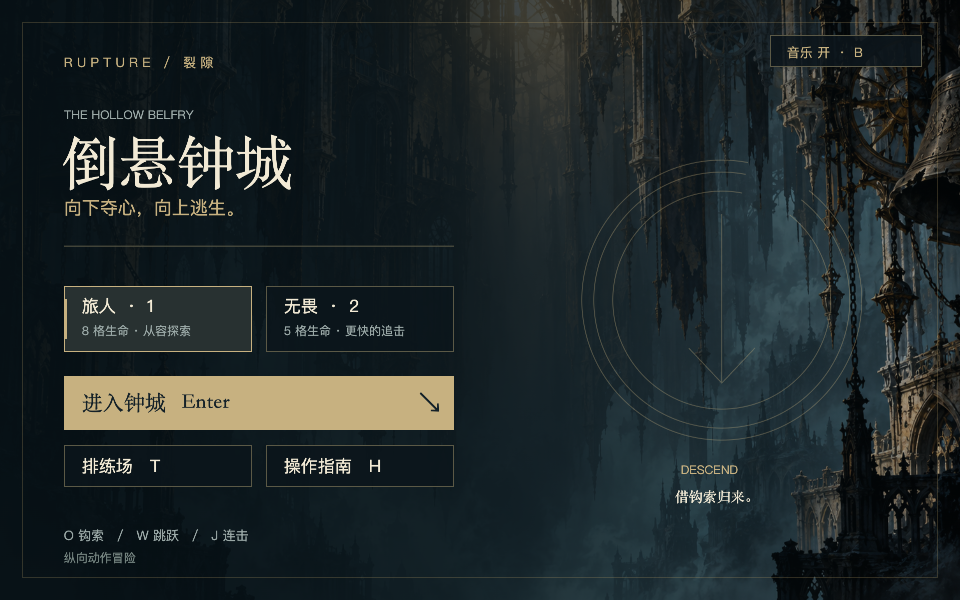

# XBuilder 原生导入版 · v0.12.1

本版继续本地交付，不推送 GitHub。目标是在 XBuilder 中导入后先看见完整的开始菜单，并让整个游戏在预览、宽屏与全屏中完整显示。

## 导入与游玩

1. 在 XBuilder 的项目菜单选择「导入项目文件」，选本轮交付的 `.xbp`。建议导入到一个新项目，保留现有项目。
2. 点击运行后先显示「倒悬钟城」标题界面；加载本身不会开始计时或战斗。
3. 点击「旅人 / 无畏」或按 1 / 2 选难度，再点击「进入钟城」或按 Enter 开始。
4. 点击「排练场」或按 T 练习；H 打开指南，Esc 暂停 / 继续，暂停后 M 返回标题。菜单按钮也可以直接点击。
5. 初次点击允许浏览器播放声音。右上角音乐开关和 B 控制音乐，三首完整录音按开始 / 游戏 / 结束阶段循环。

| 状态 | 界面与行为 |
| --- | --- |
| 标题 | 难度、开始、排练、指南、音乐开关；不消耗战斗时间 |
| 游戏 | 生命、技能就绪 / 剩余冷却、阶段目标；H / Esc / B 使用快捷键，三个大按钮隐藏 |
| 帮助 | 开始 / 重开 / 排练快捷键被隔离；Enter 或 Esc 返回进入帮助前的状态 |
| 暂停 | 停止战斗与音乐，可继续或返回标题 |
| 失败 | 显示失败页，可检查点重试、重新远征或返回标题 |
| 胜利 | 显示结束页，可重新远征或返回标题 |

从排练返回标题会退出排练状态，避免标题页数字键误启动练习敌人。原生导入版提供纯动作玩法；网页的铭文题目、8,815 词自适应词册、成就、本机存储、完整战斗信息面板与音效混音没有在本轮迁移。菜单只显示实际可用的功能。

## v0.12.1 镜头纠偏

编辑器在切换选中的精灵时会更新 `cameraFollowSpriteId`（见本地参考源码 `StageViewer.vue` 的选择监听）。截图中的左半黑屏可以通过让编辑器保存 `camera.on:"Anchor"` 精确复现：镜头被跟随逻辑拉回 (0, 0)，而关卡设计中心是 x=480。`Camera.setXYpos` 只设置位置，不会解除已有跟随；上一版仅验证空跟随配置，遗漏了这一情形。

现在 `fitViewport` 先调用 `Camera.changeXYpos 0,0` 清除跟随目标，再应用游戏自己的 `cameraRenderX / cameraRenderY`。每帧执行，运行中恢复错误跟随也能自动纠正。角色、平台、美术资源不需要平移来掩盖镜头错误。游戏 / 排练中的指南、暂停、音乐按钮及点击热区已经移除，相关快捷键仍有效。

已使用网站部署的项目模型和编译组件，在本机完成实际 `.xbp` 的导入—导出—编译运行检查；不访问账号令牌，不上传或改写在线项目。复现条件是测试主动设置的跟随目标，未读取用户在线工程当前保存的 camera 配置。

高分屏对照测试还暴露了运行时 SVG 渲染问题：480×360 的运行配置在 1125×844、DPR=2 的画布冷启动时发生 Godot WASM 堆栈错误；同配置的最小工程可启动，完整游戏将 SVG 转为 PNG 后也能启动。缩短装饰柱、关闭镜头适配、切换 stretchMode 均未解决，因此没有保留这些试探性改动。

导出构建现在把 **69 个 SVG 造型**按设计尺寸预渲染为 PNG，保留 pivot、bitmapResolution 与精灵比例，替换造型引用并移除包内旧 SVG。网页继续用原始 SVG，源码美术不变。资源尺寸验证限制为 4096 像素，遇到超限或无法解码会停止打包，保留上一份可用导出包。

## 窗口适配的原因与实现

XBuilder 项目模型读取时忽略传入的 `run` 尺寸，保存 / 运行时采用固定的 480×360 视口；因此只把 JSON 改成 960×600 无法解决导入后的裁切。[官方项目模型源码](https://github.com/goplus/builder/blob/dev/spx-gui/src/models/spx/project.ts)

本游戏仍以 960×600 为设计范围，适配分为三步：

- 导出 `stretchMode:false`，关闭引擎对不同比例窗口的非等比拉伸；该额外舞台配置由编辑器项目模型保留。
- 公共 `Viewport.spx` 读取 `Camera.viewportRect` 和当前缩放，按宽高约束中的较小值调整镜头。既适配导入后的 480×360，也适配网页原有的 960×600 配置；每帧检查可响应运行中的窗口变化。
- 原生界面跟随实际镜头中心，不以人物坐标代替屏幕坐标。四个深色遮罩覆盖设计区域之外的空间，不裁掉设计区域内的平台、角色或菜单。UI 图片与点击区域使用同一组布局数据。

横竖比例不同时会留边，这是保持人物比例和完整视野的选择。窄窗口的菜单与战斗画面整体变小；本轮不提供手机触控操作。线上网站的顶栏、侧栏和播放器外框由 XBuilder 控制，工程内只控制自身游戏画面。

## 资源与维护

- `build-belfry-native.mjs` 使用现有钟城美术生成菜单、HUD 与按钮造型；中文在构建时绘成 2 倍分辨率 PNG，运行时不依赖网页字体或 DOM。同时预渲染场景和特效的 SVG 造型，仅改变导出包的图像格式。
- 生成结果放在被忽略的 `projects/belfry-native/`；14 个 UI 精灵使用原始实例，没有额外创建菜单克隆。
- `NativeShell.spx` 管理菜单、帮助状态与点击操作；`NativeBindings.spx` 注册 H / B；Enter / Esc / M 等原有事件在导出时换为原生菜单处理。
- `NativeMusic.spx` 保持原有三阶段背景音乐。网页继续使用自己的菜单与播放器，不叠加导出版界面。
- `package.py` 构建原生 UI，合并字段和方法，加入原生资源和音乐，再验证包内每个文件。

```sh
# 从仓库根目录执行
bash scripts/with-env.sh node prototypes/runlab/build-belfry.mjs
python3 prototypes/runlab/package.py --game belfry

# 先启动本地服务，再运行菜单与窗口专项
RUNLAB_URL='http://127.0.0.1:4184/' bash scripts/with-env.sh node prototypes/runlab/test-belfry-native-shell.mjs
```

输出为 `prototypes/runlab/exports/belfry.xbp`。新打包步骤使用项目锁定的 Node / Playwright；Python 负责 ZIP，不再是单纯复制已生成文件。菜单使用本机字体栅格化，当前验收环境为 macOS；其他系统重建字体外观仍需复核，已经交付的 PNG 不受导入机器字体影响。

## 验证范围

专项从实际交付包解压运行，覆盖菜单生命周期、帮助页输入隔离、480×360 / 1280×720 / 1440×600 / 600×900 / 960×600 的连续变化、完整视野与点击映射；另用 960×600 的 run 配置验证无硬编码半倍缩放。胜利 / 失败页通过仅测试使用的阶段快捷键进入，不冒充整关通关。

本轮验证见 [v0.12.1 镜头纠偏记录](evidence/2026-10-26-native-camera/verification.json)。v0.12.0 的 [53 项检查](evidence/2026-10-26-native-shell/verification.json) 保留为历史记录。网站模型 / 运行组件的本机测试不等同于用户账号内工程保存验收，未改写线上项目；深层位置和结算页面使用明确标注的测试夹具，不冒充完整通关。

网站组件复测（已下载的官方运行组件目录和部署模型 URL 必须匹配）：

```sh
XBUILDER_RUNTIME_DIR=.cache/xbuilder-online-20261026 \
XBUILDER_MODEL_URL=https://x.qiniu.com/assets/img-rendering-CIpDEpA1.js \
RUNLAB_URL=http://127.0.0.1:4177/ \
bash scripts/with-env.sh node prototypes/runlab/test-belfry-native-shell.mjs
```

依赖的公开模型模块按固定构建文件名加载；远端撤下该构建时需要重新核对导出名和运行组件，不能默默跳过。




