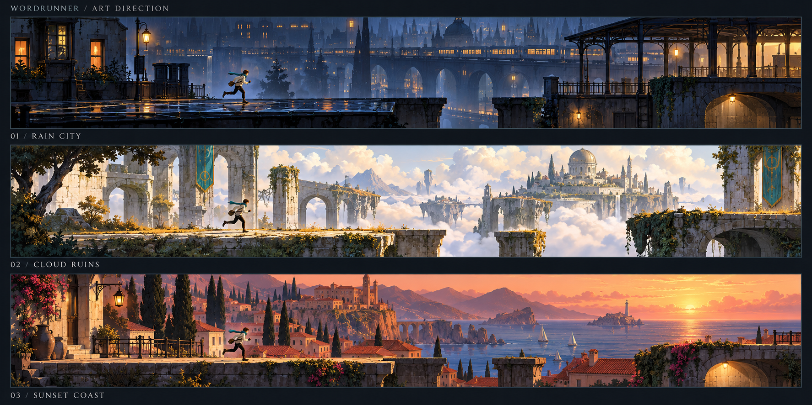

# WordRunner 美术方向 v0.1：适合成人的短篇冒险

日期：2026-10-23。状态：视觉方案与概念图，尚未实现为游戏画面。依据用户最新要求，美术必须让成年人也愿意主动体验；年龄不决定画面风格，英语初学也不意味着使用幼儿化呈现。

本方案保留 PRD 的两套 P0 主题、六个动作、独立语言与操作难度。三个候选视觉中，前两个对应现有 P0 主题的演进，第三个为后续方向。本次没有增加第三套 P0 主题，也没有完成运行时素材。

## 1. 设计立场

**定位：在有氛围的世界中，用英语完成一次短途冒险。**

成年人的偏好并不统一。我们同时探索都市、自然幻想和温暖旅行三种情绪，避免把成人审美简单等同于黑暗、霓虹或写实。此前研究提出的儿童首轮招募建议不是美术年龄限制；成人吸引力需要单独观察，不能用儿童反馈替代。

希望通过以下体验获得兴趣，均属于待验证的设计假设：

| 兴趣点 | 视觉和交互做法 | 三天内的实现边界 |
| --- | --- | --- |
| 短暂离开日常、进入另一个地方 | 明确的天气、光线、远景目的地，留出安静画面 | 分层背景与一处地标，不做开放世界 |
| 动作熟练带来的满足 | 起跳、着地、冲刺和滑行姿态清楚，反馈紧凑 | 共用一套角色动画，不靠堆特效 |
| 探索与轻故事 | 每关有明确的出发点、目的地和投递任务 | 开场一句任务、环境变化、结尾一句回执 |
| 自己选择体验气质 | 两套主题自由切换，漫游与挑战独立 | 不用“儿童版 / 成人版”标签锁定风格 |
| 看见个人进步 | 记录独立表达、需要提示的句子和个人动作表现 | 不虚构口语分数，不增加在线排名 |

温柔、明亮、幽默都可以保留。需要控制的是玩具化比例、满屏奖章、幼儿教师式口吻，以及与游戏场景无关的练习弹窗。

## 2. 三种视觉方向

该图由内置 imagegen 生成，用于讨论氛围、轮廓和角色比例；图中文字与构图不作为界面或关卡的精确规格。完整生成提示词见 [IMAGE_PROMPTS.md](IMAGE_PROMPTS.md)。

| 方向 | 画面设计 | 希望吸引的偏好 | 与现有范围关系 |
| --- | --- | --- | --- |
| **雨夜都市 · Rain City** | 蓝灰雨夜、少量琥珀灯光、湿地反射、屋顶与高架站台，远处有亮灯的投递站 | 城市夜行、轻科幻、速度与独处氛围 | “霓虹都市”的细化；建议作为演示主视觉 |
| **云海遗迹 · Cloud Ruins** | 明亮云海、风化石拱、矿物青、金色草地、远处观测塔；轮廓简洁、尺度开阔 | 自然幻想、探索、安静而壮阔的风景 | “绘本云岛”的成熟化演进提案；保留明亮路线 |
| **落日海岸 · Sunset Coast** | 暖桃色天空、墨蓝海面、赤陶屋顶、海边步道与远处灯塔 | 旅行、放松、温暖生活感 | 后续视觉方向；本期只做概念，不新增关卡 |

推荐先制作雨夜都市与云海遗迹的完整主题映射。它们提供一暗一明两种偏好，成年人也可选择云海。落日海岸先用于比较偏好，不能以概念图存在就声称第三主题已可玩。

现 PRD 的主题名称还未定稿；本文件提出命名与视觉演进，不额外引入解谜系统、机器人伙伴或新动作。

## 3. 共用的视觉语言

- **镜头：**固定横版侧视，角色位于画面约 28% 宽度，右侧留出观察和表达空间。正式关卡保持同一个地平线与平台基准。
- **形状：**近景清楚、远景简化；可站立边缘连续，障碍用明确轮廓。背景建筑可有透视，碰撞平面保持侧视可读。
- **层次：**天空 / 最远地标 / 中景建筑或岩层 / 游戏地面 / 少量不挡路的前景。视差强度可降低；语音等待时镜头稳定。
- **细节：**把纹理集中在停留处和远景地标，角色前方的任务区域减少杂物。雨、雾、光粒子不能挡字幕、障碍和落点。
- **光线：**装饰灯光与危险提示用不同形状。暖色只表示氛围时，不让它同时成为唯一危险信号。
- **整体：**平面插画与轻纹理，避免需要大量模型、材质和光照调试的写实 3D 路线。

设计配色如下；精确值另存于 [visual-tokens.json](visual-tokens.json)，仅为设计数据，尚未接入代码。

| 用途 | 雨夜都市 | 云海遗迹 | 落日海岸 |
| --- | --- | --- | --- |
| 主背景 | `#101D2B` 深蓝灰 | `#E9E5D8` 云白 | `#EBC4AD` 暖桃 |
| 中景 | `#304A5B` 石板蓝 | `#A5B9AE` 雾绿 | `#C88773` 赤陶 |
| 地面轮廓 | `#162C38` | `#405C59` | `#253F50` |
| 交互强调 | `#86D1C2` 浅青 | `#286E68` 矿物青 | `#325E73` 海蓝 |
| 氛围点缀 | `#E8B078` 琥珀 | `#C49652` 暖金 | `#F3DBAA` 沙金 |

HUD 统一使用深色实底和浅色文字，避免因主题不同导致字幕忽明忽暗。强调色用于图形与状态边框，正常正文使用统一文字色。

## 4. 角色：一位旅行中的信使

共用一位中性旅行者：约 6–6.5 头身，短外套、实用鞋、小挎包、短围巾。以明亮上衣和深色下装形成轮廓；不依赖面部小细节识别角色。浅色场景中增加深色边缘，深色场景中保留明亮轮廓。

角色以投递任务连接原 PRD 的关卡目标：穿过一个地方，把一封信或一份讯息送到终点。两套世界共享这个身份，不必为成人和儿童各做一套角色与故事。

外观不与英语水平绑定。换装、不同体型、更多人物可在后续扩展，本期不做角色商城。

### 动作表现建议

| 动作 | 需要看清的姿态 | 首版制作方式 |
| --- | --- | --- |
| Jog 慢跑 | 重心较直、步幅小、节奏放松 | 共用跑步循环，调整步幅和播放速率 |
| Run 跑步 | 自然前倾、步态稳定 | 6 帧循环作为基础 |
| Sprint 冲刺 | 更明显前倾、手臂后摆、短尾迹 | 跑步循环加姿态偏移和少量特效 |
| Stop 停止 | 明确稳住身体、观察前方 | 1 个稳定站姿，短过渡，不持续滑步 |
| Jump 跳跃 | 起跳、上升、最高点、下降和着地可区分 | 4 个关键姿态，着地短过渡可复用 |
| Slide 滑行 | 身体低、头部与地面关系清楚 | 进入、保持、退出 3 个姿态 |

约 14 个基础姿态槽位是工作量预算，不是已生成的动画帧。实际帧数根据引擎能力和首轮手感调整。视觉压缩、围巾和尾迹都不能暗中改变碰撞体；主题切换也不能改变动作时序。

## 5. 界面与语言呈现

逻辑画布沿用 1280×720。以下尺寸为设计起点，需在实际窗口中检查；窄屏应重排，不能单纯缩小整张画面。

| 区域 | 内容 | 设计约束 |
| --- | --- | --- |
| 顶部 24–72 px | 关卡名、进度、生命 / 体力、暂停 | 一行，克制图标，不做满屏计分面板 |
| 中央游戏区 | 角色、机关、目的地 | 关键地形不被卡片遮挡 |
| 上方安静区域 | 当前一句任务；需要时显示一句释义 | 居中实底卡片，宽不超过 560 px，自动换行 |
| 底部右侧 | 麦克风状态与识别后的简短反馈 | 关闭 / 收音中 / 处理中 / 错误有文字，不只变色 |
| 底部左侧 | 按键或触控入口 | 不与地面落点重叠，始终能接管 |

英文任务初始 28–32 px；中文解释 18–20 px；辅助状态 16–18 px。优先系统无衬线字体，避免额外字体下载与授权依赖。单句太长时分阶段呈现，不能为了装下而无限缩小。

普通 HUD 文本采用 `#F4F1E8` / `#111D2B`，弱化文字采用 `#B8C6CF` / `#111D2B`。文字背景使用实底；如果改透明度，需要对实际合成画面重新测量对比度。颜色同时配合文字、图标或形状。

### 不同阶段的界面语气

- 开场：`Deliver the message to the station.` / “把讯息送到车站。”一句交代目标，立即可玩。
- 入门示范：`Slide under the gate.` 配动作图标和可选中文，播放器手动重听。
- 独立任务：展示情境和目标，不提前露出正确口令；按 PRD 的提示开关显示辅助。
- 成功：用闸门、灯光或角色动作给反馈，再简短显示“指令已执行”。不默认宣称“你已经学会”。
- 未识别：“这次没有听清，可以重试。”保留按键接管。
- 结算：“本次独立完成 2 个表达 / 1 个仍需提示”，仅在有真实记录时显示；下方再放游戏成绩。

“初学者”也使用同样成熟的版式。卡通教师语音、满屏星星和夸张奖章不作为默认反馈；声音也应支持这个方向：短促轻音、环境声、背景音乐在收音时降低。

## 6. 英语与场景如何结合

雨夜都市的 90 秒示例，以有效行进时间为参考；玩家的等待与表达会延长实际时长：

| 阶段 | 视觉变化 | 动作 / 语言任务 | 制作约束 |
| --- | --- | --- | --- |
| 出发 | 屋顶暖灯、远方车站地标 | 自由跑步，交代投递目的 | 无不可跳过长过场 |
| 高架连桥 | 地面宽阔、缺口提前出现 | Jump 或已配置短句；安全起跳区等待 | 共用现有跳跃动作与任务表 |
| 站台通道 | 低门与地面有明显高差 | Slide under the gate | 门高与碰撞规则一致，不靠猜阴影 |
| 信号区 | 灯与门的周期可观察 | Stop / Wait here，随后恢复跑步 | 收音时地形不突然变化 |
| 抵达 | 投递点灯光展开、远景渐亮 | 完成投递，显示真实练习记录 | 一个短环境反馈，不新增剧情系统 |

云海主题将站台、低门、信号区映射为石桥、石拱低门、光幕机关，使用同样的碰撞尺寸与任务状态。教学词句必须匹配实际物体：城市的 gate 可对应遗迹门，但不能把画面中的石块叫作 log。未在课程映射表中的新表达，不能因概念图里出现过就自动获得识别支持。

## 7. 三天可承担的美术资产

| 范围 | 预算 | 复用方式 |
| --- | --- | --- |
| 角色 | 1 套，约 14 个基础姿态槽位 | 两主题共用，调色不影响识别 |
| 背景 | 每主题 3 层：远景 / 中景 / 地标，共 6 层 | 天空渐变、天气由程序辅助 |
| 地面 | 每主题 2 个可拼接模块，共 4 个 | 共用碰撞数据，纹理和材质不同 |
| 障碍 | 每主题 3 类，共 6 个外观 | 对应跳跃、滑行、等待 / 通行 |
| 投递终点 | 每主题 1 个，共 2 个 | 同一触发与结算逻辑 |
| HUD | 1 套图标、任务卡和状态组件 | 所有主题与英语档位共用 |
| 环境反馈 | 雨、草风、尾迹、落地反馈 | 强度受控，可减少动态效果 |

### 制作顺序与时间盒

本表是原三天排期中的美术时间分配建议，不是额外增加的工时，也不是已完成记录。

1. **D1：45 分钟锁定方向，60 分钟确定角色轮廓与 UI 样式。**先在灰盒上检查角色大小、地面高度和文本区域；继续完成真实语音闭环。
2. **D2：约 2.5 小时主主题，1.5 小时第二主题映射，1 小时角色动作适配。**先背景、地面、障碍完整，再补细节；不等待一套完美插画才接入。
3. **D3：约 1 小时可读性检查与 30 分钟成人偏好测试。**只修遮挡、比例、颜色、字体与突兀反馈，不临时换整套风格。

估算依赖可复用模块和简单分层素材。若超时，先减少纹理、前景装饰、粒子与独有动画，保留两套主题的完整背景、地面、障碍和界面。概念图需要拆分、修边、制作重复接缝和验证后才能成为游戏资产，不能把一整张画直接当可碰撞场景。

## 8. 如何判断是否符合成人兴趣

先邀请 5–8 位成年人做形成性测试，包含轻度游戏玩家和英语初学者；人数只用于发现问题，不代表市场比例。

1. 三张图使用相同尺寸、角色比例、关卡结构，轮换呈现顺序，不提前标“成人推荐”。
2. 先问“你觉得这是什么游戏、会在什么场合玩”，观察是否被看作只给小孩用的练习软件。
3. 让试玩者选择愿意体验的主题并解释具体原因，记录光线、角色、节奏、场景等因素，不只记投票。
4. 显示真实任务 UI，再检查是否仍愿意玩、文字是否清楚；不能只验证好看的无界面概念图。
5. 在手机宽度和电脑窗口分别看角色与障碍能否辨认；明确这是桌面优先原型，不虚报移动端验收。
6. 最后观察是否主动体验第二局，并分开记录“喜欢画面”和“愿意开口”。

成年试玩结果与儿童结果分别汇总。若喜欢画面却觉得词句过浅，下一步改内容层级；继续加滤镜不能解决学习内容的问题。

## 9. 参考来源与本次产物边界

本次核对了官方页面，仅借鉴设计原则，不复制角色、地图和素材，也不从这些产品推断成人偏好的比例：

- [Alto's Odyssey](https://www.altosodyssey.com/)：参考跑酷与景观氛围结合的呈现方向。
- [GRIS 官方介绍](https://nomada.studio/gris-game/)：官方描述强调精细美术、动画、配乐及轻平台挑战，适合作为整体氛围的讨论参照。
- [Neva 官方页面](https://neva.game/)：参考自然场景、角色关系和远近层次的组织方式。

以上均是审美参考，不是“成年人一定喜欢该风格”的实验证据。生成提示词未使用这些作品或艺术家的名称。

交付清单：本设计文档、三方向概念图、可复用配色与布局参数、完整生成提示词。尚未交付角色图集、可拼接背景、动画、游戏 UI 实现或成人试玩结论。
