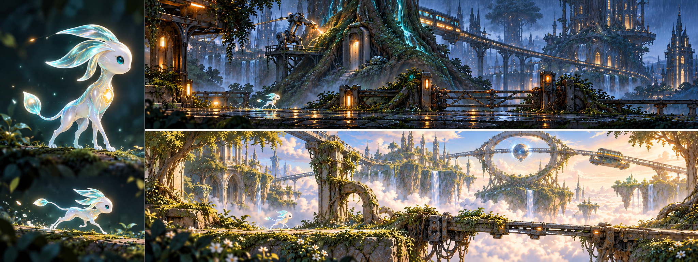

# WordRunner 精灵与科技共存的世界设计

日期：2026-10-23。状态：世界观、美术与玩法设计；尚未实现为游戏。用户已确认主角为非常小、精巧、美丽的非人类精灵，以《奥日》的精灵气质作为参考；人类已经灭绝，当前世界的智慧角色以精灵与机器人构成。沿用成人友好、信使冒险、两套主题与三天原型的约束；具体外形与机关仍需验证。

**方向：人类灭绝后，精灵与机器人在旧文明的遗迹上争用同一条能源脉络。玩家是一位非人类精灵信使，穿越相互缠绕的森林与机械设施，理解环境并选择通过方式。**

上图由内置 imagegen 生成，左侧放大观察角色，右侧检查它在巨大环境中的尺度；不是已实现截图或可直接使用的关卡资产。v1 人形信使与 v2 偏大、偏硬的枝晶造型均作为历史稿保留，当前采用微小光精灵方向。完整提示词与检查记录见 [生成记录](SPIRIT_TECH_IMAGE_PROMPT.md)。

## 世界为何发生冲突

人类已经灭绝，具体原因暂不定稿。旧城市、轨道、能源设施和机器协议留了下来。现世叙事围绕精灵与机器人展开，人类仅作为这些遗产的历史背景。

世界地下的灵脉同时供养精灵的栖息地和机器设施。精灵通过树根、菌丝和风脉使用它；机器人依赖导管、储能器和充能站。一部分机器仍执行维护旧交通网的命令，另一部分已经开始调整规则、与精灵共同生活。精灵也会对如何对待机械遗产持有不同意见。

一座抽能塔可以维持机器人充能与危险设施的稳定，同时让古树失去恢复能力；一片根系可以保护精灵的居所，同时堵住机器运送修复部件的路线。双方都有自身需要，帮助任何一方都可能改变另一方的处境。

玩家是一位往返不同地区的精灵信使，携带讯息与小型物件。首关可向仍在工作的机器接收站投递一枚校准芯片，让被错误封锁的通道重新连通；首版只呈现局部行动结果，不要求先阅读历史，也不在三天内增加分支结局。

工作名称仍为 WordRunner / EasyRun。以下地名、能源与角色设定是创作提案，不代表已完成产品改名。

## 一眼能读懂的视觉语言

| 维度 | 精灵一侧 | 科技一侧 | 相遇后的画面 |
| --- | --- | --- | --- |
| 轮廓 | 分枝、弧线、层叠叶片与生长结构 | 导轨、直线、规则切面与连接件 | 根系托起轨道，塔体被树冠穿过 |
| 材质 | 树皮、半透明叶脉、矿石、织物 | 陶瓷、拉丝金属、玻璃、旧涂层 | 被修补的金属树屋，嵌入石拱的能源管 |
| 光 | 稀疏的叶脉、孢子与矿物微光 | 有节律的信号灯与设备指示 | 细线式光源在同一节点交汇 |
| 动势 | 生长、呼吸、摆动、舒展 | 转动、伸缩、周期、锁定 | 同一机关出现两种可观察状态 |
| 声音 | 风、叶片、木结构与轻微共鸣 | 继电器、轨道、低频机械声 | 两种节律随机关状态交替，收音时降低背景音 |

画面保留精灵建筑的优雅和机器的精确感；局部有幽默与生活痕迹。成人友好通过比例、构图、材质和叙事分寸实现，明亮温柔的区域同样成立。

主角先以“微光精灵”为工作称呼：非常小、纤巧的生命，身体像凝聚成形的水滴与珍珠微光，边缘有淡青色透光感。短弯月形花瓣感知鳍、深青眼睛、胸口一点暖金光核和末端带露珠芽的细短尾巴形成原创轮廓。四肢轻巧、足部为非人类小爪；不使用人的五官、皮肤、头发、日常服装或鞋。讯息作为光核中的一个微小光点表现，不为投递任务增加大背包。

参考《奥日》的方向是微小生命面对巨大环境的感受、柔和光感和灵动动作。我们自己的辨识点采用短花瓣感知鳍、珍珠淡青材质、暖金光核与露珠尾芽。官方参考入口：[Ori 介绍](https://www.orithegame.com/?swcfpc=1)、[官方媒体库](https://www.orithegame.com/media/)。不把参考作品的角色图或地图当作项目运行时素材。

世界尺度上，一段轨道、一片叶子或机器脚部就能形成显著地形。设计起点是角色在 720 像素高的实际游戏画面中约占 6%–8.5% 高度，即约 43–61 像素，最终按实际屏幕可读性调整。概念板的局部放大不表示角色在关卡中同样大；不直接缩小整套碰撞和跳跃参数来改变游戏手感。

移动强调轻巧蹬地、身体舒展和落地微缩，停下时感知鳍轻动、光核缓缓呼吸。感知鳍与尾光不提供飞行或新动作。明亮主题用浅色身体的深青轮廓保持识别，暗色主题保留柔和边光；发光不能糊成看不清姿态的光团。成人友好通过精致材质、环境氛围和动作分寸表达，可以可爱，也要有细腻情绪。首版仍是一套角色与六动作。

机器人同样优先使用功能结构辨认：检修臂、履带、悬挂底盘或单个传感器，不用人脸仿生人承担主要角色。最新 AI 对话需求将一个站务机器人纳入 P0，通过静态通信面板贯穿三个叙事节点；移动伙伴 AI、宠物与多个 NPC 仍属后续范围。

危险、可通行与可交互状态同时用轮廓、动画和图标区分，不能仅依赖精灵绿、机器橙。前景落点与通道保持清晰，精细纹理和大地标集中在背景。

## 两个区域属于同一个世界

| 现有主题 | 演进候选名 | 环境设计 | 气质 |
| --- | --- | --- | --- |
| 雨夜都市 | 根脉机城 | 古树穿过交通塔，高架轨道沿树根绕行，维护机器修补被根系挤裂的管线；投递站保留暖灯 | 夜行、紧张、精密设施中的生命感 |
| 云海遗迹 | 浮空林庭 | 云海上有树木生长成的精灵庭院、石拱与悬根，旧能源环和升降轨道仍在运行 | 明亮、探索、壮阔与未解之谜 |

两个区域都同时出现精灵与科技。明暗差异继续服务主题选择，主题本身不表示年龄、语言难度或道德立场。它们复用角色、镜头、碰撞尺寸和任务结构，不增加第三套 P0 主题。

## 世界观怎样产生游戏选择

核心设计原则：能源状态改变设施的运作与自然结构的生长，玩家从可观察的变化中判断行动。新机关必须改变玩家的选择，不能只增加视觉装饰。

可以优先验证一个局部机关：**被根系缠绕的能源闸门**。以下是新机制候选，需要灰盒试验和重新估时，不默认为已进入三天 P0。

| 闸门状态 | 环境变化 | 通过方式 | 代价与适用情形 |
| --- | --- | --- | --- |
| 能源供给机器 | 闸门按固定周期完全打开，根系收拢 | 观察窗口后快速通过 | 通过可以更快，但需要判断时机；冲刺会影响已有体力余量 |
| 能源引向根系 | 根系逐渐撑住闸门，形成稳定但较低的通道 | 等待形态稳定后滑行 | 通行压力较小，准备和通过耗时更长 |

两种方法使用已有的 Stop、Run、Sprint、Slide。开关选择的价值来自当前体力、玩家对周期的熟悉程度和本局目标；如果试玩中总有一种方法明显更优，就调整结构或舍弃这一分支，不把选项数量当作深度。

真实语音在安全节点发起，状态提交前给予清楚反馈。收音与处理时长不计入用于比较路线效率的时间；不能让识别延迟造成错过机关窗口。按键与语音执行同一选择。

后续可以沿同一规则扩展桥梁、风道或交通装置，每次只引入一个新关系。战斗、潜行、阵营好感和世界状态树不随世界观一并加入。

## 趣味也来自世界中的小事情

- 一个仍按时检查信号的机器人，被精灵用树叶给它装了“帽子”；它一本正经地把叶片整理成标准形状。
- 一座精灵树屋用旧列车车厢作公共空间，门口的藤蔓会避让真正运转的轨道。
- 投递站的设备需要机器供电，站外的遮雨结构由树根维持，玩家能看见双方合作的实际好处。

这些细节可通过背景画、一个简单循环或一两句回执表达。它们用于探索气质，不是首版逐项必须制作的资产清单。

## 英语在这个世界里的位置

英语设定为人类遗留下来的机器通信语言。机器人保留旧指令和广播，精灵逐渐学会理解、使用它，与设备和机器人交换行动意图。教学支持仍按需出现，不要求玩家接受人类教师或课程剧情；机器接受一个指令也不代表对发音进行了专业评分。

即时动作仍使用已审校的六动作及任务表达，例如 Wait here、Run faster、Slide under the gate。安全区另提供 AI 自由对话，允许询问任务、路况和角色已知故事；自由转写不进入动作匹配器。后续确实加入协作机关时再支持相应行动请求。两条链路目前均为规划，不能写成已经实现。

所有剧情与角色台词使用统一对话层，世界事实、角色知识边界和实际事件是输入依据。AI 不生成幸存人类、不替作者决定灭绝原因，也不凭玩家一句话改写任务结果；故障时使用固定台词。具体范围见 [PRD](../../WordRunner_PRD_v0.1.md) 第 6A 节。

游戏先检查观察、时机和动作是否有趣。英语帮助理解设施信息、表达决定；新手可使用释义与示范。说话次数、口音与麦克风故障不决定阵营态度或道德结果。

## 三天原型中的落点

先把已有素材清单映射到这个世界：跳跃障碍成为断轨与根拱，滑行障碍成为缠根闸门，等待区域成为能源周期节点，终点成为两种文明共用的接收站。两套背景分别覆盖机城与林庭，角色与六动作共用。

上述视觉映射可以沿既有资产预算推进。它能建立风格，但不能单凭换皮宣称新增了玩法深度。双状态闸门是单独的玩法试验候选；先用简单形状验证选择是否成立，再决定替换哪一段现有关卡并调整工时。

三天预算已经包含两套美术、真实语音、教学帮助、AI 对话与测试。AI 已按最新 PRD 在 27 小时内预留约 4 小时，压缩装饰与独有动画。双状态新机关仍需额外估时，不能与新增对话一起默认叠加；两主题、六动作与语音接管继续保留。

验收风格时观察：不看说明能否看出两种文明共存；角色与障碍是否清楚；成人是否愿意探索。验收玩法时另看：玩家是否理解状态、是否能解释选择、第二次是否会调整策略。

相关文档：[现有美术规范](ART_DIRECTION_v0.1.md)、[产品定义](../PRODUCT_DEFINITION_v0.2.md)、[开发任务](../DEVELOPMENT_BACKLOG_v0.1.md)。
