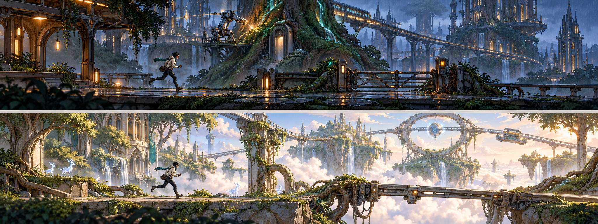

# WordRunner 精灵与科技共存的世界设计

日期：2026-10-23。状态：世界观、美术与玩法候选方案；尚未实现为游戏。用户提出以精灵世界与科技世界的冲突增加趣味，本方案沿用成人友好、信使冒险、两套主题与三天原型的约束。

**方向：同一个世界中的两种文明争用同一条能源脉络。玩家穿越相互缠绕的森林、城市和遗迹，在投递途中理解环境，并选择通过方式。**

上图由内置 imagegen 生成，为同一世界的明暗两区域概念探索；不是已实现截图或可直接使用的关卡资产。完整提示词与检查记录见 [生成记录](SPIRIT_TECH_IMAGE_PROMPT.md)。

## 世界为何发生冲突

世界地下的灵脉同时供养森林生命和城市设施。精灵通过树根、菌丝和风脉使用它；科技文明通过导管、储能器和交通网络使用它。城市扩张改变了灵脉流向，森林生长开始侵入轨道与设备，双方维持生存的方法正在妨碍彼此。

这让同一处场景可以有两种合理诉求：一座抽能塔维持附近居民的交通与照明，同时让古树失去恢复能力；一片根系保护精灵的居所，同时堵住救援路线。人物与组织可以对解决方法有不同意见，不把整个种族写成统一性格。

玩家继续扮演旅行信使，携带讯息与小型物件往返不同地区。首关只交付一件具体物品，例如送往接收站的校准芯片；宏大冲突通过环境和短回执逐渐显露，不要求玩家开局阅读历史设定。

工作名称仍为 WordRunner / EasyRun。以下地名、能源与角色设定是创作提案，不代表已完成产品改名。

## 一眼能读懂的视觉语言

| 维度 | 精灵一侧 | 科技一侧 | 相遇后的画面 |
| --- | --- | --- | --- |
| 轮廓 | 分枝、弧线、层叠叶片与生长结构 | 导轨、直线、规则切面与连接件 | 根系托起轨道，塔体被树冠穿过 |
| 材质 | 树皮、半透明叶脉、矿石、织物 | 陶瓷、拉丝金属、玻璃、旧涂层 | 被修补的金属树屋，嵌入石拱的能源管 |
| 光 | 稀疏的叶脉、孢子与矿物微光 | 有节律的信号灯与设备指示 | 细线式光源在同一节点交汇 |
| 动势 | 生长、呼吸、摆动、舒展 | 转动、伸缩、周期、锁定 | 同一机关出现两种可观察状态 |
| 声音 | 风、叶片、木结构与轻微共鸣 | 继电器、轨道、低频机械声 | 两种节律随机关状态交替，收音时降低背景音 |

画面保留精灵建筑的优雅和机器的精确感；局部有幽默与生活痕迹。成人友好通过比例、构图、材质和叙事分寸实现，明亮温柔的区域同样成立。

角色约 6–6.5 头身，继续使用短外套、短围巾、小挎包与实用鞋；可加一个小型机械腕部装置作为两种文明之间的视觉连接。首版仍只有一套主角动作。林间光灵与维护机器人可先作为环境形象，不因概念图出现就增加伙伴 AI、宠物或 NPC 系统。

危险、可通行与可交互状态同时用轮廓、动画和图标区分，不能仅依赖精灵绿、机器橙。前景落点与通道保持清晰，精细纹理和大地标集中在背景。

## 两个区域属于同一个世界

| 现有主题 | 演进候选名 | 环境设计 | 气质 |
| --- | --- | --- | --- |
| 雨夜都市 | 根脉机城 | 古树穿过交通塔，高架轨道沿树根绕行，维护机器修补被根系挤裂的管线；投递站保留暖灯 | 夜行、紧张、精密设施中的生命感 |
| 云海遗迹 | 浮空林庭 | 云海上有树木生长成的精灵庭院、石拱与悬根，旧能源环和升降轨道仍在运行 | 明亮、探索、壮阔与未解之谜 |

两个区域都同时出现精灵与科技。明暗差异继续服务主题选择，主题本身不表示年龄、语言难度或道德立场。它们复用角色、镜头、碰撞尺寸和任务结构，不增加第三套 P0 主题。

## 世界观怎样产生游戏选择

核心设计原则：能源状态改变设施的运作与自然结构的生长，玩家从可观察的变化中判断行动。新机关必须改变玩家的选择，不能只增加视觉装饰。

可以优先验证一个局部机关：**被根系缠绕的能源闸门**。以下是新机制候选，需要灰盒试验和重新估时，不默认为已进入三天 P0。

| 闸门状态 | 环境变化 | 通过方式 | 代价与适用情形 |
| --- | --- | --- | --- |
| 能源供给机器 | 闸门按固定周期完全打开，根系收拢 | 观察窗口后快速通过 | 通过可以更快，但需要判断时机；冲刺会影响已有体力余量 |
| 能源引向根系 | 根系逐渐撑住闸门，形成稳定但较低的通道 | 等待形态稳定后滑行 | 通行压力较小，准备和通过耗时更长 |

两种方法使用已有的 Stop、Run、Sprint、Slide。开关选择的价值来自当前体力、玩家对周期的熟悉程度和本局目标；如果试玩中总有一种方法明显更优，就调整结构或舍弃这一分支，不把选项数量当作深度。

真实语音在安全节点发起，状态提交前给予清楚反馈。收音与处理时长不计入用于比较路线效率的时间；不能让识别延迟造成错过机关窗口。按键与语音执行同一选择。

后续可以沿同一规则扩展桥梁、风道或交通装置，每次只引入一个新关系。战斗、潜行、阵营好感和世界状态树不随世界观一并加入。

## 趣味也来自世界中的小事情

- 一个仍按时检查信号的机器人，被精灵用树叶给它装了“帽子”；它一本正经地把叶片整理成标准形状。
- 一座精灵树屋用旧列车车厢作公共空间，门口的藤蔓会避让真正运转的轨道。
- 投递站的设备需要机器供电，站外的遮雨结构由树根维持，玩家能看见双方合作的实际好处。

这些细节可通过背景画、一个简单循环或一两句回执表达。它们用于探索气质，不是首版逐项必须制作的资产清单。

## 英语在这个世界里的位置

英语可作为跨区域交通网的通信语言。先理解任务与表达意图，再提供按需的语言帮助；剧情不围绕英语考试展开。

首版仍使用已审校的六动作及任务表达，例如 Wait here、Run faster、Slide under the gate。若后续确实加入协作机关，再考虑 Hold the gate 等有明确对象和结果的表达，不把自由对话或新增句子的识别能力写成已经具备。

游戏先检查观察、时机和动作是否有趣。英语帮助理解设施信息、表达决定；新手可使用释义与示范。说话次数、口音与麦克风故障不决定阵营态度或道德结果。

## 三天原型中的落点

先把已有素材清单映射到这个世界：跳跃障碍成为断轨与根拱，滑行障碍成为缠根闸门，等待区域成为能源周期节点，终点成为两种文明共用的接收站。两套背景分别覆盖机城与林庭，角色与六动作共用。

上述视觉映射可以沿既有资产预算推进。它能建立风格，但不能单凭换皮宣称新增了玩法深度。双状态闸门是单独的玩法试验候选；先用简单形状验证选择是否成立，再决定替换哪一段现有关卡并调整工时。

三天预算已经包含两套美术、真实语音、教学帮助和测试。若新机关需要额外开发，需明确压缩哪些装饰或后移内容；不默认增加总工时，也不默默撤销两主题、六动作、语音接管等已确认要求。

验收风格时观察：不看说明能否看出两种文明共存；角色与障碍是否清楚；成人是否愿意探索。验收玩法时另看：玩家是否理解状态、是否能解释选择、第二次是否会调整策略。

相关文档：[现有美术规范](ART_DIRECTION_v0.1.md)、[产品定义](../PRODUCT_DEFINITION_v0.2.md)、[开发任务](../DEVELOPMENT_BACKLOG_v0.1.md)。
