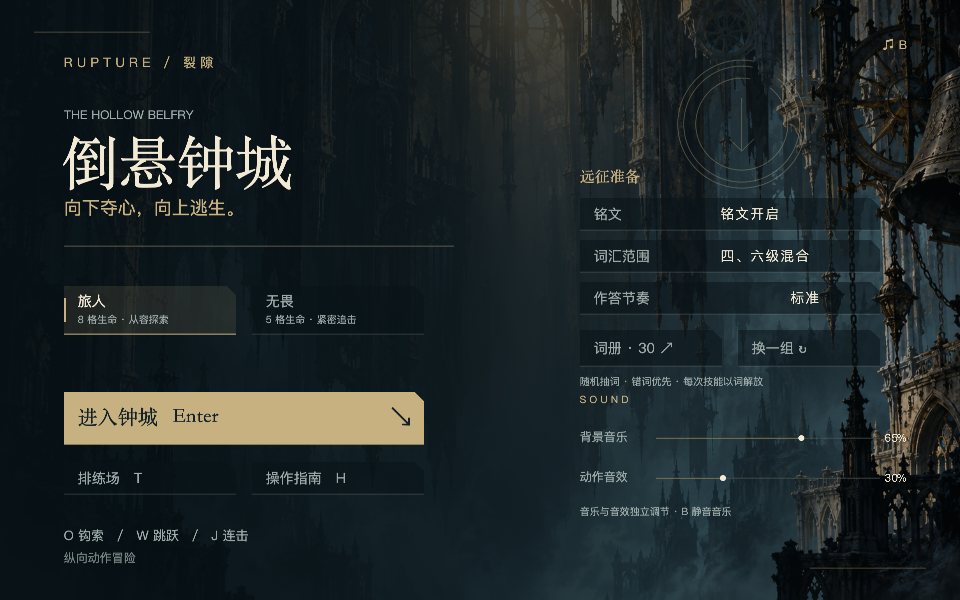

# v0.13.0 原生铭文、混音与界面验收

交付：`EasyRun-XBuilder-v0.13.0-inscription-ui.xbp`，99.35 MiB。仅本地，不改写在线项目，不推送 GitHub。

- [汇总与哈希](verification.json)：51 项检查；桌面副本与构建输出相同。
- [网站组件单词专项](native-words.json)：13 项。真实技能按键触发关口；测试专用按键只准备生命 / 余烬、选择题型和布置束缚。
- [网站组件菜单 / 窗口专项](deployed-shell.json)：14 项。实际 `.xbp` 经网站项目模型导入 / 导出后在本机编译，包含残留镜头跟随、高分屏与连续缩放。
- [原生声音输出](native-music.json)：10 项。测量引擎真实音频，验证独立通道、静音、切曲、暂停、答题不压低背景音乐和循环。短片段仅用于加速循环测试。
- [网页音乐回归](web-music.json)：14 项。包括新默认混音、旧偏好保存、答题不压低音乐与加载失败恢复。

正式包最后补充了词源说明与 MIT 许可。汇总记录了测试包 / 交付包两个哈希，并逐文件确认原有运行内容完全相同；没有将未测代码冒充已测代码。原生权重和音量是会话状态，重新运行后重置，未实现原生跨日存档和成就。

