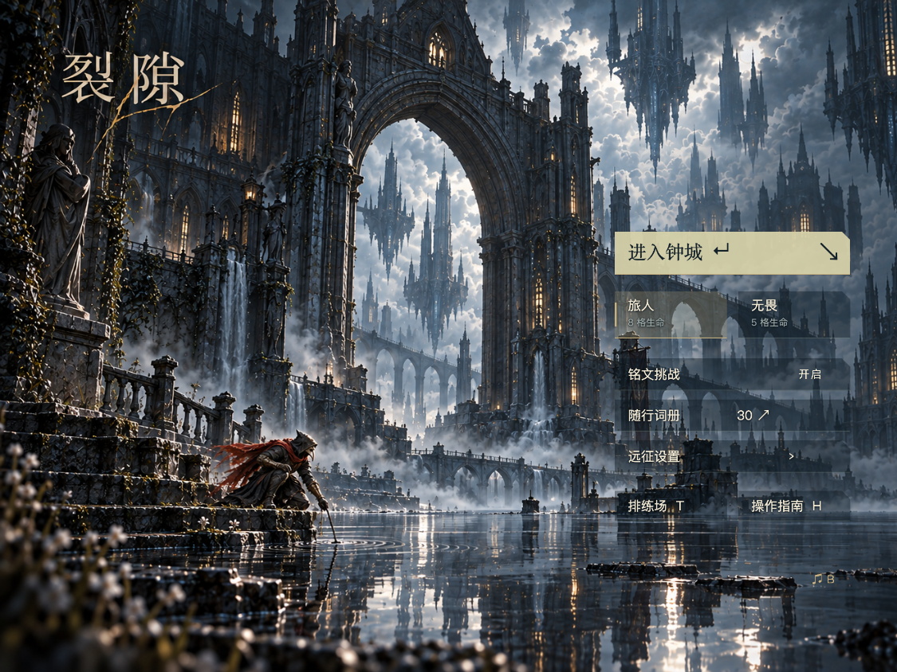
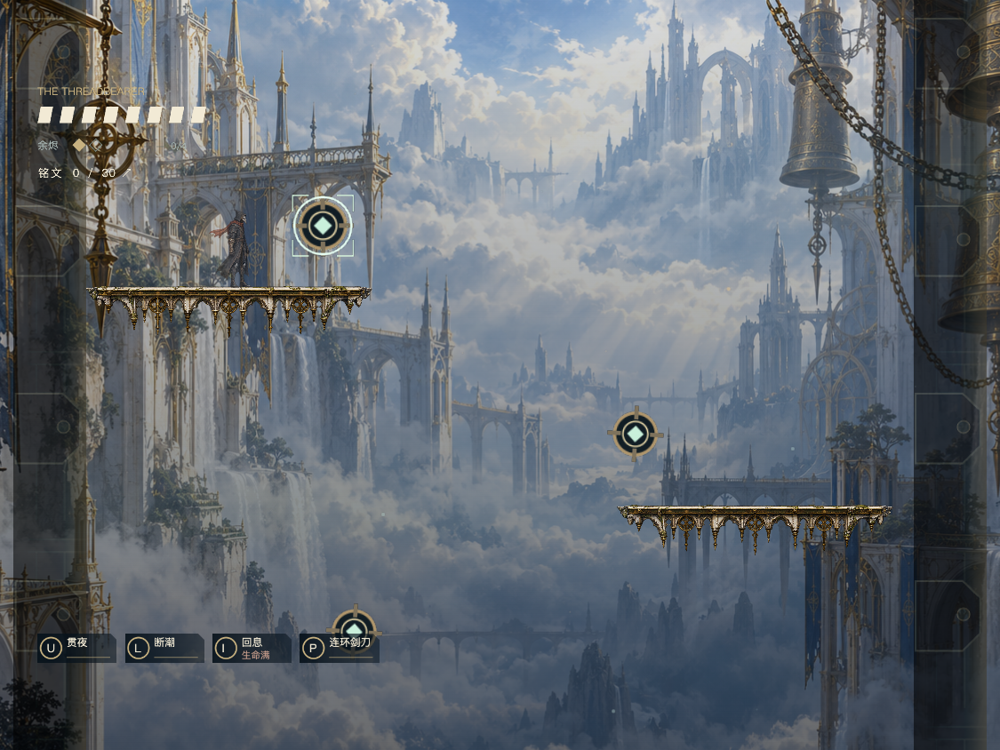

# v0.16.7 · 窗口铺满

2026-10-31。移除 XBuilder 独立导入包菜单、战斗画面上下的黑色留边。仅更新本地源码与导入包，未推送远程，也未覆盖在线作品。

## 原因与修改

原先镜头完整容纳 960×600 设计范围，并用四个 `NativeMatte` 精灵遮住该范围外的画面。XBuilder 常见的 4:3 窗口比设计画幅更高，所以遮罩成为上下黑边。单独改运行配置或删除遮罩，都不能保证背景完整覆盖额外视野。

- 删除四个遮罩及其调用、资源。
- 原生打包新增 `native_viewport.py`：五区背景等比覆盖实际窗口，视差偏移限制在预留区域内；深度色调也覆盖窗口。保留原有缩放写入缓存，避免重复设置精灵尺寸。
- 菜单底图、水面和披风局部动画共用同一缩放与定位。仍使用原图中的主角，不重新拼角色；普通 4:3 与 16:9 窗口保留标题、主角和菜单操作。
- 控件继续位于完整可见的 960×600 安全区域，点击坐标不变。移除固定画幅的全宽 HUD 渐变和菜单侧栏渐变，避免露出矩形边缘；按钮使用局部半透明底与浅色文字。
- 较高窗口的物体渲染可见距离随视口扩展；角色比例、碰撞、AI、技能和克隆池上限保持原状。

不同宽高比下，菜单背景会等比裁切右侧或下方。极宽的 1440×600 窗口会裁去较多水面和菜单插画主角下部；控件仍完整。游戏场景则显示更多外围范围。此修改不控制 XBuilder 网站自身的顶栏、侧栏或播放器外框，也不新增触屏操作。

## 验证

使用实际交付 `.xbp`，经过固定部署版 XBuilder 项目模型往返，再在本地运行对应编译器与资源。三组共 **44 项通过，运行错误为零**，报告均记录同一个交付包 SHA-256：

- [窗口与菜单交互](native-shell.json)：15 项。480×360、1125×844、1280×720、1440×600、600×900、960×600 连续切换；检查顶部/底部不再是单色留边、设计范围与点击映射、镜头归位、2 倍像素密度启动、暂停/结算/词册返回。
- [菜单动画](native-menu.json)：5 项。原图主角姿态固定，水纹/披风帧循环，镜头与克隆数稳定；设置、减少动态效果和开始游戏正常。
- [单词与词册](native-words.json)：24 项。8815 条数据、30 词抽选、翻页搜索、答题输入、错误取消、冷却、提示隐藏、小窗口长文字和克隆预算回归通过。测试中安全资源、长文字、束缚状态使用显式测试夹具，不进入交付包。

人工复核以下最终运行截图：





定向 ESLint、Prettier、Python 编译检查和 `git diff --check` 通过。ZIP CRC 通过；与 v0.16.6 对比，全部 19 个音频文件、场景/角色/菜单原图内容一致，保留 Tab 词册背景音乐连续播放修复。本轮没有重新测量实际音频或帧率，不据此宣称性能提升。

## 交付与复现

桌面文件：`EasyRun-XBuilder-v0.16.7-full-bleed.xbp`。需要重新导入；v0.16.6 保留供回退。包大小、条目、差异清单和 SHA-256 见 [文件记录](artifact.json)。

```sh
python3 prototypes/runlab/package.py --game belfry
export RUNLAB_URL=http://127.0.0.1:4177/
export XBUILDER_RUNTIME_DIR=.cache/xbuilder-online-20261026
export XBUILDER_MODEL_URL=https://x.qiniu.com/assets/img-rendering-CIpDEpA1.js
for test_script in prototypes/runlab/test-belfry-native-shell.mjs prototypes/runlab/test-belfry-menu.mjs prototypes/runlab/test-belfry-native-words.mjs; do
  bash scripts/with-env.sh node "$test_script" || exit $?
done
```
