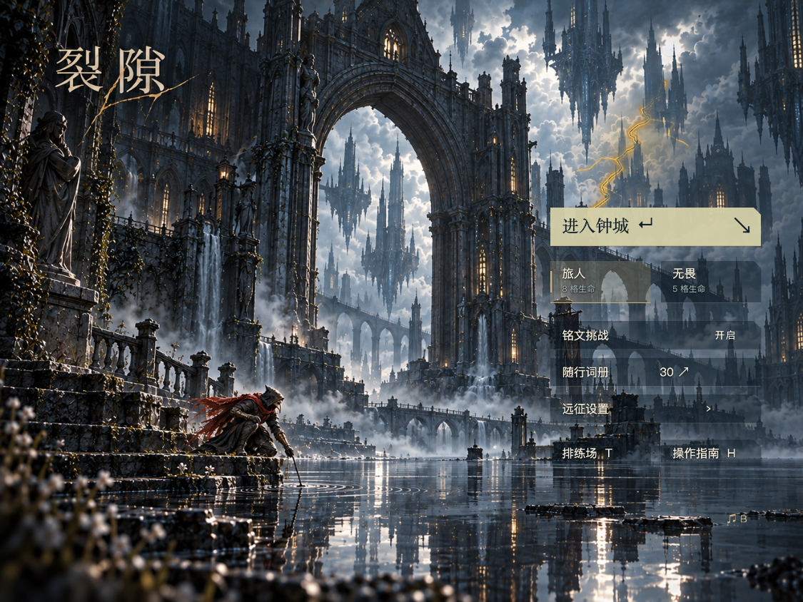

# v0.16.8 · 云间暗金闪电

2026-10-31。为静水圣庭菜单加入云内暗金电弧；网页版和 XBuilder 导入版共享素材与时序。仅本地更新，未推送仓库或覆盖线上作品。

## 视觉与节奏

- 三条不同路径轮换。每条包含暗色裂痕预兆、带暗色内芯的金黄主闪、断续余辉，云层有局部暖光。
- 初次进入菜单约 2.8 秒后出现；每轮持续 1.3 秒，其中金色主闪约 0.18 秒。两轮之间安静 5.8–10.2 秒，按确定性序列变化，不循环高频频闪。
- 保留原菜单建筑、主角、标题与水面像素。光效固定在原图的远景云区，依据底图亮度遮挡暗色建筑；这是二维近似遮挡，不是真实三维光照。
- 光效在菜单与控件之间，与背景共用窗口缩放。打开设置、词册、指南时停止闪电；关闭后留出 3.2 秒再恢复。进入游戏隐藏；开启减少动态后关闭闪电并冻结原有水纹/披风。
- 不新增雷声音效、全屏白闪或镜头震动；原先选定的背景音乐不受影响。

## 实现与开销

`belfry-menu-lightning.mjs` 在构建时生成手工主路径的细分裂痕、分叉、光晕和云层蒙版。每种路径只用三个曝光造型，共九张 420×340 PNG；运行时一个非交互 `MenuLightning` 精灵切换造型、量化透明度。九张 RGBA 像素约 4.9 MiB，不含引擎纹理附加开销。没有增加粒子克隆、实时模糊或逐帧像素处理。

`MenuMotion.spx` 管理时序，`belfry-render-cache.mjs` 缓存未变的显示属性，`native_viewport.py` 复用菜单底图变换。网页设置说明同步更新。没有改动碰撞、战斗、单词和音乐逻辑。

## 验证与边界

共 **26 项通过，错误为零**：

- [原生菜单](native-menu.json)：6 项。交付 `.xbp` 经部署项目模型往返后运行；自然观察到九个闪电造型和三种路径，前几次实际启动时刻为 2.81、13.75、23.62 秒。检查固定主角姿态、稳定镜头/克隆数、无战斗 FX、模态菜单关闭光效、减少动态及开始游戏隐藏。
- [原生窗口与交互](native-shell.json)：15 项。六组窗口尺寸、2 倍像素密度、实际按钮点击、镜头回归、暂停、结算、词册及上下边缘回归通过。
- [网页菜单](web-menu.json)：5 项。难度、词册搜索、设置焦点、音量、减少动态、开始/返回和小屏尺寸回归通过。

以下为实际原生运行截图；仅为截图在测试副本中冻结主闪曝光，交付版本自动消退，没有冻结键：



本机原生采样 1,312 帧，p50/p95/p99 均约 16.67ms，超过 34ms 的 1 帧。数据来自带诊断日志的引擎帧间隔，不等于 GPU 呈现时间，不构成低端设备性能保证。没有重新测量音频、完整通关或单词正确率；音频及词库文件做字节一致性校验。定向 ESLint、Prettier、Python 编译、ZIP CRC 和 `git diff --check` 通过。

## 交付

桌面：`EasyRun-XBuilder-v0.16.8-cloud-lightning.xbp`。重新导入可见效果，v0.16.7 保留供回退；网页刷新本地 4177 页面即可。文件大小、哈希和资源对比见 [artifact.json](artifact.json)。

```sh
bash scripts/with-env.sh node prototypes/runlab/build-belfry.mjs
python3 prototypes/runlab/package.py --game belfry
export RUNLAB_URL=http://127.0.0.1:4177/
export XBUILDER_RUNTIME_DIR=.cache/xbuilder-online-20261026
export XBUILDER_MODEL_URL=https://x.qiniu.com/assets/img-rendering-CIpDEpA1.js
for test_script in prototypes/runlab/test-belfry-menu.mjs prototypes/runlab/test-belfry-native-shell.mjs prototypes/runlab/test-belfry-menu-web.mjs; do
  bash scripts/with-env.sh node "$test_script" || exit $?
done
```
