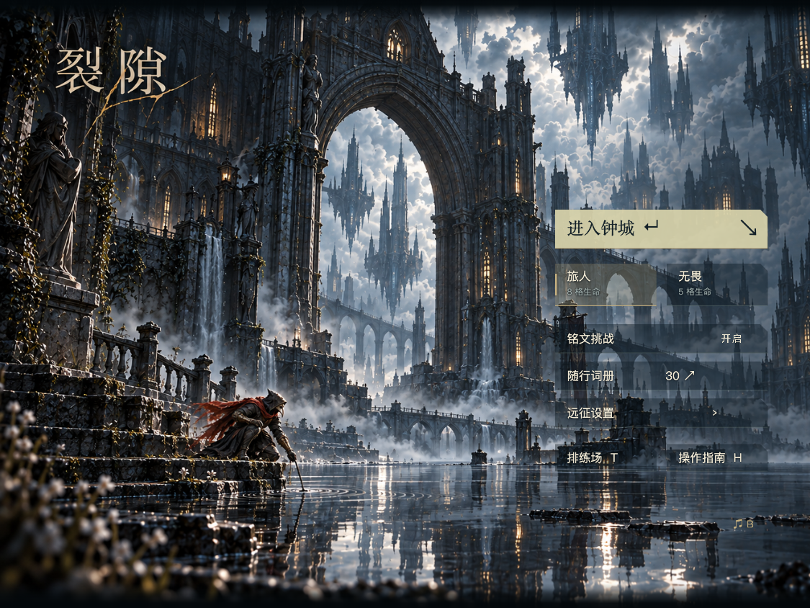
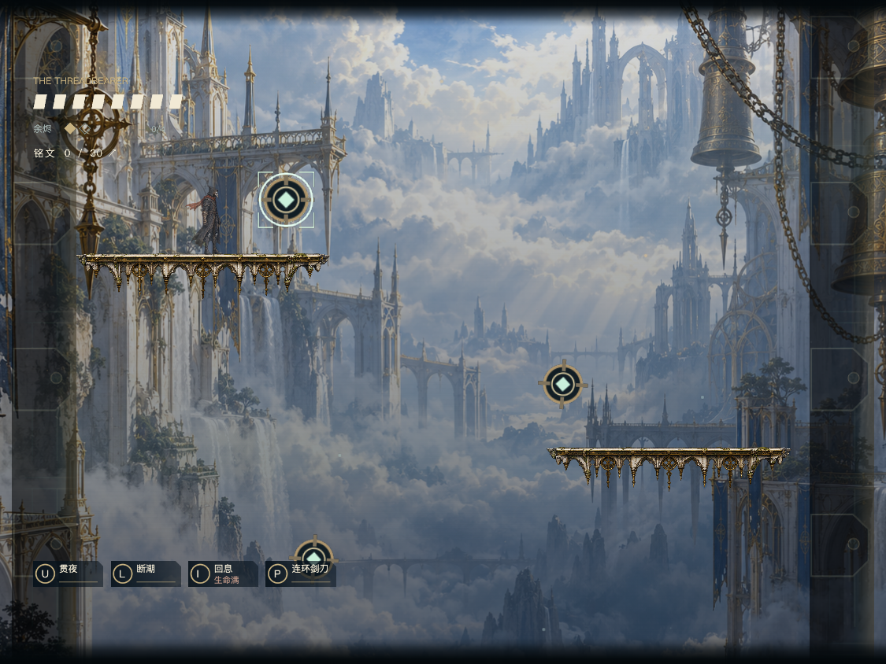

# v0.16.9 · 上下渐变薄边

2026-10-31。按反馈在菜单和战斗窗口上下恢复薄的深色边带，为后续功能预留位置。仍保留 v0.16.7 的背景铺满和 v0.16.8 的云间闪电，不恢复固定画幅外的厚实心遮罩。

## 设计与实现

- 上下各约占实际窗口高度 4%：600 像素高窗口约 24 像素，844 像素高窗口约 34 像素。外缘接近黑色，在前 20% 厚度内保持较深，之后向场景渐隐。
- 当前只留视觉位置，不加入标签、按钮、统计或点击行为。现有标题、人物、生命/技能栏仍在原位置；边带置于可操作控件下层。
- `.xbp` 用两个无点击事件的固定精灵，每条只用一张 2048×32 PNG，原图和闪电资源不变。外缘锚点分别固定在实际视口顶端/底端，尺寸、位置与层级沿用原生 UI 缓存，不新增逐帧像素计算、克隆或独立循环。
- 网页使用两个 `aria-hidden`、`pointer-events:none` 的空装饰元素，CSS 渐变与原生版一致。它们位于游戏容器内，不占网页文档布局高度。

原生薄边在常用比例下为 4%；为保证超宽窗口横向覆盖，宽高比超过约 2.56 时允许略增厚。当前六组验收窗口都在 4% 范围。边带是覆盖场景的渐变装饰，不更改世界物理、镜头视野或可操作区域。

## 后续功能接入位置

预留区域目前为空：顶部 `[0, 4% × 窗口高度]`、底部 `[96% × 窗口高度, 窗口高度]`。网页可在 `.viewport-edge-top` / `.viewport-edge-bottom` 对应层增加内容，原生可基于 `viewCenterX`、`viewCenterY ± viewHeight/2` 定位新控件。后续实际添加功能时再单独设计交互、可读性和厚度，不把装饰背景本身变成大面积点击区域。

## 验证

- [原生窗口与交互](native-shell.json)：15 项通过，实际 `.xbp` 经部署版 XBuilder 模型往返后运行。覆盖 480×360、1125×844、1280×720、1440×600、600×900、960×600、2 倍像素密度、菜单点击、开始/暂停/返回、词册与镜头归位。
- 像素采样检查两侧最外缘保持深色，进入窗口高度 2% 处仍有场景色彩，确认边带渐隐而非厚实心留黑；竖屏最外侧缝隙在最终包中已修复。
- [网页菜单](web-menu.json)：5 项通过，设置、词册、音量、开始/返回、小屏交互正常。
- 定向 ESLint、Prettier、ZIP CRC 和 `git diff --check` 通过。与 v0.16.8 对比，已有 PNG、音乐和音效内容全部一致；没有重跑音频、通关、单词或性能专项，不宣称帧率提升。





## 交付

桌面文件：`EasyRun-XBuilder-v0.16.9-soft-frame.xbp`，需重新导入。旧版保留供回退；网页版刷新本地 4177 页面即可。源码和文档仅本地更新，没有推送远程或修改在线作品。文件哈希与差异记录见 [artifact.json](artifact.json)。

```sh
python3 prototypes/runlab/package.py --game belfry
export RUNLAB_URL=http://127.0.0.1:4177/
export XBUILDER_RUNTIME_DIR=.cache/xbuilder-online-20261026
export XBUILDER_MODEL_URL=https://x.qiniu.com/assets/img-rendering-CIpDEpA1.js
for test_script in prototypes/runlab/test-belfry-native-shell.mjs prototypes/runlab/test-belfry-menu-web.mjs; do
  bash scripts/with-env.sh node "$test_script" || exit $?
done
```
