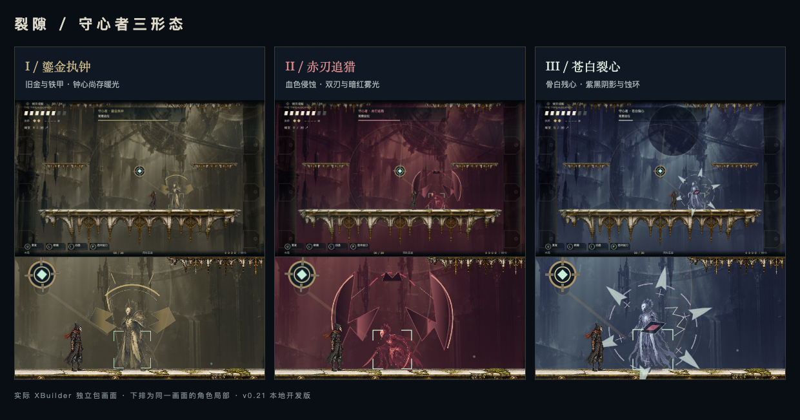

# v0.21.0 形态与场景侵蚀验收

2026-11-01。本地分支 `feat/adaptive-wordbook-local`，未导入/发布 XBuilder，未提交/推送远程。设计参数见 [形态与场景设计](../../BOSS_EVOLUTION_V210.md)。

## 最终包

- 桌面：`/Users/rj/Desktop/EasyRun-XBuilder-v0.21.0-boss-evolution.xbp`。
- 仓库：`prototypes/runlab/exports/belfry-boss-evolution.xbp`，与默认 `belfry.xbp` 一致。
- 153,347,667 字节；SHA-256：`8075a3ef3155e3437d649d4650831ee29985e983a9b73cdf29a301385769c15a`。
- [机器清单](artifact.json)。本机 IndexedDB 模式，学习规则和数据结构未修改。

## 验证

| 检查 | 结果 | 证据 |
|---|---|---|
| 本体贴图 | 十八帧颜色均改变；每帧 384×384，Alpha 通道与 v0.20 成品逐像素一致 | [PNG 对比](palette-comparison.json) |
| 原生 Boss 与进化联动 | 10 组通过，包含三套本体/场景、两次真实进化、转换中点、主动暂停、减少动态、大小窗口和退场重开 | [Boss 报告](boss-evolution.json) |
| 战斗 HUD 与窗口 | 10 组通过，121 个世界克隆不变，题中 Boss 信息保留、技能冷却和结算正常 | [HUD 报告](native-combat.json) |
| 网页实际战斗 | 17 组通过，包含实际命中/跳跃躲避、两次变形、击杀返程和题中继续回流 | [网页报告](keeper-web.json) |
| JavaScript 与差异检查 | 新增配色、氛围、生成器和测试文件 ESLint 通过，`git diff --check` 通过 | 构建/检查命令见下 |

原生报告均对应上面的最终包 SHA-256。使用完整 `.xbp`、缓存 XBuilder 3.3 编译器/资源和独立测试浏览器；测试布置仅在内存生效，交付包没有传送、无敌或自动判题代码。第一次编译发现新精灵不能直接继承主控制器的 `math` 导入，已移除该依赖，并在最终包完成全部上述运行测试。

此前 [v0.20 学习与存档回归](../2026-11-01-boss-rework/README.md) 保留为基线证据；本轮没有修改选词、存储或英语成就逻辑，没有把旧存档报告标成新包测试。

## 实际画面



对照由实际独立包截图排版，局部只是同一张截图的放大显示，没有额外合成角色、光效或补画。单独原图：[旧金](form-gold.png)、[暗红](form-crimson.png)、[苍白](form-pale.png)。

其他：[原生题中回流](spelling-healing.png)、[网页题中回流](web-mending-word-focus.png)、[超宽窗口](wide-pale.png)、[480×360](small-pale.png)、[减少动态](reduced-pale.png)。截图有测试房间布置及角色保护，用于观察表现，不作为真人战斗难度证据。

## 重点边界

- `District4` 原背景新增三套造型；进化前半程仍显示旧形态背景，在压暗的中点换入新色阶，后半程显形。主动暂停冻结转换时钟。
- 新增一个固定 `KeeperAtmosphere` 背景层；身体、残影、武器和 HUD 采用对应配色。所有新纹理提前生成，不运行逐像素颜色处理或实时模糊。
- 人物、平台、锚点、伤害预警与 UI 位于氛围层前方；不改变碰撞或技能范围。121 个世界克隆、8 个危险线槽不变。
- 减少动态保持背景/形态识别，停用漂移、浮刃旋转和转场压暗脉冲。题目与暂停遵守已有表现时钟。
- Boss 被击败/返程、标题、重开后不遗留侵蚀层；死亡和结算画面也隐藏氛围层，非 Boss 房间无此效果。
- 回流期间答题仍会继续回血，两次独立 U/L/P 命中可打断；P 多段去重、错题取消、普通 J 不打断以及形态回血上限等 v0.20 核心规则均已回归。

## 复验

保持本地开发服务 `http://127.0.0.1:4177` 运行，然后从仓库根目录执行：

```sh
bash scripts/with-env.sh node prototypes/runlab/build-belfry.mjs
LEARNING_NATIVE_STORAGE_MODE=local bash scripts/with-env.sh python3 prototypes/runlab/package.py --game belfry
BOSS_TEST_OUT=boss-evolution bash scripts/with-env.sh node prototypes/runlab/test-belfry-boss-rework.mjs
RUNLAB_URL=http://127.0.0.1:4177 XBUILDER_RUNTIME_DIR=.cache/xbuilder-online-20261026 bash scripts/with-env.sh node prototypes/runlab/test-belfry-native-combat.mjs
RUNLAB_URL='http://127.0.0.1:4177/?words=off' bash scripts/with-env.sh node prototypes/runlab/test-belfry-keeper.mjs
```

本轮没有做低配设备 FPS 基准、真人恐怖感或线上发布页验收；固定层预算与功能测试不能代替这些测量。
