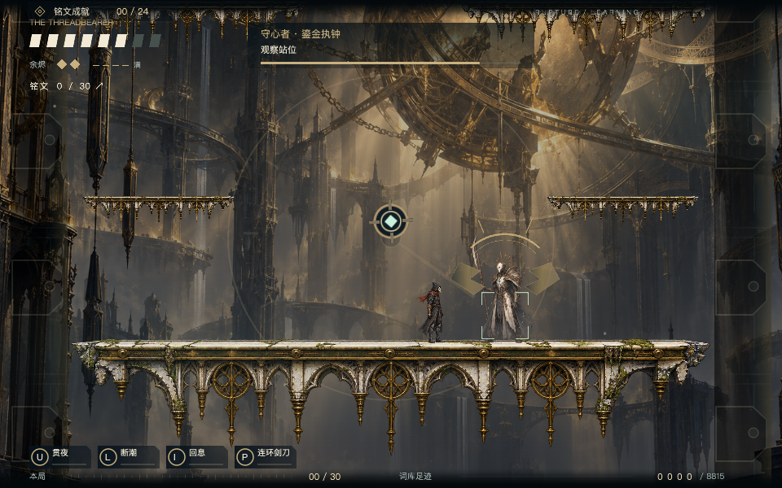
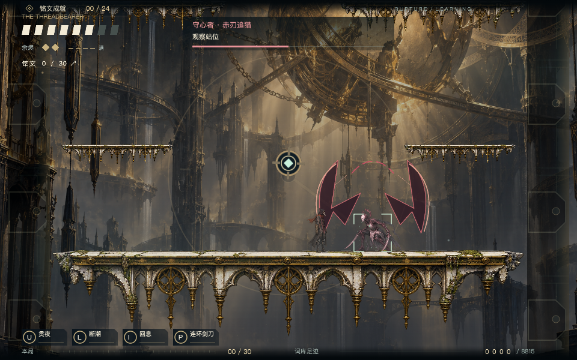
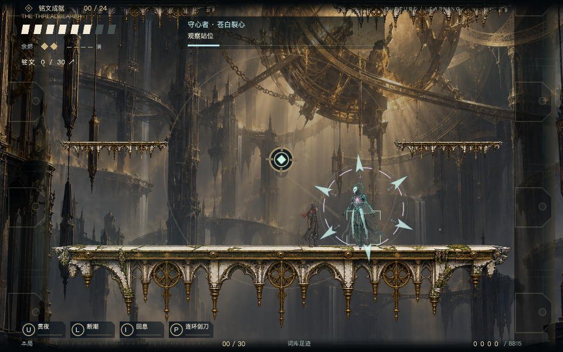
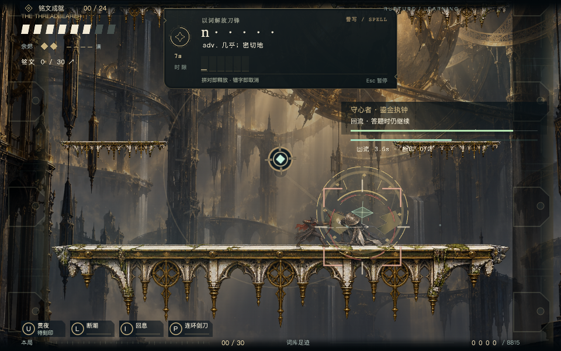
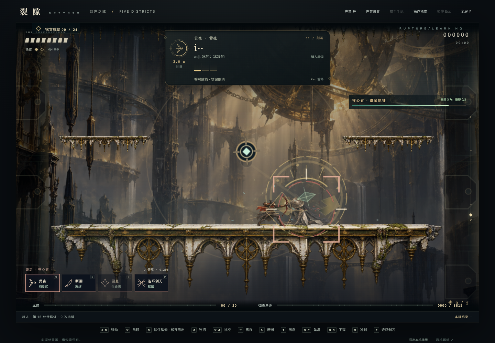

# v0.20.0 Boss 重做验收

2026-11-01。本地开发分支 `feat/adaptive-wordbook-local`。未导入或发布 XBuilder 网站，未提交或推送远程仓库。完整规则见 [设计说明](../../BOSS_REWORK_V200.md)。

## 交付文件

- 桌面：`/Users/rj/Desktop/EasyRun-XBuilder-v0.20.0-boss-rework.xbp`。
- 仓库：`prototypes/runlab/exports/belfry-boss-rework.xbp`；默认输出 `belfry.xbp` 与它一致。
- 大小：145,389,917 字节。
- SHA-256：`860432f89090ab7fd4d31e922d5bccaf41ea9b1fdd327dfced02a6246c0bc5ae`。
- [机器清单](artifact.json)；本机 IndexedDB 模式，无云端请求；保留 8,815 词、四档选择、24 项英语成就和学习边带。

## 自动化结果

| 检查 | 结果 | 证据 |
|---|---|---|
| 完整独立包 Boss 专项 | 9 组通过 | [boss-rework.json](boss-rework.json) |
| 原生词库、判题、技能、成就与输入隔离 | 28 组通过 | [native-words.json](native-words.json) |
| 原生战斗 HUD、题卡避让、480×360 窗口和结算 | 10 组通过 | [native-combat.json](native-combat.json) |
| 真实 IndexedDB 保存、断网、强关恢复、事务失败、跨页冲突、名称隔离与旧设置迁移 | 10 组通过，云请求 0 | [native-local.json](native-local.json) |
| 网页 Boss 碰撞、实际躲避、两次变形、死亡返程、题中冻结与回流 HUD | 17 组通过 | [keeper.json](keeper.json) |
| 词册/英语成就纯逻辑 | 15 项通过 | `node --test test-inscription-core.mjs test-learning-milestones.mjs` |
| 原生方法迁移与代码重定位 | 4 项通过 | `python3 prototypes/runlab/test_native_runtime.py` |
| 本轮 JavaScript ESLint 与差异空白检查 | 通过 | 本轮源文件 ESLint、`git diff --check` |

三份原生运行报告及本地存档报告均对应上面的最终包哈希；测试使用独立浏览器 profile、完整 `.xbp` 与缓存的 XBuilder 3.3 编译器/资源。网页版测试在浏览器读取资源后只覆盖关卡布置，不通过 Playwright 协议搬运整个 96 MB 美术清单，也不修改生产地图。F 键测试布置只存在于测试内存中，不进入交付包。

## 本轮重点断言

- 实际 U 触发词题后，Boss 的回流年龄和血量继续增长，普通战斗时间和位置保持不变；正确 U 接正确 L 实际命中后产生打断事件，不能把自然读条结束当作成功。
- P 五段攻击只给一枚断印；I 和普通 J 不给断印，J 仍可造成伤害。错字或错义不产生技能施放编号或断印。
- 普通/无畏使用各自的回血时长与预算；当前形态上限、两次次数限制、变形取消回血和死亡不复活均通过。明确暂停冻结时钟，恢复不追赶暂停时长。
- 十种生产招式从起手、锁定、出招到收势均运行；新增危险胶囊验证预警不伤害、激活后伤害、同一段不重复伤害。原七招还在网页版验证真实按键躲避与伤害。
- 发现并修复蓄箭后坐力翻转角色朝向，使接续重斩反向挥空的问题；回归使用真实技能输入和真实判题路径。
- 原生 Boss HUD 在词题右下方继续显示；网页版取消旧的答题血条淡化，位于题卡下方，实际边界检查不重叠。
- 121 个常驻世界克隆保留，攻击线仍使用 8 槽。新增 2 个固定世界装饰和 1 个固定 UI 时间条；没有增加危险区域克隆池或实时纹理生成。

## 截图

| 鎏金执钟 | 赤刃追猎 | 苍白裂心 |
|---|---|---|
|  |  |  |





新招预警：[返刃](move-7.png)、[棘环](move-8.png)、[裁决](move-9.png)。截图使用测试房间布置及角色保护以便观察，不能证明真人通关难度。

## 复验命令

从仓库根目录执行，先保持开发服务在 `http://127.0.0.1:4177` 运行。运行器测试建议顺序执行。

```sh
bash scripts/with-env.sh node prototypes/runlab/build-belfry.mjs
LEARNING_NATIVE_STORAGE_MODE=local bash scripts/with-env.sh python3 prototypes/runlab/package.py --game belfry
bash scripts/with-env.sh node prototypes/runlab/test-belfry-boss-rework.mjs
RUNLAB_URL=http://127.0.0.1:4177 XBUILDER_RUNTIME_DIR=.cache/xbuilder-online-20261026 bash scripts/with-env.sh node prototypes/runlab/test-belfry-native-words.mjs
RUNLAB_URL=http://127.0.0.1:4177 XBUILDER_RUNTIME_DIR=.cache/xbuilder-online-20261026 bash scripts/with-env.sh node prototypes/runlab/test-belfry-native-combat.mjs
RUNLAB_URL=http://127.0.0.1:4177 XBUILDER_RUNTIME_DIR=.cache/xbuilder-online-20261026 bash scripts/with-env.sh node prototypes/runlab/test-belfry-native-local.mjs
RUNLAB_URL='http://127.0.0.1:4177/?words=off' bash scripts/with-env.sh node prototypes/runlab/test-belfry-keeper.mjs
bash scripts/with-env.sh node --test prototypes/runlab/test-inscription-core.mjs prototypes/runlab/test-learning-milestones.mjs
bash scripts/with-env.sh python3 prototypes/runlab/test_native_runtime.py
```

本次没有宣称真人完整冒险通关、低配设备帧率或已发布线上验收。真实玩家的熟悉速度、答题时间和战斗疲劳仍需试玩后调参；回血和伤害判定已通过上述功能验证。
