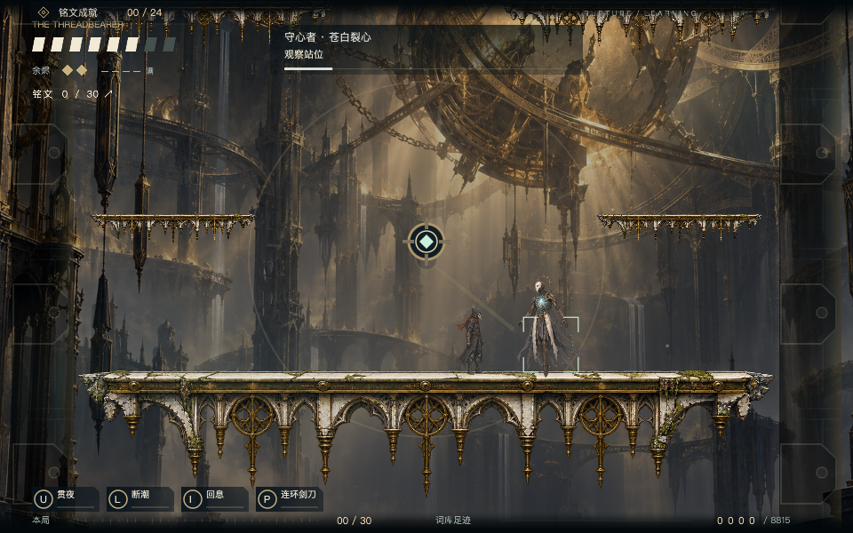

# v0.21.1 视觉恢复与新策划交付

2026-11-01。按用户反馈恢复原钟城背景与 Boss 本体原图，撤回 v0.21 的全身色阶、侵蚀层、环身装饰、修复/进化圆盘与 Boss 落地圆环；放大的锁定圆盘改为小型非圆形瞄准角标。普通敌人与主角技能不作整体改版。

## 完成与未完成

**已完成**：视觉撤回、原图校验、当前战斗回归，以及 [新的完整策划](../../BOSS_REDESIGN_V2.md)。

**新策划尚未实装**：守铠/断锋/缚心结构、两次拆甲拆刃动画、九招及新特效、9.5/8.5 秒回血窗口。当前游戏仍为 v0.20 十招和 6.4/5.8 秒回血窗口。两张 imagegen 概念图是制作沟通图，不是运行画面和可直接裁切的动画帧；[概念资产与提示词](../../../design/boss-rework/2026-11-01/README.md)。

## 最终恢复包

- 桌面：`/Users/rj/Desktop/EasyRun-XBuilder-v0.21.1-visual-reset.xbp`。
- 仓库：`prototypes/runlab/exports/belfry-visual-reset.xbp`，与默认 `belfry.xbp` 一致。
- 大小：145,223,584 字节。
- SHA-256：`2c348c46daa48602ef59c8c42b21550d358e3799e8691f93afaba88b955fba67`。
- [机器清单](artifact.json)、[真实运行报告](boss-regression.json)。没有导入/发布网站，没有提交或推送远程。

## 验证结果

- 包内 `District4/scene.png` 与原 `art/belfry/city/heart.png` 字节哈希一致；背景只保留一个原始造型。
- 十八个 Boss 动作 PNG 与 v0.20 原始成品逐文件一致；运行本体不再应用全身色相旋转。
- 运行精灵列表和 ZIP 内容均不含 `KeeperRegalia`、`KeeperRitual`、`KeeperAtmosphere`。
- 完整包在缓存 XBuilder 3.3 运行器通过 10 组回归：三种原图形态、两次进化背景不变、暂停、实际 U→L 命中打断、P 多段去重、错误取消、题中回血、有限修复/阶段上限/不复活及十招从起手至收势。
- 本轮生成器/测试 ESLint 与 `git diff --check` 通过。新策划是文字和概念交付，不声称完成了新九招或新动画的运行测试。

复验：本地服务在 `http://127.0.0.1:4177` 运行后，执行 `BOSS_TEST_OUT=boss-visual-reset bash scripts/with-env.sh node prototypes/runlab/test-belfry-boss-rework.mjs`。测试房间/传送/角色保护只存在于测试内存覆盖，不进入交付包。
