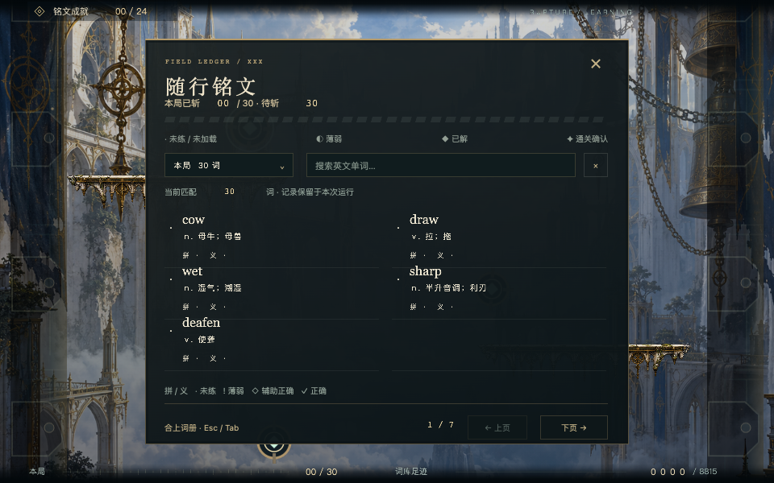

# v0.21.2 词册外遮罩移除

2026-11-01。用户要求只弹出随行词册本体，面板外不再覆盖半透明黑色区域。网页和独立 `.xbp` 同步移除词册外层黑幕与背景模糊，取消面板的外部投影，保留面板内部深色底、内描边、金边、布局和原有操作。

- 网页：`public/inscription.css` 的 `#word-journal` 外层设为透明、无模糊；词册页面保留内部阴影。
- 独立包：`build-belfry-native-style.mjs` 不再将黑幕烘焙进整幅词册 PNG。透明区域继续作为原有输入保护范围，不让键盘/鼠标操作穿透到战斗。
- 打开词册仍暂停战斗、保持音乐，关闭后恢复原状态。未修改词库、学习进度或 Boss。

桌面：`EasyRun-XBuilder-v0.21.2-ledger-no-backdrop.xbp`；仓库：`prototypes/runlab/exports/belfry-ledger-no-backdrop.xbp`。

包大小 145,222,899 字节；SHA-256 `630c884d80f88b0dfb05b8db26aeb051889f30271f5008bdb8a0433332989132`。见 [交付清单](artifact.json)。未导入/发布网站、未推送远程。

验证使用现有原生战斗 HUD 回归脚本的临时观察副本，增加实际 Tab 开关截图及音乐状态检查；10 组原有检查通过，对应同一最终包哈希。[运行报告](native-check.json)。直接读取打包后的词册 PNG，面板四周所有像素 Alpha 最大值均为 0，面板内部仍保留：[透明度检查](alpha-check.json)。

网页通过词册入口检查透明外层、无模糊及战斗暂停，Esc 关闭恢复：[网页观察](web-check.json)、[截图](web-ledger.png)。本次未新增版本化测试，未修改暂停和音乐逻辑。
