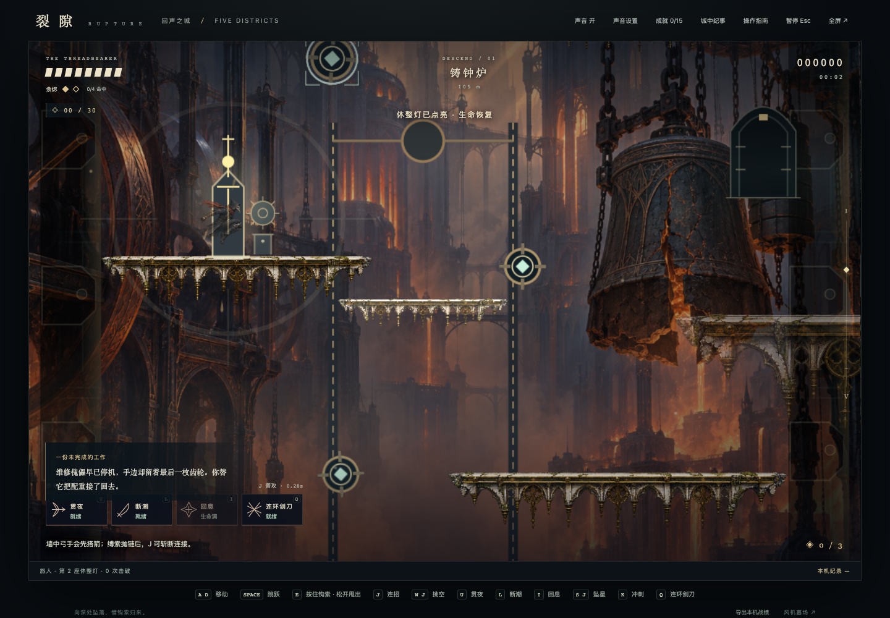
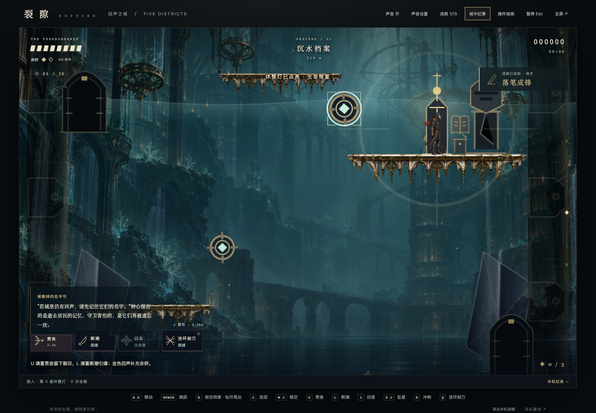
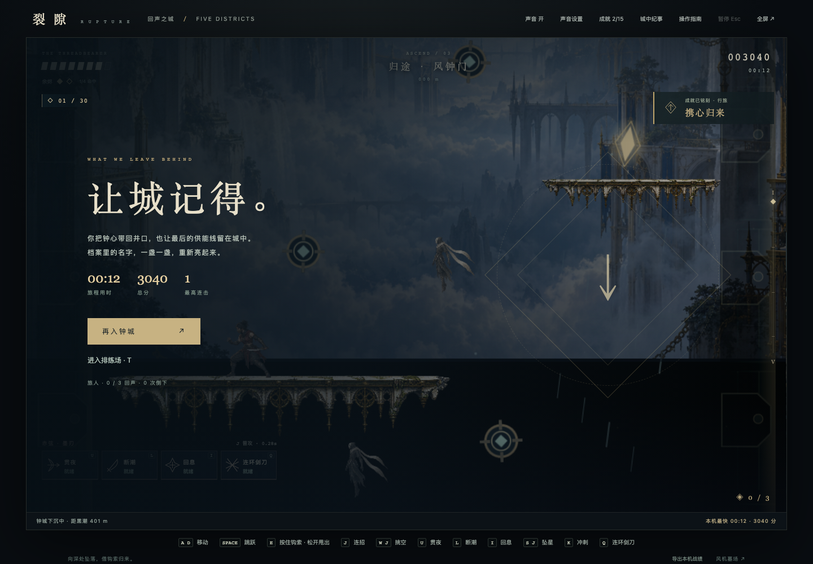

# 五区首版验证 · 2026-10-25

基线 `8d9a6b3`，分支 `feat/inscription-v1`。当前源文件和生成包 SHA-256、检查范围见 [verification.json](verification.json)，玩法和未完成项见 [CITY_V08](../../CITY_V08.md)。

| 报告                                   | 内容                                                     |
| -------------------------------------- | -------------------------------------------------------- |
| [city.json](city.json)                 | 12 项区域、机关、叙事、物理、续档、结局与全屏 / 窄屏检查 |
| [route-0.json](route-0.json)           | 旅人纯动作真实按键通关，包括主动黑潮死亡、暂停、续关     |
| [route-1.json](route-1.json)           | 无畏铭文真实按键通关，两次实际刻印                       |
| [inscription.json](inscription.json)   | 18 项铭文流程回归                                        |
| [motion.json](motion.json)             | 9 项连续动作和逐次刻印回归                               |
| [achievements.json](achievements.json) | 12 项成就浏览器回归                                      |
| [rules.txt](rules.txt)                 | 18 项词汇 / 成就纯规则                                   |

城市专项先正常点击开始并操作首台风阀，之后通过测试响应副本固定位置、清除敌人及布置 Boss 最后一击。正常引擎输入、碰撞、城市决策、保存与结算仍实际执行。城市截图来自这些可复现场景，不能冒充完整路线或真人游玩；两条 route 报告无状态注入，均验证不修复机关仍可完成主线。最终全屏入口的追加改动由城市专项复测，其他回归对应相同 spx 构建。

失败尝试也保留：[第一次](city-attempt-1.json)、[第二次](city-attempt-2.json)是页面重载时测试等待访问未就绪的全局状态；[第三次](city-attempt-3.json)是固定间隔横跨升降台折返顶点，净位移接近零。改为等待真实位移，再断言承载关系；未改变游戏轨迹、速度或存档规则以迎合检查。

## 区域实机截图








[窄屏纪事](journal-narrow.png)只验证面板可用，不代表游戏已支持触屏。实际玩家的原标签页已刷新至 `?v=city-v08`；独立测试浏览器未改动玩家词册和成就。

## 执行方式

先构建并启动本地服务，再执行（端口可改）：

```sh
bash scripts/with-env.sh node prototypes/runlab/build-belfry.mjs
RUNLAB_URL='http://127.0.0.1:4184/?words=on' bash scripts/with-env.sh node prototypes/runlab/test-belfry-city.mjs
RUNLAB_URL='http://127.0.0.1:4184/?words=off' MODE=0 RETURN_FAILURE=1 bash scripts/with-env.sh node prototypes/runlab/test-belfry-route.mjs
RUNLAB_URL='http://127.0.0.1:4184/?words=on' MODE=1 RETURN_FAILURE=0 bash scripts/with-env.sh node prototypes/runlab/test-belfry-route.mjs
```

固定工具版本与其他检查命令见 [运行手册](../../RUNBOOK.md)。本机 Chromium 验证不等于远程 Actions、跨浏览器、低端设备性能或真人可玩性验收。
