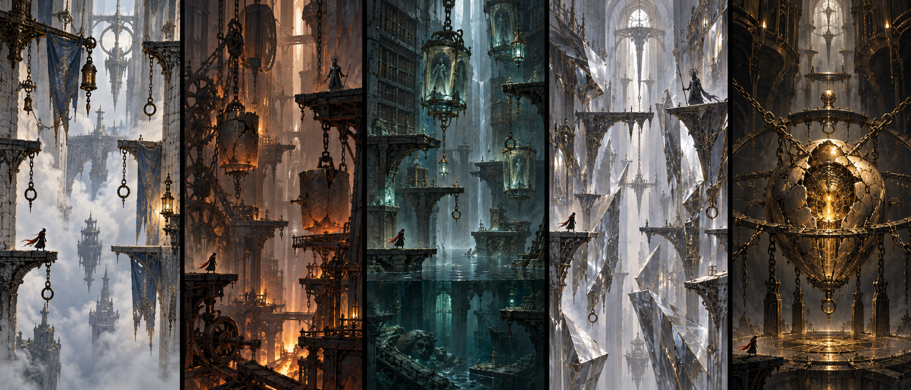

# 美术方向：被职责困住的城

设计提案；图片是概念探索，不是实机或最终切图。保留当前持弦者与五类刺客，不擅自恢复旧精灵/机器人版本，不恢复语音。

左起：风钟门、铸钟炉、沉水档案、碎镜唱廊、守心机枢。该板由内置 image_gen 生成；完整提示见 assets/art-prompt.txt。未经拆层、碰撞对齐和性能验证，不能直接当生产背景使用。

## 一致的视觉语言

核心材质是风化石、暗铜、旧铁、旧布、破玻璃；纹样从挂链、刻度、修补铆钉、断环中长出来。没有卡通吉祥物、彩虹奖励、课本卡片墙、满屏赛博霓虹。成人兴趣来自尺度悬殊、荒废用途、孤独的职责和可信的机械变化。

叙事母题：钟城仍执行失去对象的旧命令。让玩家先看到空投递口、磨损桥面和仍在守护的傀儡，再从简短铭文理解含义。单词是能读的工作语言，不以装饰乱码代替。剧情通过环境和动作成立，不要求长文本或对话才能继续。

| 区域 | 空间轮廓 / 主色 | 可玩信息 | 一处叙事焦点 | 不能踩的坑 |
| --- | --- | --- | --- | --- |
| 风钟门 | 大留白、断壁、垂直旗布；灰蓝 #9FB5BD、暖石 #C0B49A | 风向看旗，真锚点有金属挂座和实心环 | 每个投递口都空了，信匣仍巡回 | 用雾遮掉落点；把所有圆圈画成可抓锚点 |
| 铸钟炉 | 非对称巨秤、钟模、斜桥；焦褐 #49372C、铜橙 #C88A59 | 承重链粗且有铆接，装饰链细；危险阴影先到 | 维修傀儡仍想修好没人敲的钟 | 装饰火花盖过敌人前摇；停锤像答题奖杯 |
| 沉水档案 | 低水面、阶梯书架、悬挂琉璃匣；深青 #1C363C、旧玉 #72ACA5 | 水位刻度、可落脚干燥边缘、可核验磨痕 | 被封存的旧航路指向一堵后修的墙 | 所有玻璃都发光；“找物”变成像素点击 |
| 碎镜唱廊 | 斜切板面、缺口、单侧栏；银白 #C6C1D5、冷灰 #5B626E | 实桥有实体挂链/阴影，虚像无碰撞并缺结构连接 | 镜中旧城还完整，真实桥却断了 | 靠微小色差猜真假；翻转操控制造恶心 |
| 守心机枢 | 向心链与巨大空洞；近黑 #141719、暗金 #D2B76E | Boss和钟锁轮廓与背景分离，出口方向常驻 | 守心者还在维护早已失效的命令 | 终式白屏；巨心与角色同亮；长强制镜头 |

## 图层与可读性

按后景远城 → 大型静态结构 → 中景轮廓 → 可碰撞平台/锚点 → 角色/敌人 → 短特效 → HUD 排列。反光、尘光和视差只能辅助纵深，不能改变碰撞含义。背景通常低对比；可踩边缘留连续高对比窄带。危险靠形状、方向、提前动作和音色共同表达，不靠红色单通道。

强度优先级：敌人真实伤害前摇 > 主角/落点 > 可抓锚点 > 机关状态 > 目标词 > 奖励/氛围。答案出现时保持主角与下一落点可见；沿用 480px/短屏440px断环刻印，拒绝回到横跨整屏的题框。

标准检查图：960×600内部视口、1280×720桌面短屏、灰度、减少动效。每次加入特效都在“两个敌人+钩索+铭文”最坏组合检查，不只看空房概念图。

## 敌人：职责写在外形和动作上

| 既有敌人 | 剪影与局部道具 | 环境职责 | 关卡变化，不新增不公平招式 |
| --- | --- | --- | --- |
| 悬刃 | 偏薄三角衣摆、绳束和磨损挂扣 | 巡回不存在的航路 | 信使支路横切、档案区垂直巡线；预警先收拢衣摆再掠身 |
| 短锋 | 低重心、短披肩、一侧护臂 | 维持旧决斗礼法 | 炉膛借落锤破防，镜廊练错拍；假动作保留最终实击前摇 |
| 壁弓 | 长弓形成明显弧线、壁座和箭痕 | 守望废弃边界 | 两处壁龛换位，不藏到画面外射击；拉弦线先于箭出现 |
| 缚索 | 大线圈与垂坠链端，强调手臂回拉 | 回收离轨物件 | 双秤井牵引，返程守便道；可剪线段纹理清晰，链与装饰链不同 |
| 封脉 | 紧束袖、低位前手、脚步清楚 | 阻止未经许可的触碰 | 档案守证物，镜廊守门；只在有支撑的平台出现，不能擒住后推崖 |
| 守心者 | 保留短锋谱系，裂钟形护肩，胸前残缺职责牌 | 无人授命却仍维持钟锁 | 两轮破锁；半血增加已教会的节拍变化，不突然加陌生语言题 |

不靠换肤宣称六个新敌种。优先增补“看见玩家、失败反制、放弃无效职责”的短动作：壁弓回头检查空箭槽、缚索收回断链、守心者扶正无用职责牌。死亡收束约0.3–0.6秒且不阻挡操作；没有搞笑对白。

## 词义如何变成画面

| 行为 | 预兆 | 成功 | 失败/跳过 |
| --- | --- | --- | --- |
| repair 修复 | 断链垂落、转轴空转，显示“辅助升降机失效” | 可见链扣闭合，齿轮再啮合，平台开始按可预测周期移动 | 断链仍垂落；不爆炸、不改变原安全路线 |
| protect 保护 | 桥侧支撑出现受压纹，敌人正在瞄准 | 铜色纹沿支架闭合，挡住一次明确攻击 | 原战斗继续；主通路仍有替代落点 |
| reveal 揭示 | 局部结构被尘层覆盖而非全屏黑暗 | 一次掠光扫出挂链与平台边缘，随后保留淡轮廓 | 普通照明可用；不强迫重试猜谜 |
| contrast 差异 | 两个起手姿势并置，但脚步存在真实区别 | 只给真实受力脚和落点短边光；玩家自行反击 | 不替玩家选错误攻击；回到常规读招 |
| memory 记忆 | 琉璃匣中有低频旧影 | 过去路线以局部透片展开，移开即收起 | 词义回到册页，房间照常可走 |
| escape 逃脱 | 出口风向、缺失台阶与上行锚点同时可见 | 打开玩家此前修好的便道，光向上递进 | 保留永久锚点路线；出口绝不按词数上锁 |

单词粒子沿武器/机关运动方向出现；弓用收束细线，剑用短弧，回血用回拢余烬，解控用断开的链节。不得给所有结果同一个金色爆炸。每个机关必须绘制“未变/已变/失效”三态，让玩家认得发生了什么。

## 镜头、声音与性能制作预算

继承当前独立表现时钟：题目时战斗安全冻结，姿态与粒子渐缓；完成后立即交还控制。常规不额外推镜，重点词/精英才用小幅聚焦；不叠旋转镜头、屏幕色差或全屏模糊。减少动效关闭额外推镜/字母流光，保留机关三态和伤害信息。

声音继续无语音：风钟门细风与远铃、炉膛低频落锤、档案滴水与玻璃、镜廊干脆短回声、心室脉冲低钟。机关接通、取消、错误反馈有不同的材质音；环境音自动避让敌人前摇与落点反馈。已有82个采样优先复用，新增五个环境底层须可独立混音和暂停。

新增区块先以静态背景、局部循环贴片与模块化平台实现。水面不做实时流体，镜面不复制完整战斗世界，巨钟背景无复杂物理。设计目标：新增单区常驻解码纹理≤24MiB、跨区过渡≤48MiB（不含原有角色、音频与引擎；必须实测），不一次加载五区高分辨率全层。

新增环境常态装饰粒子≤24、短峰值≤48，且不得抬高原引擎90个特效对象总上限；网页字母流光保持单画布、有界数量。双敌起手上限不变。纹理预算只是制作约束，不是性能验证；不能用高品质概念图承诺实机达到同等动态效果。

## 制作清单与交付规格

| 批次 | 素材 | 数量/复用原则 | 验收 |
| --- | --- | --- | --- |
| 切片 | 铸钟炉远景、中景、近景、钟模/配重/支架/落锤/维修匣 | 3景层 + 6机关家族，机关至少三态 | R03/R04/S02可一眼分开，结构轮廓清楚 |
| 全版 | 其余4区景层、共用石台/栏杆/锚点套件 | 每区3景层，共用12个结构模块 | 无碰撞缝隙，平台边缘和透视一致 |
| 角色 | 既有主角与42姿态敌人清理、职责道具 | 不要求重画全套；先修衔接最明显帧 | 原点、脚底、朝向统一；不改变命中框 |
| 语义机关 | 升降机、桥、线索匣、镜框、逃生门 | 共5组关键三态；字义与状态一一对应 | 可用灰度截图说清前后差异 |
| 效果 | 6类动作结果、5区低成本环境循环 | 共用图集，固定生命周期 | 不遮前摇、不残留、不影响暂停 |
| 成就 | 5区完成印记、全词机会路线印记、兵器纹样 | 非贴纸；未完成只显示留白刻痕 | 提示完成/独立复核区别明确 |

命名示例 `forge_lift_broken/active/idle`；角色帧同一原点、透明边界与导出尺寸。PNG原件、切图清单和源提示单独保留；最终图集与Web包走原构建流程。概念板及提示的版本记录不得冒充可直接导入的sprite sheet。
