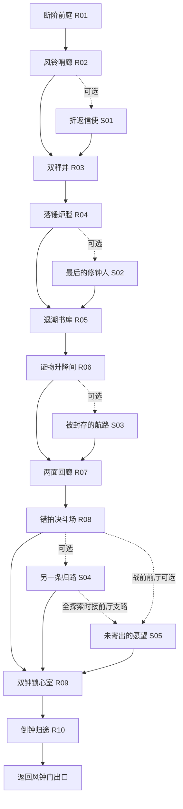

# 五区十五房 · 关卡设计

本文件的十五房拓扑仍是后续关卡说明。五区环境与基础修复已接入原纵向关卡，实际范围见 [CITY_V08](../../CITY_V08.md)，不能把它视为本文十五房已完成。主路十房，可选支路五房，复用空间在返程改变通行状态。详细字段由 design-data.json 和评审页共用，避免图和文字各说一套。

## 拓扑与路线

S05 位于夺心前的安全前厅，**不放在击败 Boss 后已启动黑潮的途中**。R09 前厅可主动理解 `purpose / resist`；正式开战后只复核已见词，未看词不阻止开战。R10 是穿过已见区域的上行便道组，不是突然出现的第六种世界。

不做强制清空支路、三十词出口门或缺词重刷。支路入口可辨认且有一次退出机会；R09前有保存点，确认开始Boss后才关闭回头路。返程以永久锚点为骨架，支路只提供可选捷径/补给。

## 内容清单

| 房间             | 时长规划 | 核心动作 / 决策                          | 新词机会 | 复核机会 |
| ---------------- | -------: | ---------------------------------------- | -------: | -------: |
| R01 断阶前庭     |     90秒 | 安全落点、第一次换壁；无敌人再到单悬刃   |        2 |        0 |
| R02 风铃哨廊     |    110秒 | 高路快但无掩体，低路慢但能斩箭接近       |        2 |        0 |
| S01 折返信使     |    120秒 | 追机械匣或走短路截获，丢失后仍能退出     |        2 |        0 |
| R03 双秤井       |    100秒 | 修升降机、分配能量，或沿永久锚点下潜     |        2 |        0 |
| R04 落锤炉膛     |    120秒 | 借落锤破防或稳步绕行，完成一次已见词复核 |        2 |        1 |
| S02 最后的修钟人 |    140秒 | 分两段护送；维修傀儡修好的桥影响返程     |        2 |        1 |
| R05 退潮书库     |     95秒 | 看水位，选择干路/低路并搜索信息          |        2 |        0 |
| R06 证物升降间   |    125秒 | 核对磨痕与位置；平台封脉单独教学         |        2 |        1 |
| S03 被封存的航路 |    150秒 | 拼合旧路线并实际执行一次钩索接力         |        2 |        1 |
| R07 两面回廊     |     95秒 | 通过结构连接区分实体和镜像               |        2 |        0 |
| R08 错拍决斗场   |    105秒 | 一对一看脚步判撤步与实击                 |        1 |        0 |
| S04 另一条归路   |    160秒 | 判断记录，选择开启哪条便道               |        3 |        1 |
| S05 未寄出的愿望 |    190秒 | 战前取舍：带走匣子拿补给，留下匣子开便道 |        3 |        1 |
| R09 双钟锁心室   |    180秒 | 前厅新词机会；两次破锁与已见词反制       |        2 |        1 |
| R10 倒钟归途     |    130秒 | 向上跑、复用修复结果；安全肩台才有词交互 |        1 |        1 |

主线合计 1,150 秒（约19.2分）、18新词+4复核；全探索增加760秒（共约31.8分）、30新词+8复核。不是15房各答两题的固定模板：各房动作、第一机会数与复核数不同，且题目必须由玩家发起。

复核样例：R04 `reach`、R06 `energy`、R09 `reveal`、R10 `repair`；支路 S02 `narrow`、S03 `follow`、S04 `evidence`、S05 `choice`。实际请求仅在词已见、间隔合格且有匹配语境时可用；不满足则换合格复核或取消，不把房间锁住等计时。

## 关卡变化不是换色

- **风钟门**提供大量可读空气、落点选择和第一次“我可以不打而绕行”。S01用同一空间做追赶，不复制R02的清怪条件。
- **铸钟炉**重点是改变环境、借力攻击和护送移动。机关未改造与已改造应形成两种同样可通行的路径；R04下层保底桥始终存在。
- **沉水档案**降低敌人密度，给观察和推断空间；线索必须相互验证。解谜不会依赖本来就不熟悉的第二个英语词，更不以读错一次让水位即死上涨。
- **碎镜唱廊**训练识别而非反射神经：先看结构，后看脚步。真实伤害预警从不伪装成不可辨认的幻影，镜像不能偷伤玩家。
- **守心机枢**将已经学过的反制、钩索、破锁、方向选择组合起来。Boss与上行追逐是动作高潮，语言只复用熟悉内容。支线的选择在返程被看见，避免收集完没有反馈。

## R03 双秤井：可交给开发的白盒规格

详见 [结构图](assets/counterweight-room.svg)。内部世界宽960；局部原点为底部，y向上，高1200。当前角色活动x为92–868，现有锚点距离阈值约470，草案不扩大该能力。图中间距只做几何检查，仍须真实角色通行验证。

| 结构         | 局部坐标/跨度        | 用途                                                          |
| ------------ | -------------------- | ------------------------------------------------------------- |
| 入口台       | x80–320，y1010       | 摄像机先显示两条路线；无敌人，不自动弹题                      |
| 第一永久锚点 | (300,1110)           | 初始选择点，返程可用                                          |
| 第二永久锚点 | (580,880)            | 右台上方，保证不必依赖升降机                                  |
| 观察/机关台  | x600–860，y750       | 辨读 repair、选择把 energy 给升降机或临时护栏；不自动连续两题 |
| 第三永久锚点 | (330,650)            | 链接到左侧备用台                                              |
| 左补救台     | x100–360，y500       | 错过摆渡也能落脚，视野看得到下方永久路                        |
| 第四永久锚点 | (600,420)            | 通往下层战斗台                                                |
| 战斗台       | x570–860，y240       | 单缚索，保证足够空间；无封脉、无同时落锤                      |
| 第五永久锚点 | (360,200)            | 物理解链和上行都可用                                          |
| 底部保底地面 | x80–880，y40         | 失败回收与出口，无语言锁                                      |
| 可选升降机   | x430附近、y540–820间 | 成功修理后提供便利；不覆盖永久锚点通道                        |

固定锚点连续距离约362、340、355、326单位，都小于470。真实关卡还需检查遮挡、角色半径、从平台起跳时的抓取高度、镜头范围和平台移动快照；“距离够”不等于已证明可通关。

**约100秒体验脚本**：先给15秒观察并抓第一点；到右台选择是否修升降机；完成一次语言请求后至少25有效动作秒内自由摆渡、钩索、攻击；在第二个可主动交互点分配能量；下降到宽战斗台识别缚索；用J/E逃脱并择机反制；底部离开。动作快者可以不做两个词节点直接通过，不能强迫停下来凑100秒。

**机关选择的结果**：修复开启较慢但稳定的平台；把能量给护栏则增加掩体但不代替跳跃；两个目标都可成立。选择之后的三项中文选项只核对英文指令含义。失败保留旧状态，不替玩家选择危险方案。相同机关不无限产词/奖励；未使用词槽移动到后续合法机会，记录为未遇见。

## R09 / R10 的高潮节奏

R09 前厅分散两处可查看对象：职责牌 `purpose` 与旧断链 `resist`，不连弹两题。玩家自由查看后开启Boss；直接开战者不会被强塞这两个新词。Boss第一阶段拉两侧钟锁、诱导冲刺、打伤害；半血重锁保留清晰预告，只加入先前镜廊展示过的节拍变化。复核最多一次，优先 `reveal`；没有已见词就用动作破绽，不吞完整攻击。

R10在所有玩家都看得到的永固锚点上行；侧门和修好的桥减少绕行，不成为唯一生路。追逐进入前先给一段安全肩台；`escape` 的首次机会放在此处，主动启动追逐后不再出新词。上行压力高时本局最后的 `repair` 复核也可取消，不能在快追上的黑潮前补最后一个词。

## 难度与随机内容

三轴分别调：动作（敌人组合/危险覆盖/补救台）、语言（同一CET-4范围下的义项与提示）、时间（宽裕/标准/紧凑）。困难动作只在玩家已学的动作上加组合；不同时缩阅读时间、加两倍血和取消所有救援平台。

每房首版只做A/B两种已验证编排。例如R02是“高路单弓低路短锋”或“高路悬刃低路单弓”；锚点和出口仍固定。禁止同时改真实碰撞和语言答案的双随机；不放三个控制敌人靠数值凑难度。精英只继承已教会的一个变化，不能暗中缩短基础前摇。

## 实装验收

- 主路和全探索均有无词/纯动作通行录像；跳过任意支路仍可进Boss和出城。
- 全探索存在30个唯一词的有效首次机会；随机词池无法匹配特殊机关时仍有语境回退。每次出题必须有真实可用结果，不靠空挥补额度。
- 返程有永久路线，S05不与黑潮冲突；所有支路有回收点，不用英语解除不可逆困局。
- 专注快照覆盖移动平台、配重、风、敌弹、锁链、玩家速度；暂停/隐藏/恢复不漂移、不积压伤害。
- 测试最坏组合：双敌、抓钩、机关运动、语义交互同时出现；字牌与特效不遮下一个落点。
- 本次自动核验只是拓扑、词数、机会排程和锚点几何检查；上述实装、通关与真人乐趣均留待开发后验收。
