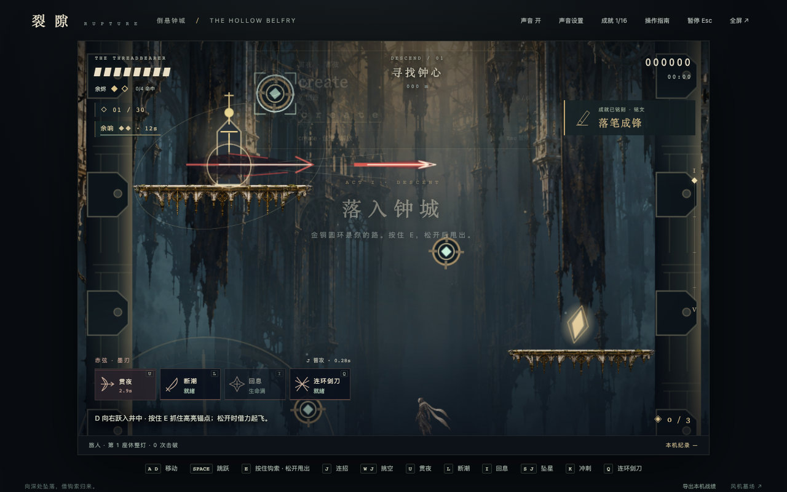

# v0.7 铭文远征与钟城铭录 · 交付清单

整理日期：2026-10-25（Asia/Shanghai）。仓库：[RJ-SRE/EasyRun](https://github.com/RJ-SRE/EasyRun)。当前交付分支：`feat/inscription-v1`。

本记录整理已提交的可玩代码及配套资料。玩法基线是 [`a97d2f8`](https://github.com/RJ-SRE/EasyRun/commit/a97d2f8a5da272d968de37e2f1d95cea18d0e133)，本次在其后新增文档整理提交，不再改动游戏规则。最新文档提交由本文件的 Git 历史定位，不虚构预先未知的提交号。

## 1. 交付组成

| 交付        | 已具备                                                   | 当前边界                                      |
| ----------- | -------------------------------------------------------- | --------------------------------------------- |
| 倒悬钟城    | 完整纵向单关、两档难度、检查点、夺心返程与结局           | 一张主地图；不是新五区长篇                    |
| 动作 / 敌人 | 钩索、位移、地空连段、四技能、五类刺客与守心者、排练     | 关键图像与连续位移，非骨骼动画或通用寻路      |
| 铭文        | 两种输入、六类时机、30 词预览、复习、词册、续档          | 82 词精选，不是完整 CET-4 大纲；30 词不挡通关 |
| 流畅度      | 28% 独立表现、即时释放、两次余响、音效衔接               | 真实战斗仍冻结；未承诺稳定 60 FPS             |
| 成就        | 16 项、称号、最高进度、解锁日期、导出                    | 本机记录，无战力奖励；排练不计，旧战绩不补发  |
| 声音        | 82 个动作 / 材质采样、环境音乐、设置与静音               | 无角色语音、对白或网络生成                    |
| 工程        | 锁定依赖、原图与提示词、可重建输出、测试、MD 和 Git 历史 | 本机网页为完整体验；未正式上线                |
| 独立通道    | passages 五通道与钩索实验                                | 另行构建，未合入钟城运行时                    |
| 后续策划    | 五区十五房、30 词语境、美术规范与评审材料                | 是提案，非已完成关卡                          |

## 2. 从哪个分支取得版本

```sh
git clone --branch feat/inscription-v1 https://github.com/RJ-SRE/EasyRun.git
cd EasyRun
bash scripts/bootstrap.sh
bash scripts/with-env.sh node scripts/build-game.mjs
bash scripts/with-env.sh node prototypes/runlab/server.mjs
```

默认打开 <http://127.0.0.1:4177/>。当前协作浏览器的 4184 来自显式端口设置；完整复现、排查、专项与打包见 [RUNBOOK](../RUNBOOK.md)。本机工具与依赖不需要上传到 GitHub，也不要求安装编辑器参考源码才可运行网页。

文档规整前获取远程核对：`origin/main` 为 `616297e`，`feat/inscription-v1` 比它领先 8 个提交且没有缺少 main 提交。本次继续推送功能分支，不改变 main、仓库权限或可见性，不创建标签 / Release / 部署。

## 3. 真实提交链

| 提交      | 内容                                 | 状态                 |
| --------- | ------------------------------------ | -------------------- |
| `47942dd` | 五通道与检查点挑战                   | 独立模块             |
| `22983b3` | 通道钩索材质与空间声音               | 独立模块，保留父历史 |
| `7ab88cc` | 五类刺客、四技能、铭文及远征存档集成 | 主游戏               |
| `7236866` | 断环刻印与紧凑界面                   | 主游戏               |
| `61a6a64` | 独立聚焦表现与立即释放               | 主游戏               |
| `5cf3ea3` | 三十词远征关卡 / 美术方案            | 仅策划               |
| `ea7e106` | 补齐持续表现与两次余响续招           | 主游戏               |
| `a97d2f8` | 成就、称号、册页与回归               | 最新玩法快照         |

这些是实际 Git 提交，不把用户早期讨论或未留存的开发中间态补造成历史提交。集中整理和旧项目清理的背景见 [开发日志](../DEVELOPMENT_LOG.md)。

## 4. 文档交付

| 文档                                                                                     | 此次规整的用途                                        |
| ---------------------------------------------------------------------------------------- | ----------------------------------------------------- |
| [根 README](../../README.md)                                                             | 当前功能、正确分支、启动、操作和边界                  |
| [文档总目录](../README.md)                                                               | 当前 / 历史 / 提案的索引与阅读顺序                    |
| [PRD](../PRD.md)                                                                         | 当前产品规则，修正聚焦速率 / 镜头参数，归位余响与成就 |
| [技术设计](../TECHNICAL_DESIGN.md)                                                       | 宿主与引擎图、phase、事件、输入、表现时钟、成就和存储 |
| [运行手册](../RUNBOOK.md)                                                                | 安装、端口、构建、测试、打包、记录恢复、常见故障      |
| [铭文实现](../INSCRIPTION_V07.md) / [成就设计](../ACHIEVEMENTS_V07.md)                   | 详细行为契约和历史修订                                |
| [路线图](../ROADMAP.md)                                                                  | 已完成与后续任务重新对齐                              |
| [测试记录](../TESTING.md)                                                                | 最新证据与历史报告分开，说明本轮核查范围              |
| [Git 流程](../GIT_WORKFLOW.md) / [贡献约定](../../CONTRIBUTING.md)                       | 功能分支、审查、真实 CI 触发与回退                    |
| [变更记录](../../CHANGELOG.md) / [决策](../DECISIONS.md) / [过程](../DEVELOPMENT_LOG.md) | 功能结果、为何取舍及实际规整过程                      |
| [资产](../ASSETS.md) / [词库](../WORD_BANK.md)                                           | 原图、声音、词元与许可边界                            |
| [Issue 草稿](../issues/2026-10-25-backlog.md)                                            | 保留未发布状态，并核对旧描述是否仍适用                |

## 5. 验证清单与证据

| 证据阶段     | 实际覆盖                                                                         | 如何解释                                                      |
| ------------ | -------------------------------------------------------------------------------- | ------------------------------------------------------------- |
| 成就版本     | 9 项规则测试 + 45 项浏览器检查：成就 13、铭文 18、连续性 9、恢复 5               | 记录在 a97d2f8 的交付材料；不是本次文档整理重新跑出的结果     |
| 成就实机     | 真实首平台解锁落笔成锋、刀锋余响、借风起身；暂停 / 输入 / 导出 / 刷新 / 故障回退 | 只固定词池，没有注入角色坐标或生命                            |
| 罕见成就     | 无伤完整冒险、独词累计、连续换钩等规则类别                                       | 规则测试；不冒充真人全成就通关                                |
| 铭文集成早期 | 词库 / 战斗 / 敌人 / 技能 / 箭术 / 生命周期与两档路线                            | 对应早期源码快照，保留原日期；不累加为最新整关通过数          |
| 本次 MD 整理 | 文档相对文件链接、命令入口、格式、Git 空白、已有报告与源码哈希                   | 游戏代码未变，不重复跑长路线制造新数字                        |
| 远程 CI      | 本轮没有报告已通过                                                               | 当前 workflow 的 push 仅覆盖 main；功能分支推送不自动跑此配置 |

入口：[最新成就摘要及源码哈希](../evidence/achievements/verification.json)、[成就浏览器报告](../evidence/achievements/achievements.json)、[早期集成与路线](../evidence/inscription-v1/verification.json)、[详细测试日志](../TESTING.md)。




截图来自成就专项测试，显示的是测试中真实获得的记录，不是用户浏览器的个人进度。

## 6. 尚未完成与下一步

首轮真人对照试玩、词条独立审校、当前版全收集 / 完整无伤路线、长时间与跨设备性能、完整编辑器导入、触屏 / 手柄、线上部署仍需后续验证。源码中没有五区十五房、全局专注节奏调度或在线生成剧情。

优先验证用户是否理解钩索、是否因答题回避技能、是否愿意为了新打法重试。再以三房间灰盒验证“词义改变路线选择”，不要先堆新题型、成就数量或数值成长。行动顺序和验收方法见 [路线图](../ROADMAP.md)。

本轮没有发布新的 GitHub Issue；五条草稿遵循用户之前的选择留在仓库。没有删除 XBuilder / 工具，也没有拷入其他聊天未核对的敌人或美术变更。
